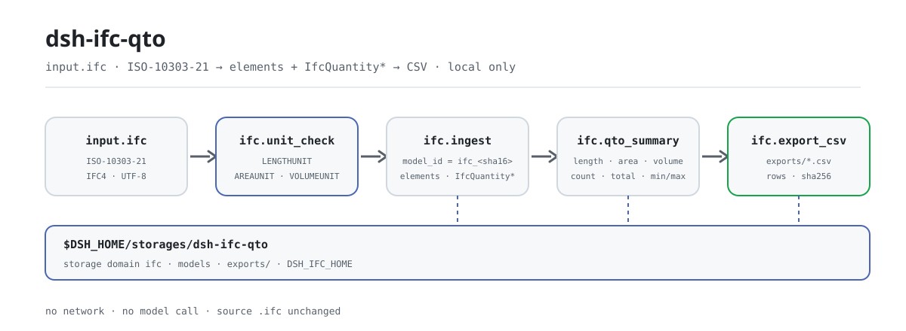

<div align="center">

<picture>
  <source media="(prefers-color-scheme: dark)" srcset="docs/assets/dsh-ifc-qto-flow-dark.svg">
  
</picture>

# dsh-ifc-qto

**Turn a local IFC model into a checkable element list and quantity CSV — text only, no network, no model call.**

A local take-off plugin for DeepSeek Harness: read ISO-10303-21 text, count walls, slabs, doors, windows and other elements with their IfcQuantity values, summarize by measurement kind, and export a CSV; the source file is never modified and nothing leaves your machine.

[Install](#three-step-setup) · [Configuration](#configuration) · [FAQ](#faq) · [简体中文](README.md) · [English](README.en.md) · [Español](README.es.md) · [Português](README.pt.md) · [हिन्दी](README.hi.md)

[](LICENSE)
[](#compatibility)
[](https://www.npmjs.com/package/dsh-ifc-qto)
[](https://github.com/PerryLink/dsh-ifc-qto/actions/workflows/ci.yml)
[](#compatibility)

[](https://github.com/PerryLink/dsh-ifc-qto/stargazers)
[](https://www.npmjs.com/package/dsh-ifc-qto)
[](https://dshfind.com/plugins/PerryLink/dsh-ifc-qto?ref=badge)
[](https://dsh.market/)

```sh
dsh plugin --profile <profile> add dsh-ifc-qto
```

</div>

<sub>Community plugin, not affiliated with DeepSeek. Canonical repository: <https://github.com/PerryLink/dsh-ifc-qto>. alpha / public-synthetic / partial / not counted / not GA; no customer evidence, no customer data, no production-readiness claim.</sub>

## What it is

`dsh-ifc-qto` runs a fully local take-off pipeline inside DeepSeek Harness: it reads a local `.ifc` text (ISO-10303-21, IFC4), counts walls, slabs, doors, windows, columns, beams, footings, stairs and other elements, pulls the `IfcQuantityLength` / `IfcQuantityArea` / `IfcQuantityVolume` entities out of the file, summarizes them per measurement kind (count, total, min/max), flags zero or negative quantities as data-quality issues, and exports a checkable CSV. It is text-level only — no geometry take-off — and it never calls the network or a model; the `.ifc` you pass in is read-only.

- **Good fit**: a quick pre-bid or pre-submittal check of how many walls, slabs and openings a model holds, and what the area and volume totals are; a first look inside an upstream `.ifc` file.
- **Not a fit**: geometry-aware re-measurement or drawing-by-drawing reconciliation; RVT/DWG or other non-IFC formats; scans or screenshots.

**Input**: a local `.ifc` text (ISO-10303-21, IFC4), UTF-8, ≤50 MB per file recommended, exported by a design office or model author. Shipped sample: `samples/quickstart/input/sample-building.ifc` (1.7 KB, synthetic: fictional project and element ids, no customer model).

**Output**: an element inventory (type, count, name), a quantity summary (count/total/min/max for length, area and volume), data-quality hints, and a CSV under `$DSH_HOME/storages/dsh-ifc-qto/exports/`. **The source file is not modified and nothing is uploaded.**

## Three-step setup

1. **Install** (four channels; npm is recommended):

   ```sh
   # npm channel (recommended; 0.1.1 is published)
   dsh plugin --profile <profile> add dsh-ifc-qto
   # git channel (tracks main; lib/ is a build artifact — run pnpm install && pnpm build in the checkout first)
   dsh plugin --profile <profile> add github:PerryLink/dsh-ifc-qto
   # tarball channel: after pnpm install && pnpm build && pnpm pack in this repo
   dsh plugin --profile <profile> add ./dsh-ifc-qto-<version>.tgz
   # 1024 store channel
   npm i -g dsh1024
   dsh1024 plugin --profile <profile> add dsh-ifc-qto
   ```

2. **Minimal config** (there are no plugin-level config keys): `cordis.patch.yml` only inserts one row. The data root defaults to `$DSH_HOME/storages/dsh-ifc-qto`; set `DSH_IFC_HOME` to move it (see "Configuration"). The host profile must provide the `tools` and `storageDomain` services.

   ```yaml
   - insert:
       - id: dsh-ifc-qto
         name: dsh-ifc-qto
   ```

3. **Verify it mounts**:

   ```sh
   dsh --profile <profile> --dump-config | grep dsh-ifc-qto
   pnpm install --frozen-lockfile && pnpm build
   node samples/quickstart/run.mjs
   ```

   The shipped quickstart walks `samples/quickstart/input/sample-building.ifc` through `ifc.unit_check → ifc.ingest → ifc.qto_summary → ifc.export_csv` and should end with:

   ```text
   ifc.unit_check   assignment=true length=MILLI|METRE area=$|SQUARE_METRE volume=$|CUBIC_METRE issues=0
   ifc.ingest       elements=6 quantities=6 types=WALL:2 SLAB:1 DOOR:1 WINDOW:1 COLUMN:1
   ifc.qto_summary  length qty=3 total=8100 min=900 max=4200
                    area   qty=2 total=86.4 min=0 max=86.4
                    volume qty=1 total=25.92 min=25.92 max=25.92
   data quality     1 issue(s): E_IFC_QUANTITY_NON_POSITIVE NetSideArea=0
   ifc.export_csv   11 rows -> exports/ifc_92f1f2cfc519059a.csv (sha256 3e8f62d3e7fd6a56…)
   ok: quickstart finished (4 tool calls, 1 data-quality issue)
   ```

   In a session you can ask for the same flow. The demo prompt shipped in `package.json` is Chinese:

```text
帮我从自带样例的模型里提取构件和工程量，看看单位声明全不全，再按类别汇总并导出一份 CSV。
```

**Uninstall**: `dsh plugin --profile <profile> remove dsh-ifc-qto` (or remove the row from the profile patch).

## Core capabilities

- **Text-level element inventory** — `ifc.ingest` checks for `ISO-10303-21` / `FILE_SCHEMA`, then walks 14 element entities (`IFCWALL`, `IFCSLAB`, `IFCDOOR`, `IFCWINDOW`, `IFCCOLUMN`, `IFCBEAM`, `IFCFOOTING`, `IFCSTAIR`, `IFCRAILING`, `IFCRAMP`, `IFCPILE`, `IFCMEMBER`, `IFCPLATE`, `IFCCOVERING`), captures GUID and name, and counts per type.
- **Quantity extraction** — the same pass captures `IfcQuantityLength` / `IfcQuantityArea` / `IfcQuantityVolume` names and values (the last number in the argument list, tolerating extra `$` placeholders).
- **Unit-declaration check** — `ifc.unit_check` looks for `IfcUnitAssignment` and the length/area/volume `IfcSIUnit`s, returning `assignment`, `prefix|unit` and a list of `E_IFC_*UNIT*_MISSING` issues; without units the numbers cannot be used for a take-off.
- **Summary and data quality** — `ifc.qto_summary` returns count, total, min/max and element-type distribution per measurement kind, and flags zero or negative quantities as `E_IFC_QUANTITY_NON_POSITIVE`; one bad value does not stop the rest of the summary.
- **CSV export** — `ifc.export_csv` writes type counts plus quantity rows to `exports/ifc_<sha16>.csv` and returns the row count and CSV SHA-256; re-importing the same text yields the same `model_id` and the same file name.
- **Read-only input** — the `.ifc` you pass in is read-only; writes land only under `$DSH_IFC_HOME` (default `$DSH_HOME/storages/dsh-ifc-qto`) and in the `models` table of the `ifc` storage domain.
- **Local only** — the source contains no `fetch` / HTTP / DNS / WebSocket calls, and the `package.json` demo metadata declares `network: false`; input and output never leave your machine.

### Tool surface

Tool names are the stable API (matching runtime output, kept in English); descriptions are localized. Tools that write files are marked **R1 (local write)**; read-only tools are **R0**.

| Tool | Purpose | Risk |
|---|---|---|
| `ifc.ingest` | Parse IFC text, inventory 14 element types and quantity entities, store a model and return `model_id` | R1 local write |
| `ifc.export_csv` | Export type counts and quantity rows as CSV; return path, row count and hash | R1 local write |
| `ifc.qto_summary` | Summarize per measurement kind (count/total/min/max) and list non-positive issues | R0 read-only |
| `ifc.unit_check` | Check whether the model declares length/area/volume SI units | R0 read-only |

`ifc.export_csv` and `ifc.qto_summary` only accept a `model_id` returned by `ifc.ingest` and stored in the `models` table; they do not accept a file path.

### Examples

These are the plugin's real entry points; the bundled synthetic sample reproduces everything.

**Detailed example** — `node samples/quickstart/run.mjs` (4 tool calls, 1 data-quality issue):

```text
ifc.unit_check   assignment=true length=MILLI|METRE area=$|SQUARE_METRE volume=$|CUBIC_METRE issues=0
ifc.ingest       elements=6 quantities=6 types=WALL:2 SLAB:1 DOOR:1 WINDOW:1 COLUMN:1
ifc.qto_summary  length qty=3 total=8100 min=900 max=4200
                 area   qty=2 total=86.4 min=0 max=86.4
                 volume qty=1 total=25.92 min=25.92 max=25.92
data quality     1 issue(s): E_IFC_QUANTITY_NON_POSITIVE NetSideArea=0
ifc.export_csv   11 rows -> exports/ifc_92f1f2cfc519059a.csv (sha256 3e8f62d3e7fd6a56…)
```

*Observed from `samples/quickstart/expected/console.txt` (matches `samples/quickstart/expected/result.json`).*

**Failure branch** — calling `ifc.export_csv` with an unknown `model_id`:

```text
找不到这个模型（E_IFC_UNREADABLE）｜下一步：先用 ifc.ingest 导入模型拿到 model_id，再导出 CSV
```

*Observed from `src/plugin/tools.ts:5`; the other error codes are in [`TROUBLESHOOTING.md`](TROUBLESHOOTING.md).*

## Measured data


*The capture above is a real run of `node samples/quickstart/run.mjs` on the bundled synthetic sample (2026-11-02), line-for-line identical to `samples/quickstart/expected/console.txt`; the sample has fictional project and element ids only, no customer model.*

The public/synthetic acceptance suite is reproduced with `scripts/acceptance.mjs`; details live in `ACCEPTANCE.csv`. These are all 8 rows, quoted verbatim (the full file also carries `script` and `evidence_sha256`):

```csv
req_id,metric,threshold,actual,pass,source,counted
SKU-07-A01,IFC 构件（20）,20,20,true,public/synthetic,false
SKU-07-A02,类型数,5,5,true,public/synthetic,false
SKU-07-A03,量实体,3,3,true,public/synthetic,false
SKU-07-A04,CSV 行,>=8,8,true,public/synthetic,false
SKU-07-A05,公开 IFC 量实体,>=5,36,true,public/synthetic,false
SKU-07-A06,QTO 汇总/数据质量,1,3,true,public/synthetic,false
SKU-07-A07,IFC 单位声明检查,>=1,3,true,public/synthetic,false
PS1-QS01,quickstart 样例与金标一致,1/1,1,true,synthetic/quickstart,true
```

The SKU-07 rows are public/synthetic fixture checks (`counted=false`); only `PS1-QS01` is a local reproduction of the shipped sample (`counted=true`). The quickstart model holds 6 elements and 6 quantities: 3 length values totalling 8100, 2 area values totalling 86.4, 1 volume value of 25.92, and an 11-row CSV. None of this is a customer run, and no output is invented.

**Fixture-backed acceptance**: the public MIT sample `fixtures/public/mit/3walls.ifc` is parsed by `test/public-ifc.test.mjs` (via `pnpm test`), while acceptance row `SKU-07-A01` (IFC elements 20, 20/20) comes from the synthetic IFC inside `scripts/acceptance.mjs`. Both are public/synthetic fixtures, not a customer run. All public samples live in `fixtures/` (with `SOURCE.md` and upstream licenses), and every SKU row in `ACCEPTANCE.csv` is `counted=false`.

## Configuration

This plugin has no Schemastery `Config` fields: `cordis.patch.yml` only inserts one row, and what you can tune is environment variables and tool arguments.

| Tunable | Default | Meaning |
|---|---|---|
| `DSH_IFC_HOME` | unset | Data root; when unset it is `$DSH_HOME/storages/dsh-ifc-qto`, and when `DSH_HOME` is unset too, `storages/dsh-ifc-qto` under the host process cwd |
| `DSH_HOME` | unset | Host home; decides the default data root |
| Export directory | `<data root>/exports` | CSV destination; the file name is fixed to `ifc_<first 16 sha256 chars>.csv` |

Model records live in the plugin's own `ifc` storage domain (version 1), table `models`; each `ifc.ingest` writes one record, and `model_id` is `ifc_<first 16 sha256 chars>`.

<details>
<summary>Tool arguments</summary>

| Argument | Default | Applies to | Meaning |
|---|---|---|---|
| `ifc_text` | required | `ifc.ingest` / `ifc.unit_check` | The IFC text itself (ISO-10303-21) |
| `source_name` | `inline.ifc` | `ifc.ingest` | Source label stored in the record; an identifier only |
| `model_id` | required | `ifc.export_csv` / `ifc.qto_summary` | The id returned by `ifc.ingest` |

</details>

<details>
<summary>Error format and common error codes</summary>

Every failure reads "one plain sentence (`E_IFC_*`) | next: one action"; step-by-step triage is in [`TROUBLESHOOTING.md`](TROUBLESHOOTING.md).

| Code | Meaning |
|---|---|
| `E_IFC_UNREADABLE` | Not IFC text; or no countable elements/quantities; or the `model_id` does not exist |
| `E_IFC_EMPTY` | The file is empty (0 bytes or whitespace only) |
| `E_IFC_EXPORT_FAILED` | The CSV could not be written (permissions, read-only mount, disk full) |
| `E_IFC_QUANTITY_NON_POSITIVE` | A quantity is zero or negative (a data-quality hint, does not block the rest) |
| `E_IFC_UNITASSIGNMENT_MISSING` | The model has no `IfcUnitAssignment` |
| `E_IFC_LENGTHUNIT_MISSING` / `E_IFC_AREAUNIT_MISSING` / `E_IFC_VOLUMEUNIT_MISSING` | The matching `IfcSIUnit` declaration is missing |

</details>

Example profile patch override:

```yaml
- insert:
    - id: dsh-ifc-qto
      name: dsh-ifc-qto
```

Move the data root:

```sh
export DSH_IFC_HOME=/path/to/ifc-data   # Windows PowerShell: $env:DSH_IFC_HOME = 'D:\ifc-data'
```

## FAQ

<details>
<summary>Where is the data stored? Does it modify my source file?</summary>

Model records go into the `models` table of the `ifc` storage domain (default root `$DSH_HOME/storages/dsh-ifc-qto`, override with `DSH_IFC_HOME`), and CSVs go under `<data root>/exports/`. The `.ifc` you pass in is read-only and the tools never rewrite it; there is no upload and no telemetry.

</details>

<details>
<summary>Can it process my real model? Can it compute geometry?</summary>

It reads standard `.ifc` (ISO-10303-21) text, but only does text-level take-off: element counts, the quantities already present as `IfcQuantity*`, and unit declarations. It does not do 3D geometry take-off and does not derive areas or volumes — if the model has no `IfcQuantity`, nothing is counted. RVT/DWG/PDF and scans are not supported; the package is alpha and verified on public/synthetic data only, so it is not a basis for a take-off or settlement conclusion. One IFC text per call (no batch), ≤50 MB per file recommended; parsing is line-oriented regex work with no model call or network round-trip.

</details>

<details>
<summary>The numbers do not match, or I see E_IFC_QUANTITY_NON_POSITIVE — what now?</summary>

Run `ifc.unit_check` first to confirm the length/area/volume units are declared (without units the values cannot be used for a take-off), then look at `issues` from `ifc.qto_summary`: a zero or negative quantity usually comes from a missing or mis-exported value, so fix the model and re-export. It is only a data-quality hint and does not block the rest of the summary.

</details>

<details>
<summary>It will not install or will not apply — what should I check?</summary>

Check `node --version` (`>=24.9 <25`) and `dsh --version` (`>=0.2.1-rc.3 <0.4.0`), then confirm the mount with `dsh --profile <profile> --dump-config | grep dsh-ifc-qto`. The plugin needs both the `tools` and `storageDomain` host services; with either missing it will not apply. Full steps are in [`TROUBLESHOOTING.md`](TROUBLESHOOTING.md).

</details>

<details>
<summary>Does it fight other plugins over command names, slots or storage? What is the overhead?</summary>

No. All four tools live under the `ifc.*` namespace; it registers no command, client slot, `webServer` route or service key; it uses only one `models` table in its own `ifc` v1 domain and touches no other domain; it patches no prototype, rewrites no `process.env`, and replaces no global fetch. The point-by-point argument is in "Interoperability with other DSH plugins".

The overhead is small too: parsing is line-oriented regex work with no model call and no network request; the heaviest step is reading the text and one summary pass.

</details>

## Security boundaries

- **No network, no model call.** The source contains no `fetch` / HTTP / DNS / WebSocket calls, and the `package.json` demo metadata declares `network: false`. Input and output stay local.
- **The source file is never modified.** Writes land only under `$DSH_IFC_HOME` (default `$DSH_HOME/storages/dsh-ifc-qto`) in `exports/`, and in the `models` table of the `ifc` storage domain; the read surface is the IFC text the caller passes in — the plugin walks no directory and opens no other file.
- **Strict parsing, loud failure.** Text that is not ISO-10303-21, or that contains no countable elements/quantities, fails with `E_IFC_UNREADABLE`; an empty file fails with `E_IFC_EMPTY`; it never silently returns an empty inventory.
- **Readable errors that reveal nothing.** User-facing text is "one plain sentence + error code + next action"; original model content is never echoed in an error.
- **Independent storage domain.** Only one `models` table in its own `ifc` v1 domain; the domain closes through a Cordis effect, so stop/hot-reload removes it.
- **No credentials, no external systems.** It reads no credentials and connects to no ERP / BIM platform / cloud service; there is no telemetry and no upload.
- **Host face only.** It registers no client bundle, slot or UI; everything goes through the tool surface.

## Permissions & data

```text
Read:  the .ifc model the user points at; no other directory
Write: $DSH_HOME/storages/dsh-ifc-qto (no original file stored; parsed records and exports/*.csv only); the source file is not modified
Network: no
External systems: none
```

This matches the source: `apply()` takes its write directory from `DSH_IFC_HOME` (default `$DSH_HOME/storages/dsh-ifc-qto`) and there is no network call anywhere. The plugin itself opens no file path — `ifc_text` is supplied by the caller. Tools that write (`ifc.ingest`, `ifc.export_csv`) are marked **R1 local write**; read-only tools (`ifc.qto_summary`, `ifc.unit_check`) are **R0**.

## Known limitations

- **Public/synthetic verification only.** Every acceptance row comes from a public or synthetic fixture (`counted=false` for the SKU rows in `ACCEPTANCE.csv`; `PS1-QS01` is a local reproduction of the shipped sample, `counted=true`); no customer data or customer evidence.
- **alpha / partial / not counted / not GA.** No production-readiness claim, and nothing here is a take-off, settlement or audit conclusion.
- **Text-level, not geometric.** It counts elements and reads the `IfcQuantity*` already in the file; it does no 3D geometry take-off, derives no areas or volumes, and does not reconcile against drawings.
- **Element types are a whitelist.** Only 14 types are counted: `IFCWALL`, `IFCSLAB`, `IFCDOOR`, `IFCWINDOW`, `IFCCOLUMN`, `IFCBEAM`, `IFCFOOTING`, `IFCSTAIR`, `IFCRAILING`, `IFCRAMP`, `IFCPILE`, `IFCMEMBER`, `IFCPLATE`, `IFCCOVERING`; anything else is ignored.
- **IFC text only.** RVT, DWG, PDF, scans and images are not supported; a binary file or a renamed extension fails with `E_IFC_UNREADABLE`.
- **One file, no batch.** One IFC text per call, ≤50 MB per file recommended; loop for batches.
- **`model_id` is not a path.** `ifc.qto_summary` / `ifc.export_csv` only accept an id returned by `ifc.ingest` and stored in `models`; passing a file path fails with `E_IFC_UNREADABLE`.
- **Storage is a JSON KV.** The `ifc` v1 domain has one `models` table with no cross-table transactions, foreign keys or migrations; re-importing the same text overwrites the same record.
- **Host services required.** The plugin injects `tools` and `storageDomain`; on a bare profile without storage it does not apply.
- **Narrow Node range.** Only `>=24.9.0 <25`; no browser half and no UI.

## Interoperability with other DSH plugins

Checked against the source (`src/plugin/index.ts`, `src/plugin/tools.ts`, `src/plugin/storage.ts`), the plugin has no collision surface with commands, tools, slots, HTTP routes or storage domains:

- **Namespaced tool names.** All 4 tools start with `ifc.` and take no bare name owned by a built-in or another plugin.
- **Consumes only, provides no service.** `inject` is only `['tools', 'storageDomain']`; it registers no command, client slot, `webServer` prefix or service key.
- **Independent storage domain.** It uses only one `models` table in its own `ifc` v1 domain and reads/writes no other domain.
- **No global mutation.** No prototype patching, no `process.env` rewriting, no global fetch replacement.
- **Exports stay inside.** CSV writes go only to its own `exports/`, named after `model_id`.
- **Read-only tools are re-entrant.** `ifc.qto_summary` and `ifc.unit_check` write no state and are safe to call repeatedly.

## Compatibility

| Surface | Status |
|---|---|
| Harness | `dsh >=0.2.1-rc.3 <0.4.0` (`engines.dsh` in `package.json`) |
| Node | `>=24.9.0 <25` (`.nvmrc`: 24) |
| Host services | `tools` and `storageDomain` must be composed (see `inject` in `src/plugin/index.ts`) |
| Platforms | Anywhere DSH runs; local files only, no browser half |
| Model | Not required; no model call |
| Data | No network, no model call, no upload; writes only `$DSH_HOME/storages/dsh-ifc-qto` |
| Maintenance | Active (since 2026-11-01; features and hardening ship in alpha releases) |

## Ecosystem & quality

- [dshfind plugin page](https://dshfind.com/plugins/PerryLink/dsh-ifc-qto) (installs and ranking)
- [DSH Market](https://dsh.market/) (listed)
- [Domain index](https://perrylink.github.io/dsh-plugins/) · [Checker family](https://perrylink.github.io/zh/checkers/) · [Mainline family](https://github.com/PerryLink/dsh-kit)
- [Gitee aggregate mirror](https://gitee.com/perrylink/dsh-plugins) (GitHub is canonical)
- **1024 store channel**: `npm i -g dsh1024` once, then `dsh1024 plugin --profile <profile> add dsh-ifc-qto` (counts toward the [deepseek1024.com](https://deepseek1024.com) install ranking)
- Sibling packages: [`dsh-docx-redline`](https://github.com/PerryLink/dsh-docx-redline), [`dsh-pim-lint`](https://github.com/PerryLink/dsh-pim-lint)
- Related checkers (each a separate package with its own rule pack and version; install only what you need):

| Package | Why it is relevant |
|---|---|
| [`dsh-construction-doc-check`](https://github.com/PerryLink/dsh-construction-doc-check) | Construction document directory, versions and empty files |
| [`dsh-pipeline-check`](https://github.com/PerryLink/dsh-pipeline-check) | Whole-process project document chain |
| [`dsh-site-log-check`](https://github.com/PerryLink/dsh-site-log-check) | Supervision-log continuity and on-site record coverage |

- Documentation: [`TROUBLESHOOTING.md`](TROUBLESHOOTING.md) · [`PRIVACY.md`](PRIVACY.md) · [`SECURITY.md`](SECURITY.md) · [`FIXTURES.md`](FIXTURES.md) · [`EVIDENCE.md`](EVIDENCE.md) · [`ACCEPTANCE.csv`](ACCEPTANCE.csv)

## Development

```sh
pnpm install --frozen-lockfile
pnpm build && pnpm lint && pnpm typecheck && pnpm test   # 5 test files
pnpm gate:sku07                                          # acceptance gate (ACCEPTANCE.csv)
node scripts/acceptance.mjs                              # re-run public/synthetic acceptance
node samples/quickstart/run.mjs                          # synthetic sample: 4 tool calls, 1 data-quality issue
```

Current version `0.1.1`.

Directory layout:

| Path | Content |
|---|---|
| `src/core/` | `ifc.ts`: IFC text parsing (elements, quantities) and the unit-declaration check |
| `src/plugin/` | `index.ts` (apply), `tools.ts` (4 tools), `storage.ts` (storage domain `ifc` v1) |
| `test/` | `node --test` cases (ifc, plugin-smoke, public-ifc, qto-summary, units) |
| `scripts/` | Mechanical gates: lint, acceptance, gate-sku07, check-pack, sbom, make-samples, plus the new `gen-readme-assets.py` |
| `fixtures/public/mit/` | 4 public MIT/Apache IFC samples (with `SOURCE.md` and upstream licenses) |
| `samples/quickstart/` | Synthetic building sample, `run.mjs`, and the golden `expected/console.txt` / `result.json` |
| `docs/assets/` | README images |
| `evidence/` | Acceptance run snapshots (`result.json`) |

The images are generated programmatically by [`scripts/gen-readme-assets.py`](scripts/gen-readme-assets.py) (Python; the SVGs are vector and need no Pillow). Re-running `python scripts/gen-readme-assets.py` rewrites `docs/assets/dsh-ifc-qto-flow-{light,dark}.svg`; the diagrams contain command/config tokens only and are shared by all five languages. The old single-version `docs/assets/dsh-ifc-qto-flow.svg` is kept so existing external links do not 404.

Topics: `deepseek-harness`, `dsh`, `dsh-plugin`, `ifc`, `qto`, `bim`, `perrylink`, `construction`

## Family & thanks

This project is part of the DeepSeek Harness plugin family from [PerryLink](https://github.com/PerryLink) (all Apache-2.0). If it is useful, **a star helps the next person find it** — nothing is gated behind it.

- [@PerryLink](https://github.com/PerryLink) — creator and maintainer: IFC text take-off and quantity extraction, the unit-declaration check, QTO summary and CSV export, the quickstart and acceptance suite, and the five-language docs.

<details>
<summary>Expand the DSH domain plugin family (15 packages + 2 suites)</summary>

| Plugin | npm | Status |
|---|---|---|
| **[dsh-einvoice](https://github.com/PerryLink/dsh-einvoice)** | [npm](https://www.npmjs.com/package/dsh-einvoice) |  |
| **[dsh-docx-redline](https://github.com/PerryLink/dsh-docx-redline)** | [npm](https://www.npmjs.com/package/dsh-docx-redline) |  |
| **[dsh-policy-ledger](https://github.com/PerryLink/dsh-policy-ledger)** | [npm](https://www.npmjs.com/package/dsh-policy-ledger) |  |
| **[dsh-ghg](https://github.com/PerryLink/dsh-ghg)** | [npm](https://www.npmjs.com/package/dsh-ghg) |  |
| **[dsh-bankrec](https://github.com/PerryLink/dsh-bankrec)** | [npm](https://www.npmjs.com/package/dsh-bankrec) |  |
| **[dsh-ap-three-way](https://github.com/PerryLink/dsh-ap-three-way)** | [npm](https://www.npmjs.com/package/dsh-ap-three-way) |  |
| **[dsh-ifc-qto](https://github.com/PerryLink/dsh-ifc-qto)** | [npm](https://www.npmjs.com/package/dsh-ifc-qto) |  |
| **[dsh-qms-capa](https://github.com/PerryLink/dsh-qms-capa)** | [npm](https://www.npmjs.com/package/dsh-qms-capa) |  |
| **[dsh-legal-intake](https://github.com/PerryLink/dsh-legal-intake)** | [npm](https://www.npmjs.com/package/dsh-legal-intake) |  |
| **[dsh-legal-clause](https://github.com/PerryLink/dsh-legal-clause)** | [npm](https://www.npmjs.com/package/dsh-legal-clause) |  |
| **[dsh-freight-audit](https://github.com/PerryLink/dsh-freight-audit)** | [npm](https://www.npmjs.com/package/dsh-freight-audit) |  |
| **[dsh-hs-candidate](https://github.com/PerryLink/dsh-hs-candidate)** | [npm](https://www.npmjs.com/package/dsh-hs-candidate) |  |
| **[dsh-travel-recon](https://github.com/PerryLink/dsh-travel-recon)** | [npm](https://www.npmjs.com/package/dsh-travel-recon) |  |
| **[dsh-pim-lint](https://github.com/PerryLink/dsh-pim-lint)** | [npm](https://www.npmjs.com/package/dsh-pim-lint) |  |
| **[dsh-eval-pack](https://github.com/PerryLink/dsh-eval-pack)** | [npm](https://www.npmjs.com/package/dsh-eval-pack) |  |
| **[dsh-finops-suite](https://github.com/PerryLink/dsh-finops-suite)** | [npm](https://www.npmjs.com/package/dsh-finops-suite) |  |
| **[dsh-contract-suite](https://github.com/PerryLink/dsh-contract-suite)** | [npm](https://www.npmjs.com/package/dsh-contract-suite) |  |

</details>

<details>
<summary>Expand the mainline family (87 current install specs)</summary>

| Plugin | npm | Status |
|---|---|---|
| **[dsh-aqua-input-check](https://github.com/PerryLink/dsh-aqua-input-check)** | [npm](https://www.npmjs.com/package/dsh-aqua-input-check) |  |
| **[dsh-archive-check](https://github.com/PerryLink/dsh-archive-check)** | [npm](https://www.npmjs.com/package/dsh-archive-check) |  |
| **[dsh-bid-ca-precheck](https://github.com/PerryLink/dsh-bid-ca-precheck)** | [npm](https://www.npmjs.com/package/dsh-bid-ca-precheck) |  |
| **[dsh-bid-qual-check](https://github.com/PerryLink/dsh-bid-qual-check)** | [npm](https://www.npmjs.com/package/dsh-bid-qual-check) |  |
| **[dsh-contract-stance](https://github.com/PerryLink/dsh-contract-stance)** | [npm](https://www.npmjs.com/package/dsh-contract-stance) |  |
| **[dsh-customs-doc-check](https://github.com/PerryLink/dsh-customs-doc-check)** | [npm](https://www.npmjs.com/package/dsh-customs-doc-check) |  |
| **[dsh-demurrage-ledger](https://github.com/PerryLink/dsh-demurrage-ledger)** | [npm](https://www.npmjs.com/package/dsh-demurrage-ledger) |  |
| **[dsh-drill-script-check](https://github.com/PerryLink/dsh-drill-script-check)** | [npm](https://www.npmjs.com/package/dsh-drill-script-check) |  |
| **[dsh-eia-guide-check](https://github.com/PerryLink/dsh-eia-guide-check)** | [npm](https://www.npmjs.com/package/dsh-eia-guide-check) |  |
| **[dsh-emergency-plan](https://github.com/PerryLink/dsh-emergency-plan)** | [npm](https://www.npmjs.com/package/dsh-emergency-plan) |  |
| **[dsh-essay-rubric-check](https://github.com/PerryLink/dsh-essay-rubric-check)** | [npm](https://www.npmjs.com/package/dsh-essay-rubric-check) |  |
| **[dsh-evidence-check](https://github.com/PerryLink/dsh-evidence-check)** | [npm](https://www.npmjs.com/package/dsh-evidence-check) |  |
| **[dsh-export-ctl-check](https://github.com/PerryLink/dsh-export-ctl-check)** | [npm](https://www.npmjs.com/package/dsh-export-ctl-check) |  |
| **[dsh-fmea-table-check](https://github.com/PerryLink/dsh-fmea-table-check)** | [npm](https://www.npmjs.com/package/dsh-fmea-table-check) |  |
| **[dsh-forecast-penalty](https://github.com/PerryLink/dsh-forecast-penalty)** | [npm](https://www.npmjs.com/package/dsh-forecast-penalty) |  |
| **[dsh-gongwen-flow-check](https://github.com/PerryLink/dsh-gongwen-flow-check)** | [npm](https://www.npmjs.com/package/dsh-gongwen-flow-check) |  |
| **[dsh-gongwen-word-check](https://github.com/PerryLink/dsh-gongwen-word-check)** | [npm](https://www.npmjs.com/package/dsh-gongwen-word-check) |  |
| **[dsh-guard-plan-qc](https://github.com/PerryLink/dsh-guard-plan-qc)** | [npm](https://www.npmjs.com/package/dsh-guard-plan-qc) |  |
| **[dsh-hazchem-check](https://github.com/PerryLink/dsh-hazchem-check)** | [npm](https://www.npmjs.com/package/dsh-hazchem-check) |  |
| **[dsh-hazplan-check](https://github.com/PerryLink/dsh-hazplan-check)** | [npm](https://www.npmjs.com/package/dsh-hazplan-check) |  |
| **[dsh-hidden-risk-map](https://github.com/PerryLink/dsh-hidden-risk-map)** | [npm](https://www.npmjs.com/package/dsh-hidden-risk-map) |  |
| **[dsh-hs-classify](https://github.com/PerryLink/dsh-hs-classify)** | [npm](https://www.npmjs.com/package/dsh-hs-classify) |  |
| **[dsh-icd-rule-check](https://github.com/PerryLink/dsh-icd-rule-check)** | [npm](https://www.npmjs.com/package/dsh-icd-rule-check) |  |
| **[dsh-lawcite-adapter](https://github.com/PerryLink/dsh-lawcite-adapter)** | [npm](https://www.npmjs.com/package/dsh-lawcite-adapter) |  |
| **[dsh-lc-doc-check](https://github.com/PerryLink/dsh-lc-doc-check)** | [npm](https://www.npmjs.com/package/dsh-lc-doc-check) |  |
| **[dsh-learning-gap-check](https://github.com/PerryLink/dsh-learning-gap-check)** | [npm](https://www.npmjs.com/package/dsh-learning-gap-check) |  |
| **[dsh-medrec-qc](https://github.com/PerryLink/dsh-medrec-qc)** | [npm](https://www.npmjs.com/package/dsh-medrec-qc) |  |
| **[dsh-nsfc-form-check](https://github.com/PerryLink/dsh-nsfc-form-check)** | [npm](https://www.npmjs.com/package/dsh-nsfc-form-check) |  |
| **[dsh-nurse-record-check](https://github.com/PerryLink/dsh-nurse-record-check)** | [npm](https://www.npmjs.com/package/dsh-nurse-record-check) |  |
| **[dsh-origin-rvc-check](https://github.com/PerryLink/dsh-origin-rvc-check)** | [npm](https://www.npmjs.com/package/dsh-origin-rvc-check) |  |
| **[dsh-ota-review-check](https://github.com/PerryLink/dsh-ota-review-check)** | [npm](https://www.npmjs.com/package/dsh-ota-review-check) |  |
| **[dsh-paper-doc-adapter](https://github.com/PerryLink/dsh-paper-doc-adapter)** | [npm](https://www.npmjs.com/package/dsh-paper-doc-adapter) |  |
| **[dsh-permit-report-check](https://github.com/PerryLink/dsh-permit-report-check)** | [npm](https://www.npmjs.com/package/dsh-permit-report-check) |  |
| **[dsh-pipeline-check](https://github.com/PerryLink/dsh-pipeline-check)** | [npm](https://www.npmjs.com/package/dsh-pipeline-check) |  |
| **[dsh-pleading-draft](https://github.com/PerryLink/dsh-pleading-draft)** | [npm](https://www.npmjs.com/package/dsh-pleading-draft) |  |
| **[dsh-policy-brief-draft](https://github.com/PerryLink/dsh-policy-brief-draft)** | [npm](https://www.npmjs.com/package/dsh-policy-brief-draft) |  |
| **[dsh-power-loss-split](https://github.com/PerryLink/dsh-power-loss-split)** | [npm](https://www.npmjs.com/package/dsh-power-loss-split) |  |
| **[dsh-power-ticket-check](https://github.com/PerryLink/dsh-power-ticket-check)** | [npm](https://www.npmjs.com/package/dsh-power-ticket-check) |  |
| **[dsh-ppap-check](https://github.com/PerryLink/dsh-ppap-check)** | [npm](https://www.npmjs.com/package/dsh-ppap-check) |  |
| **[dsh-protest-deadline](https://github.com/PerryLink/dsh-protest-deadline)** | [npm](https://www.npmjs.com/package/dsh-protest-deadline) |  |
| **[dsh-railway-window](https://github.com/PerryLink/dsh-railway-window)** | [npm](https://www.npmjs.com/package/dsh-railway-window) |  |
| **[dsh-repair-order-qc](https://github.com/PerryLink/dsh-repair-order-qc)** | [npm](https://www.npmjs.com/package/dsh-repair-order-qc) |  |
| **[dsh-review-reply-check](https://github.com/PerryLink/dsh-review-reply-check)** | [npm](https://www.npmjs.com/package/dsh-review-reply-check) |  |
| **[dsh-rulefile-check](https://github.com/PerryLink/dsh-rulefile-check)** | [npm](https://www.npmjs.com/package/dsh-rulefile-check) |  |
| **[dsh-safety-brief-check](https://github.com/PerryLink/dsh-safety-brief-check)** | [npm](https://www.npmjs.com/package/dsh-safety-brief-check) |  |
| **[dsh-site-log-check](https://github.com/PerryLink/dsh-site-log-check)** | [npm](https://www.npmjs.com/package/dsh-site-log-check) |  |
| **[dsh-soe-decision-check](https://github.com/PerryLink/dsh-soe-decision-check)** | [npm](https://www.npmjs.com/package/dsh-soe-decision-check) |  |
| **[dsh-soilwater-check](https://github.com/PerryLink/dsh-soilwater-check)** | [npm](https://www.npmjs.com/package/dsh-soilwater-check) |  |
| **[dsh-sop-sync-check](https://github.com/PerryLink/dsh-sop-sync-check)** | [npm](https://www.npmjs.com/package/dsh-sop-sync-check) |  |
| **[dsh-spc-gbt-adapter](https://github.com/PerryLink/dsh-spc-gbt-adapter)** | [npm](https://www.npmjs.com/package/dsh-spc-gbt-adapter) |  |
| **[dsh-tender-extract](https://github.com/PerryLink/dsh-tender-extract)** | [npm](https://www.npmjs.com/package/dsh-tender-extract) |  |
| **[dsh-tender-matrix](https://github.com/PerryLink/dsh-tender-matrix)** | [npm](https://www.npmjs.com/package/dsh-tender-matrix) |  |
| **[dsh-warranty-calc](https://github.com/PerryLink/dsh-warranty-calc)** | [npm](https://www.npmjs.com/package/dsh-warranty-calc) |  |
| **[dsh-auto-review](https://github.com/PerryLink/dsh-auto-review)** | [npm](https://www.npmjs.com/package/dsh-auto-review) |  |
| **[dsh-autotier](https://github.com/PerryLink/dsh-autotier)** | [npm](https://www.npmjs.com/package/dsh-autotier) | 🧊 FROZEN — see the repo README |
| **[dsh-budget](https://github.com/PerryLink/dsh-budget)** | [npm](https://www.npmjs.com/package/dsh-budget) |  |
| **[dsh-cert-mcp](https://github.com/PerryLink/dsh-cert-mcp)** | [npm](https://www.npmjs.com/package/dsh-cert-mcp) | 🧊 FROZEN — see the repo README |
| **[dsh-checkpoint-rewind](https://github.com/PerryLink/dsh-checkpoint-rewind)** | [npm](https://www.npmjs.com/package/dsh-checkpoint-rewind) |  |
| **[dsh-claude-move](https://github.com/PerryLink/dsh-claude-move)** | [npm](https://www.npmjs.com/package/dsh-claude-move) |  |
| **[dsh-click](https://github.com/PerryLink/dsh-click)** | [npm](https://www.npmjs.com/package/dsh-click) |  |
| **[dsh-composer-history](https://github.com/PerryLink/dsh-composer-history)** | [npm](https://www.npmjs.com/package/dsh-composer-history) |  |
| **[dsh-data-quality](https://github.com/PerryLink/dsh-data-quality)** | [npm](https://www.npmjs.com/package/dsh-data-quality) | 🧊 FROZEN — see the repo README |
| **[dsh-defend](https://github.com/PerryLink/dsh-defend)** | [npm](https://www.npmjs.com/package/dsh-defend) |  |
| **[dsh-doublecheck](https://github.com/PerryLink/dsh-doublecheck)** | [npm](https://www.npmjs.com/package/dsh-doublecheck) |  |
| **[dsh-draw](https://github.com/PerryLink/dsh-draw)** | [npm](https://www.npmjs.com/package/dsh-draw) | 🧊 FROZEN — see the repo README |
| **[dsh-fast](https://github.com/PerryLink/dsh-fast)** | [npm](https://www.npmjs.com/package/dsh-fast) |  |
| **[dsh-fund-research](https://github.com/PerryLink/dsh-fund-research)** | [npm](https://www.npmjs.com/package/dsh-fund-research) |  |
| **[dsh-industry-research](https://github.com/PerryLink/dsh-industry-research)** | [npm](https://www.npmjs.com/package/dsh-industry-research) |  |
| **[dsh-laya](https://github.com/PerryLink/dsh-laya)** | [npm](https://www.npmjs.com/package/dsh-laya) |  |
| **[dsh-library](https://github.com/PerryLink/dsh-library)** | [npm](https://www.npmjs.com/package/dsh-library) |  |
| **[dsh-local-ai](https://github.com/PerryLink/dsh-local-ai)** | [npm](https://www.npmjs.com/package/dsh-local-ai) |  |
| **[dsh-lsp-actions](https://github.com/PerryLink/dsh-lsp-actions)** | [npm](https://www.npmjs.com/package/dsh-lsp-actions) |  |
| **[dsh-mask](https://github.com/PerryLink/dsh-mask)** | [npm](https://www.npmjs.com/package/dsh-mask) |  |
| **[dsh-mcp-panel](https://github.com/PerryLink/dsh-mcp-panel)** | [npm](https://www.npmjs.com/package/dsh-mcp-panel) |  |
| **[dsh-memento](https://github.com/PerryLink/dsh-memento)** | [npm](https://www.npmjs.com/package/dsh-memento) | 🧊 FROZEN — see the repo README |
| **[dsh-observe](https://github.com/PerryLink/dsh-observe)** | [npm](https://www.npmjs.com/package/dsh-observe) |  |
| **[dsh-output-styles](https://github.com/PerryLink/dsh-output-styles)** | [npm](https://www.npmjs.com/package/dsh-output-styles) |  |
| **[dsh-permission-rules](https://github.com/PerryLink/dsh-permission-rules)** | [npm](https://www.npmjs.com/package/dsh-permission-rules) |  |
| **[dsh-plugin-guide](https://github.com/PerryLink/dsh-plugin-guide)** | [npm](https://www.npmjs.com/package/dsh-plugin-guide) |  |
| **[dsh-plugin-upgrade](https://github.com/PerryLink/dsh-plugin-upgrade)** | [npm](https://www.npmjs.com/package/dsh-plugin-upgrade) | 🚫 RETIRED (repo archived) |
| **[dsh-reach](https://github.com/PerryLink/dsh-reach)** | [npm](https://www.npmjs.com/package/dsh-reach) |  |
| **[dsh-research-report](https://github.com/PerryLink/dsh-research-report)** | [npm](https://www.npmjs.com/package/dsh-research-report) |  |
| **[dsh-score](https://github.com/PerryLink/dsh-score)** | [npm](https://www.npmjs.com/package/dsh-score) | 🧊 FROZEN — see the repo README |
| **[dsh-session-sync](https://github.com/PerryLink/dsh-session-sync)** | [npm](https://www.npmjs.com/package/dsh-session-sync) |  |
| **[dsh-talk](https://github.com/PerryLink/dsh-talk)** | [npm](https://www.npmjs.com/package/dsh-talk) |  |
| **[dsh-test-drive](https://github.com/PerryLink/dsh-test-drive)** | [npm](https://www.npmjs.com/package/dsh-test-drive) |  |
| **[dsh-translate](https://github.com/PerryLink/dsh-translate)** | [npm](https://www.npmjs.com/package/dsh-translate) |  |

</details>

## License

[LICENSE](LICENSE) (Apache License 2.0) © 2026 dsh-ifc-qto contributors; see also `NOTICE` and `THIRD-PARTY-NOTICES`.

<p align="center"><sub>Apache-2.0 · Community plugin, not affiliated with DeepSeek.</sub></p>
