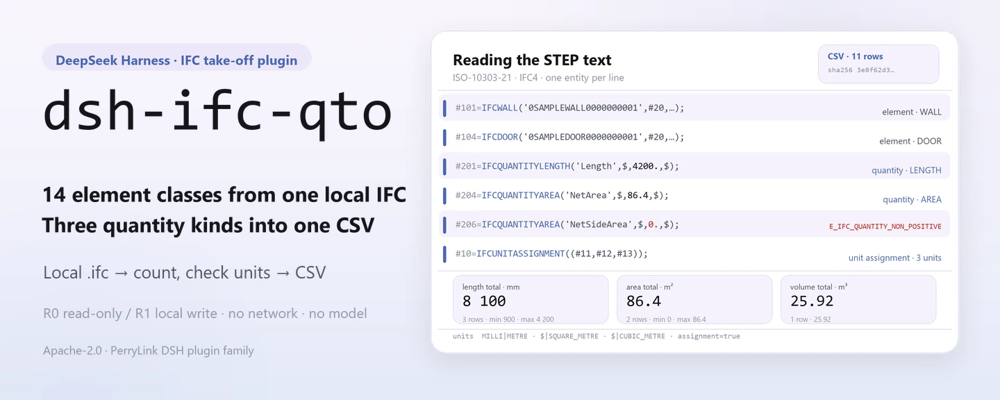
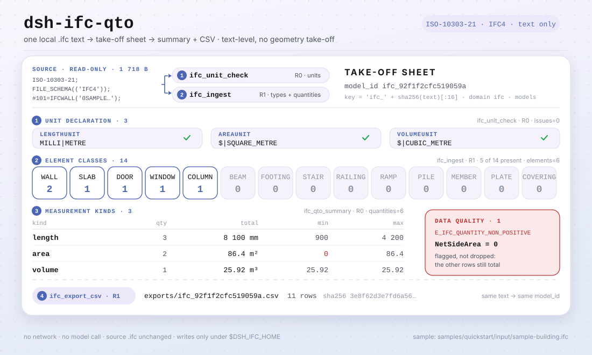

<div align="center">

<picture>
  <source media="(prefers-color-scheme: dark)" srcset="docs/assets/dsh-ifc-qto-hero-en-dark.webp">
  
</picture>

# dsh-ifc-qto

**Convierte un modelo IFC local en una lista de elementos y un CSV de cantidades verificables: solo texto, sin red y sin llamadas al modelo.**

Un plugin de medición local para DeepSeek Harness: lee texto ISO-10303-21, cuenta muros, losas, puertas, ventanas y otros elementos con sus valores `IfcQuantity`, resume por tipo de medición y exporta un CSV; el archivo de origen no se modifica y nada sale de tu máquina.

[Instalar](#instalación-en-tres-pasos) · [Configuración](#configuración) · [FAQ](#faq) · [简体中文](README.md) · [English](README.en.md) · [Español](README.es.md) · [Português](README.pt.md) · [हिन्दी](README.hi.md)

[](LICENSE)
[](#compatibilidad)
[](https://www.npmjs.com/package/dsh-ifc-qto)
[](https://github.com/PerryLink/dsh-ifc-qto/actions/workflows/ci.yml)
[](#compatibilidad)

[](https://github.com/PerryLink/dsh-ifc-qto/stargazers)
[](https://www.npmjs.com/package/dsh-ifc-qto)
[](https://dshfind.com/plugins/PerryLink/dsh-ifc-qto?ref=badge)
[](https://dsh.market/)

```sh
dsh plugin --profile <profile> add dsh-ifc-qto
```

</div>

<sub>Plugin de la comunidad, no afiliado a DeepSeek. Repositorio canónico: <https://github.com/PerryLink/dsh-ifc-qto>. alpha / datos públicos o sintéticos / parcial / no contabilizado / no GA; sin evidencia ni datos de clientes y sin promesa de producción.</sub>

## Qué es

`dsh-ifc-qto` ejecuta dentro de DeepSeek Harness una tubería de medición totalmente local: lee un texto `.ifc` local (ISO-10303-21, IFC4), cuenta muros, losas, puertas, ventanas, pilares, vigas, zapatas, escaleras y otros elementos, extrae las entidades `IfcQuantityLength` / `IfcQuantityArea` / `IfcQuantityVolume` del archivo, las resume por tipo de medición (número, total, mínimo/máximo), marca las cantidades cero o negativas como problemas de calidad de datos y exporta un CSV verificable. Es solo a nivel de texto —sin medición geométrica— y nunca llama a la red ni a un modelo; el `.ifc` que pasas es de solo lectura.

- **Encaja** con una comprobación rápida antes de una licitación o de una certificación de cantidades: cuántos muros, losas y huecos hay, y cuánto suman las áreas y los volúmenes; también para ver de un vistazo qué contiene un `.ifc` recibido.
- **No encaja** con la remedición geométrica o el cotejo pieza a pieza contra planos; tampoco con RVT/DWG u otros formatos que no sean IFC, ni con escaneos o capturas.

**Entrada**: un texto `.ifc` local (ISO-10303-21, IFC4), UTF-8, ≤50 MB por archivo recomendado, exportado por un estudio de diseño o por el autor del modelo. Muestra incluida: `samples/quickstart/input/sample-building.ifc` (1,7 KB, sintética: proyecto y elementos ficticios, sin modelo de cliente).

**Salida**: inventario de elementos (tipo, número, nombre), resumen de cantidades (número/total/mínimo/máximo para longitud, área y volumen), avisos de calidad de datos y un CSV en `$DSH_HOME/storages/dsh-ifc-qto/exports/`. **El archivo de origen no se modifica y no se sube nada.**

<picture>
  <source media="(prefers-color-scheme: dark)" srcset="docs/assets/dsh-ifc-qto-flow-v5-dark.svg">
  
</picture>

## Instalación en tres pasos

1. **Instalar** (cuatro canales; npm es el recomendado):

   ```sh
   # canal npm (recomendado; 0.1.1 publicada)
   dsh plugin --profile <profile> add dsh-ifc-qto
   # canal git (sigue main; lib/ es un artefacto de compilación: antes ejecuta pnpm install && pnpm build en el checkout)
   dsh plugin --profile <profile> add github:PerryLink/dsh-ifc-qto
   # canal tarball: tras pnpm install && pnpm build && pnpm pack en este repositorio
   dsh plugin --profile <profile> add ./dsh-ifc-qto-<version>.tgz
   # canal de la tienda 1024
   npm i -g dsh1024
   dsh1024 plugin --profile <profile> add dsh-ifc-qto
   ```

2. **Configuración mínima** (no hay claves de configuración del plugin): `cordis.patch.yml` solo inserta una fila. La raíz de datos es `$DSH_HOME/storages/dsh-ifc-qto` por omisión; define `DSH_IFC_HOME` para cambiarla (ver «Configuración»). El perfil del host debe ofrecer los servicios `tools` y `storageDomain`.

   ```yaml
   - insert:
       - id: dsh-ifc-qto
         name: dsh-ifc-qto
   ```

3. **Comprobar que se monta**:

   ```sh
   dsh --profile <profile> --dump-config | grep dsh-ifc-qto
   pnpm install --frozen-lockfile && pnpm build
   node samples/quickstart/run.mjs
   ```

   El quickstart incluido recorre `samples/quickstart/input/sample-building.ifc` con `ifc.unit_check → ifc.ingest → ifc.qto_summary → ifc.export_csv` y debe terminar así:

   ```text
   ifc.unit_check   assignment=true length=MILLI|METRE area=$|SQUARE_METRE volume=$|CUBIC_METRE issues=0
   ifc.ingest       elements=6 quantities=6 types=WALL:2 SLAB:1 DOOR:1 WINDOW:1 COLUMN:1
   ifc.qto_summary  length qty=3 total=8100 min=900 max=4200
                    area   qty=2 total=86.4 min=0 max=86.4
                    volume qty=1 total=25.92 min=25.92 max=25.92
   data quality     1 issue(s): E_IFC_QUANTITY_NON_POSITIVE NetSideArea=0
   ifc.export_csv   11 rows -> exports/ifc_92f1f2cfc519059a.csv (sha256 3e8f62d3e7fd6a56…)
   ok: quickstart finished (4 tool calls, 1 data-quality issue)
   ```

   En una sesión también puedes pedir el mismo flujo; el prompt de demostración de `package.json` está en chino:

   ```text
   帮我从自带样例的模型里提取构件和工程量，看看单位声明全不全，再按类别汇总并导出一份 CSV。
   ```

**Desinstalar**: `dsh plugin --profile <profile> remove dsh-ifc-qto` (o borra la fila del patch del perfil).

## Capacidades clave

- **Inventario de elementos a nivel de texto** — `ifc.ingest` comprueba `ISO-10303-21` / `FILE_SCHEMA` y recorre 14 entidades de elemento (`IFCWALL`, `IFCSLAB`, `IFCDOOR`, `IFCWINDOW`, `IFCCOLUMN`, `IFCBEAM`, `IFCFOOTING`, `IFCSTAIR`, `IFCRAILING`, `IFCRAMP`, `IFCPILE`, `IFCMEMBER`, `IFCPLATE`, `IFCCOVERING`), toma GUID y nombre y cuenta por tipo.
- **Extracción de cantidades** — el mismo recorrido captura los nombres y valores de `IfcQuantityLength` / `IfcQuantityArea` / `IfcQuantityVolume` (el último número de la lista de argumentos, tolerando `$` adicionales).
- **Comprobación de unidades** — `ifc.unit_check` busca `IfcUnitAssignment` y los `IfcSIUnit` de longitud/área/volumen, y devuelve `assignment`, `prefix|unit` y la lista de problemas `E_IFC_*UNIT*_MISSING`; sin unidades, las cifras no sirven para certificar cantidades.
- **Resumen y calidad de datos** — `ifc.qto_summary` devuelve número, total, mínimo/máximo y distribución por tipo de elemento para cada tipo de medición, y marca las cantidades cero o negativas como `E_IFC_QUANTITY_NON_POSITIVE`; un valor malo no detiene el resto del resumen.
- **Exportación CSV** — `ifc.export_csv` escribe los recuentos por tipo y las filas de cantidades en `exports/ifc_<sha16>.csv` y devuelve el número de filas y el SHA-256 del CSV; reimportar el mismo texto produce el mismo `model_id` y el mismo nombre de archivo.
- **Entrada de solo lectura** — el `.ifc` que pasas es de solo lectura; las escrituras van solo a `$DSH_IFC_HOME` (por omisión `$DSH_HOME/storages/dsh-ifc-qto`) y a la tabla `models` del dominio de almacenamiento `ifc`.
- **Solo local** — el código no contiene llamadas `fetch` / HTTP / DNS / WebSocket, y los metadatos de demostración de `package.json` declaran `network: false`; la entrada y la salida no salen de tu máquina.

### Superficie de herramientas

Los nombres de las herramientas son la API estable (coinciden con la salida del runtime y se mantienen en inglés); las descripciones están localizadas. Las herramientas que escriben archivos se marcan **R1 (escritura local)**; las de solo lectura, **R0**.

| Herramienta | Propósito | Riesgo |
|---|---|---|
| `ifc.ingest` | Analiza texto IFC, inventaría 14 tipos de elemento y las entidades de cantidad, guarda el modelo y devuelve `model_id` | R1 escritura local |
| `ifc.export_csv` | Exporta recuentos por tipo y filas de cantidades a CSV; devuelve ruta, filas y hash | R1 escritura local |
| `ifc.qto_summary` | Resume por tipo de medición (número/total/mínimo/máximo) y enumera los problemas no positivos | R0 solo lectura |
| `ifc.unit_check` | Comprueba si el modelo declara unidades SI de longitud/área/volumen | R0 solo lectura |

`ifc.export_csv` y `ifc.qto_summary` solo aceptan un `model_id` devuelto por `ifc.ingest` y guardado en la tabla `models`; no aceptan una ruta de archivo.

### Ejemplos

Estos son los puntos de entrada reales del plugin; la muestra sintética incluida lo reproduce todo.

**Ejemplo detallado** — `node samples/quickstart/run.mjs` (4 llamadas a herramientas, 1 problema de calidad de datos):

```text
ifc.unit_check   assignment=true length=MILLI|METRE area=$|SQUARE_METRE volume=$|CUBIC_METRE issues=0
ifc.ingest       elements=6 quantities=6 types=WALL:2 SLAB:1 DOOR:1 WINDOW:1 COLUMN:1
ifc.qto_summary  length qty=3 total=8100 min=900 max=4200
                 area   qty=2 total=86.4 min=0 max=86.4
                 volume qty=1 total=25.92 min=25.92 max=25.92
data quality     1 issue(s): E_IFC_QUANTITY_NON_POSITIVE NetSideArea=0
ifc.export_csv   11 rows -> exports/ifc_92f1f2cfc519059a.csv (sha256 3e8f62d3e7fd6a56…)
```

*Observed from `samples/quickstart/expected/console.txt` (coincide con `samples/quickstart/expected/result.json`).*

**Rama de fallo** — llamar a `ifc.export_csv` con un `model_id` inexistente:

```text
找不到这个模型（E_IFC_UNREADABLE）｜下一步：先用 ifc.ingest 导入模型拿到 model_id，再导出 CSV
```

*Observed from `src/plugin/tools.ts:5`; el resto de códigos está en [`TROUBLESHOOTING.md`](TROUBLESHOOTING.md).*

## Datos medidos


*La captura es una ejecución real de `node samples/quickstart/run.mjs` sobre la muestra sintética incluida (2026-11-02), idéntica línea a línea a `samples/quickstart/expected/console.txt`; la muestra solo tiene proyecto y elementos ficticios, sin modelo de cliente.*

La aceptación pública/sintética se reproduce con `scripts/acceptance.mjs` y el detalle queda en `ACCEPTANCE.csv`. Estas son las 8 filas, citadas textualmente (el archivo completo incluye además `script` y `evidence_sha256`):

```csv
req_id,metric,threshold,actual,pass,source,counted
SKU-07-A01,IFC 构件（20）,20,20,true,public/synthetic,false
SKU-07-A02,类型数,5,5,true,public/synthetic,false
SKU-07-A03,量实体,3,3,true,public/synthetic,false
SKU-07-A04,CSV 行,>=8,8,true,public/synthetic,false
SKU-07-A05,公开 IFC 量实体,>=5,36,true,public/synthetic,false
SKU-07-A06,QTO 汇总/数据质量,1,3,true,public/synthetic,false
SKU-07-A07,IFC 单位声明检查,>=1,3,true,public/synthetic,false
PS1-QS01,quickstart 样例与金标一致,1/1,1,true,synthetic/quickstart,true
```

Las filas SKU-07 son comprobaciones con fixtures públicas/sintéticas (`counted=false`); solo `PS1-QS01` es una reproducción local de la muestra incluida (`counted=true`). El modelo del quickstart tiene 6 elementos y 6 cantidades: 3 valores de longitud que suman 8100, 2 de área que suman 86.4, 1 de volumen de 25.92 y un CSV de 11 filas. Nada de esto es una ejecución de cliente y no se inventa ninguna salida.

**Aceptación respaldada por fixtures**: la muestra pública MIT `fixtures/public/mit/3walls.ifc` la analiza `test/public-ifc.test.mjs` (con `pnpm test`), mientras que la fila `SKU-07-A01` (elementos IFC 20, 20/20) procede del IFC sintético de `scripts/acceptance.mjs`. Ambas son fixtures públicas/sintéticas, no una ejecución de cliente. Todas las muestras públicas están en `fixtures/` (con `SOURCE.md` y licencias de origen), y todas las filas SKU de `ACCEPTANCE.csv` son `counted=false`.

## Configuración

Este plugin no tiene campos Schemastery `Config`: `cordis.patch.yml` solo inserta una fila, y lo ajustable son variables de entorno y argumentos de las herramientas.

| Ajuste | Valor por omisión | Significado |
|---|---|---|
| `DSH_IFC_HOME` | sin definir | Raíz de datos; si no se define es `$DSH_HOME/storages/dsh-ifc-qto`, y si `DSH_HOME` tampoco existe, `storages/dsh-ifc-qto` bajo el cwd del proceso host |
| `DSH_HOME` | sin definir | Home del host; decide la raíz de datos por omisión |
| Directorio de exportación | `<raíz de datos>/exports` | Destino del CSV; el nombre es fijo, `ifc_<primeros 16 caracteres del sha256>.csv` |

Los registros de modelo viven en el dominio de almacenamiento propio `ifc` (versión 1), tabla `models`; cada `ifc.ingest` escribe un registro y `model_id` es `ifc_<primeros 16 caracteres del sha256>`.

<details>
<summary>Argumentos de las herramientas</summary>

| Argumento | Valor por omisión | Se aplica a | Significado |
|---|---|---|---|
| `ifc_text` | obligatorio | `ifc.ingest` / `ifc.unit_check` | El texto IFC en sí (ISO-10303-21) |
| `source_name` | `inline.ifc` | `ifc.ingest` | Etiqueta de origen guardada en el registro; solo identificativa |
| `model_id` | obligatorio | `ifc.export_csv` / `ifc.qto_summary` | El id devuelto por `ifc.ingest` |

</details>

<details>
<summary>Formato de error y códigos frecuentes</summary>

Todo fallo se lee como «una frase clara (`E_IFC_*`) | siguiente: una acción»; el diagnóstico paso a paso está en [`TROUBLESHOOTING.md`](TROUBLESHOOTING.md).

| Código | Significado |
|---|---|
| `E_IFC_UNREADABLE` | No es texto IFC; o no hay elementos/cantidades que contar; o el `model_id` no existe |
| `E_IFC_EMPTY` | El archivo está vacío (0 bytes o solo espacios) |
| `E_IFC_EXPORT_FAILED` | No se pudo escribir el CSV (permisos, montaje de solo lectura, disco lleno) |
| `E_IFC_QUANTITY_NON_POSITIVE` | Una cantidad es cero o negativa (aviso de calidad; no bloquea el resto) |
| `E_IFC_UNITASSIGNMENT_MISSING` | El modelo no tiene `IfcUnitAssignment` |
| `E_IFC_LENGTHUNIT_MISSING` / `E_IFC_AREAUNIT_MISSING` / `E_IFC_VOLUMEUNIT_MISSING` | Falta la declaración `IfcSIUnit` del tipo de medición correspondiente |

</details>

Ejemplo de override en el patch del perfil:

```yaml
- insert:
    - id: dsh-ifc-qto
      name: dsh-ifc-qto
```

Cambiar la raíz de datos:

```sh
export DSH_IFC_HOME=/path/to/ifc-data   # Windows PowerShell: $env:DSH_IFC_HOME = 'D:\ifc-data'
```

## FAQ

<details>
<summary>¿Dónde se guardan los datos? ¿Se modifica mi archivo de origen?</summary>

Los registros de modelo van a la tabla `models` del dominio de almacenamiento `ifc` (raíz por omisión `$DSH_HOME/storages/dsh-ifc-qto`, configurable con `DSH_IFC_HOME`) y los CSV a `<raíz de datos>/exports/`. El `.ifc` que pasas es de solo lectura y las herramientas nunca lo reescriben; no hay subida ni telemetría.

</details>

<details>
<summary>¿Puede procesar mi modelo real? ¿Calcula geometría?</summary>

Lee texto `.ifc` estándar (ISO-10303-21), pero solo hace medición a nivel de texto: recuento de elementos, las cantidades ya presentes como `IfcQuantity*` y la declaración de unidades. No hace medición geométrica 3D ni deduce áreas o volúmenes: si el modelo no trae `IfcQuantity`, no se cuenta nada. RVT/DWG/PDF y escaneos no son compatibles; el paquete es alpha y solo se ha verificado con datos públicos/sintéticos, así que no sirve como base para una certificación de cantidades ni una liquidación. Se procesa un texto IFC por llamada (sin lotes), ≤50 MB por archivo recomendado; el análisis es un recorrido por líneas con expresiones regulares, sin llamadas al modelo ni idas y vueltas de red.

</details>

<details>
<summary>Los números no cuadran o aparece E_IFC_QUANTITY_NON_POSITIVE: ¿qué hago?</summary>

Ejecuta primero `ifc.unit_check` para confirmar que las unidades de longitud/área/volumen están declaradas (sin unidades las cifras no sirven para certificar cantidades) y revisa luego `issues` de `ifc.qto_summary`: una cantidad cero o negativa suele venir de un valor ausente o mal exportado, así que corrige el modelo y vuelve a exportar. Es solo un aviso de calidad y no bloquea el resto del resumen.

</details>

<details>
<summary>No se instala o no se activa: ¿qué reviso?</summary>

Comprueba `node --version` (`>=24.9 <25`) y `dsh --version` (`>=0.2.1-rc.3 <0.4.0`), y confirma el montaje con `dsh --profile <profile> --dump-config | grep dsh-ifc-qto`. El plugin necesita los dos servicios del host, `tools` y `storageDomain`; si falta alguno, no se aplica. Los pasos completos están en [`TROUBLESHOOTING.md`](TROUBLESHOOTING.md).

</details>

<details>
<summary>¿Compite con otros plugins por comandos, slots o almacenamiento? ¿Cuánto cuesta?</summary>

No. Las cuatro herramientas viven bajo el espacio de nombres `ifc.*`; no registra comandos, slots de cliente, rutas `webServer` ni claves de servicio; usa solo una tabla `models` en su propio dominio `ifc` v1 y no toca otros dominios; no parchea prototipos, no reescribe `process.env` y no sustituye el fetch global. El argumento punto por punto está en «Interoperabilidad con otros plugins DSH».

El coste también es bajo: el análisis es un recorrido por líneas con expresiones regulares, sin llamadas al modelo ni peticiones de red; el paso más pesado es leer el texto y una pasada de resumen.

</details>

## Límites de seguridad

- **Sin red y sin llamadas al modelo.** El código no contiene llamadas `fetch` / HTTP / DNS / WebSocket, y los metadatos de demostración de `package.json` declaran `network: false`. La entrada y la salida se quedan en local.
- **El archivo de origen no se modifica.** Las escrituras van solo a `$DSH_IFC_HOME` (por omisión `$DSH_HOME/storages/dsh-ifc-qto`) en `exports/`, y a la tabla `models` del dominio `ifc`; la superficie de lectura es el texto IFC que entrega quien llama: el plugin no recorre directorios ni abre otros archivos.
- **Análisis estricto y fallo ruidoso.** Un texto que no sea ISO-10303-21, o sin elementos/cantidades que contar, falla con `E_IFC_UNREADABLE`; un archivo vacío falla con `E_IFC_EMPTY`; nunca devuelve un inventario vacío en silencio.
- **Errores legibles que no revelan nada.** El texto para el usuario es «una frase clara + código + siguiente acción»; el contenido original del modelo nunca se repite en un error.
- **Dominio de almacenamiento independiente.** Solo una tabla `models` en su propio dominio `ifc` v1; el dominio se cierra mediante un efecto de Cordis, así que parar o recargar en caliente lo retira.
- **Sin credenciales ni sistemas externos.** No lee credenciales ni se conecta a ERP / plataformas BIM / servicios en la nube; no hay telemetría ni subida.
- **Solo cara host.** No registra paquete de cliente, slot ni UI; todo pasa por la superficie de herramientas.

## Permisos y datos

```text
Lectura: el archivo .ifc que indica el usuario; ningún otro directorio
Escritura: $DSH_HOME/storages/dsh-ifc-qto (no se guarda el original; solo registros analizados y exports/*.csv); el archivo de origen no se modifica
Red: no
Sistemas externos: ninguno
```

Esto coincide con el código: `apply()` toma el directorio de escritura de `DSH_IFC_HOME` (por omisión `$DSH_HOME/storages/dsh-ifc-qto`) y no hay ninguna llamada de red. El plugin no abre rutas de archivo; `ifc_text` lo aporta quien llama. Las herramientas que escriben (`ifc.ingest`, `ifc.export_csv`) se marcan **R1 escritura local**; las de solo lectura (`ifc.qto_summary`, `ifc.unit_check`) son **R0**.

## Limitaciones conocidas

- **Verificación solo pública/sintética.** Todas las filas de aceptación vienen de fixtures públicas o sintéticas (`counted=false` en las filas SKU-07 de `ACCEPTANCE.csv`; `PS1-QS01` es una reproducción local de la muestra incluida, `counted=true`); sin datos ni evidencia de clientes.
- **alpha / parcial / no contabilizado / no GA.** Sin promesa de producción y sin que esto constituya una conclusión de medición, liquidación o auditoría.
- **Nivel de texto, no geométrico.** Cuenta elementos y lee los `IfcQuantity*` que ya están en el archivo; no hace medición geométrica 3D, no deduce áreas ni volúmenes y no concilia contra planos.
- **Los tipos de elemento son una lista cerrada.** Solo se cuentan 14: `IFCWALL`, `IFCSLAB`, `IFCDOOR`, `IFCWINDOW`, `IFCCOLUMN`, `IFCBEAM`, `IFCFOOTING`, `IFCSTAIR`, `IFCRAILING`, `IFCRAMP`, `IFCPILE`, `IFCMEMBER`, `IFCPLATE`, `IFCCOVERING`; el resto se ignora.
- **Solo texto IFC.** RVT, DWG, PDF, escaneos e imágenes no son compatibles; un archivo binario o con extensión cambiada falla con `E_IFC_UNREADABLE`.
- **Un archivo, sin lotes.** Un texto IFC por llamada, ≤50 MB por archivo recomendado; para lotes hay que iterar.
- **`model_id` no es una ruta.** `ifc.qto_summary` / `ifc.export_csv` solo aceptan un id devuelto por `ifc.ingest` y guardado en `models`; pasar una ruta de archivo falla con `E_IFC_UNREADABLE`.
- **El almacenamiento es un KV JSON.** El dominio `ifc` v1 tiene una tabla `models` sin transacciones entre tablas, claves foráneas ni migraciones; reimportar el mismo texto sobrescribe el mismo registro.
- **Requiere servicios del host.** El plugin inyecta `tools` y `storageDomain`; en un perfil básico sin storage no se aplica.
- **Rango de Node estrecho.** Solo `>=24.9.0 <25`; sin mitad de navegador ni UI.

## Interoperabilidad con otros plugins DSH

Revisado contra el código (`src/plugin/index.ts`, `src/plugin/tools.ts`, `src/plugin/storage.ts`), el plugin no tiene superficie de colisión con comandos, herramientas, slots, rutas HTTP ni dominios de almacenamiento:

- **Nombres de herramienta con espacio de nombres.** Las 4 herramientas empiezan por `ifc.` y no ocupan ningún nombre desnudo de una herramienta integrada u otro plugin.
- **Solo consume, no ofrece servicios.** `inject` es solo `['tools', 'storageDomain']`; no registra comandos, slots de cliente, prefijos `webServer` ni claves de servicio.
- **Dominio de almacenamiento independiente.** Usa solo una tabla `models` en su propio dominio `ifc` v1 y no lee ni escribe otros dominios.
- **Sin mutación global.** No parchea prototipos, no reescribe `process.env` ni sustituye el fetch global.
- **Las exportaciones no se salen.** El CSV se escribe solo en su propio `exports/`, con nombre derivado de `model_id`.
- **Las herramientas de solo lectura son reentrantes.** `ifc.qto_summary` e `ifc.unit_check` no escriben estado y se pueden llamar repetidamente.

## Compatibilidad

| Superficie | Estado |
|---|---|
| Harness | `dsh >=0.2.1-rc.3 <0.4.0` (`engines.dsh` en `package.json`) |
| Node | `>=24.9.0 <25` (`.nvmrc`: 24) |
| Servicios del host | Se deben componer `tools` y `storageDomain` (ver `inject` en `src/plugin/index.ts`) |
| Plataformas | Cualquier lugar donde corra DSH; solo archivos locales, sin mitad de navegador |
| Modelo | No necesario; sin llamadas al modelo |
| Datos | Sin red, sin llamadas al modelo, sin subida; solo escribe `$DSH_HOME/storages/dsh-ifc-qto` |
| Mantenimiento | Activo (desde 2026-11-01; las funciones y el endurecimiento salen en versiones alpha) |

## Ecosistema y calidad

- [Página del plugin en dshfind](https://dshfind.com/plugins/PerryLink/dsh-ifc-qto) (instalaciones y ranking)
- [DSH Market](https://dsh.market/) (listado)
- [Índice de dominio](https://perrylink.github.io/dsh-plugins/) · [Familia de checkers](https://perrylink.github.io/zh/checkers/) · [Familia principal](https://github.com/PerryLink/dsh-kit)
- [Espejo agregado en Gitee](https://gitee.com/perrylink/dsh-plugins) (GitHub es la referencia)
- **Canal de la tienda 1024**: `npm i -g dsh1024` una vez y luego `dsh1024 plugin --profile <profile> add dsh-ifc-qto` (cuenta para el ranking de instalaciones de [deepseek1024.com](https://deepseek1024.com))
- Paquetes hermanos: [`dsh-docx-redline`](https://github.com/PerryLink/dsh-docx-redline), [`dsh-pim-lint`](https://github.com/PerryLink/dsh-pim-lint)
- Verificadores relacionados (cada uno es un paquete aparte, con su propio paquete de reglas y versión; instala solo los que necesites):

| Paquete | Por qué es relevante |
|---|---|
| [`dsh-construction-doc-check`](https://github.com/PerryLink/dsh-construction-doc-check) | Directorio de documentación de obra, versiones y archivos vacíos |
| [`dsh-pipeline-check`](https://github.com/PerryLink/dsh-pipeline-check) | Cadena documental de todo el ciclo del proyecto |
| [`dsh-site-log-check`](https://github.com/PerryLink/dsh-site-log-check) | Continuidad del libro de supervisión y cobertura de registros en obra |

- Documentación: [`TROUBLESHOOTING.md`](TROUBLESHOOTING.md) · [`PRIVACY.md`](PRIVACY.md) · [`SECURITY.md`](SECURITY.md) · [`FIXTURES.md`](FIXTURES.md) · [`EVIDENCE.md`](EVIDENCE.md) · [`ACCEPTANCE.csv`](ACCEPTANCE.csv)

## Desarrollo

```sh
pnpm install --frozen-lockfile
pnpm build && pnpm lint && pnpm typecheck && pnpm test   # 5 archivos de prueba
pnpm gate:sku07                                          # puerta de aceptación (ACCEPTANCE.csv)
node scripts/acceptance.mjs                              # repetir la aceptación pública/sintética
node samples/quickstart/run.mjs                          # muestra sintética: 4 llamadas, 1 problema de calidad
```

Versión actual `0.1.1`.

Estructura de directorios:

| Ruta | Contenido |
|---|---|
| `src/core/` | `ifc.ts`: análisis de texto IFC (elementos, cantidades) y comprobación de unidades |
| `src/plugin/` | `index.ts` (apply), `tools.ts` (4 herramientas), `storage.ts` (dominio de almacenamiento `ifc` v1) |
| `test/` | Casos `node --test` (ifc, plugin-smoke, public-ifc, qto-summary, units) |
| `scripts/` | Puertas mecánicas: lint, acceptance, gate-sku07, check-pack, sbom, make-samples y el nuevo `gen-readme-assets.py` |
| `fixtures/public/mit/` | 4 muestras IFC públicas MIT/Apache (con `SOURCE.md` y licencias de origen) |
| `samples/quickstart/` | Muestra sintética de edificio, `run.mjs` y el golden `expected/console.txt` / `result.json` |
| `docs/assets/` | Imágenes del README |
| `evidence/` | Instantáneas de las ejecuciones de aceptación (`result.json`) |

El banner y el diagrama de estructura se generan mediante [`scripts/gen-readme-assets.py`](scripts/gen-readme-assets.py) (Pillow para los cuatro banners webp de 1440x576, SVG escrito a mano para el diagrama claro/oscuro de 1100x660) y se pueden volver a generar; el antiguo SVG de una sola versión `docs/assets/dsh-ifc-qto-flow.svg` y los antiguos `flow-{light,dark}.svg` se conservan para que los enlaces externos no den 404.

Topics: `deepseek-harness`, `dsh`, `dsh-plugin`, `ifc`, `qto`, `bim`, `perrylink`, `construction`

## Familia y agradecimientos

Este proyecto forma parte de la familia de plugins de DeepSeek Harness de [PerryLink](https://github.com/PerryLink) (todos Apache-2.0). Si te resulta útil, **una estrella ayuda a que la siguiente persona lo encuentre**; no desbloquea ninguna función.

- [@PerryLink](https://github.com/PerryLink) — creador y mantenedor: medición de texto IFC y extracción de cantidades, comprobación de unidades, resumen QTO y exportación CSV, el quickstart y la suite de aceptación, y la documentación en cinco idiomas.

<details>
<summary>Desplegar la familia de plugins de dominio DSH (15 paquetes + 2 suites)</summary>

| Plugin | npm | Estado |
|---|---|---|
| **[dsh-einvoice](https://github.com/PerryLink/dsh-einvoice)** | [npm](https://www.npmjs.com/package/dsh-einvoice) |  |
| **[dsh-docx-redline](https://github.com/PerryLink/dsh-docx-redline)** | [npm](https://www.npmjs.com/package/dsh-docx-redline) |  |
| **[dsh-policy-ledger](https://github.com/PerryLink/dsh-policy-ledger)** | [npm](https://www.npmjs.com/package/dsh-policy-ledger) |  |
| **[dsh-ghg](https://github.com/PerryLink/dsh-ghg)** | [npm](https://www.npmjs.com/package/dsh-ghg) |  |
| **[dsh-bankrec](https://github.com/PerryLink/dsh-bankrec)** | [npm](https://www.npmjs.com/package/dsh-bankrec) |  |
| **[dsh-ap-three-way](https://github.com/PerryLink/dsh-ap-three-way)** | [npm](https://www.npmjs.com/package/dsh-ap-three-way) |  |
| **[dsh-ifc-qto](https://github.com/PerryLink/dsh-ifc-qto)** | [npm](https://www.npmjs.com/package/dsh-ifc-qto) |  |
| **[dsh-qms-capa](https://github.com/PerryLink/dsh-qms-capa)** | [npm](https://www.npmjs.com/package/dsh-qms-capa) |  |
| **[dsh-legal-intake](https://github.com/PerryLink/dsh-legal-intake)** | [npm](https://www.npmjs.com/package/dsh-legal-intake) |  |
| **[dsh-legal-clause](https://github.com/PerryLink/dsh-legal-clause)** | [npm](https://www.npmjs.com/package/dsh-legal-clause) |  |
| **[dsh-freight-audit](https://github.com/PerryLink/dsh-freight-audit)** | [npm](https://www.npmjs.com/package/dsh-freight-audit) |  |
| **[dsh-hs-candidate](https://github.com/PerryLink/dsh-hs-candidate)** | [npm](https://www.npmjs.com/package/dsh-hs-candidate) |  |
| **[dsh-travel-recon](https://github.com/PerryLink/dsh-travel-recon)** | [npm](https://www.npmjs.com/package/dsh-travel-recon) |  |
| **[dsh-pim-lint](https://github.com/PerryLink/dsh-pim-lint)** | [npm](https://www.npmjs.com/package/dsh-pim-lint) |  |
| **[dsh-eval-pack](https://github.com/PerryLink/dsh-eval-pack)** | [npm](https://www.npmjs.com/package/dsh-eval-pack) |  |
| **[dsh-finops-suite](https://github.com/PerryLink/dsh-finops-suite)** | [npm](https://www.npmjs.com/package/dsh-finops-suite) |  |
| **[dsh-contract-suite](https://github.com/PerryLink/dsh-contract-suite)** | [npm](https://www.npmjs.com/package/dsh-contract-suite) |  |

</details>

<details>
<summary>Desplegar la familia principal (87 specs de instalación actuales)</summary>

| Plugin | npm | Estado |
|---|---|---|
| **[dsh-aqua-input-check](https://github.com/PerryLink/dsh-aqua-input-check)** | [npm](https://www.npmjs.com/package/dsh-aqua-input-check) |  |
| **[dsh-archive-check](https://github.com/PerryLink/dsh-archive-check)** | [npm](https://www.npmjs.com/package/dsh-archive-check) |  |
| **[dsh-bid-ca-precheck](https://github.com/PerryLink/dsh-bid-ca-precheck)** | [npm](https://www.npmjs.com/package/dsh-bid-ca-precheck) |  |
| **[dsh-bid-qual-check](https://github.com/PerryLink/dsh-bid-qual-check)** | [npm](https://www.npmjs.com/package/dsh-bid-qual-check) |  |
| **[dsh-contract-stance](https://github.com/PerryLink/dsh-contract-stance)** | [npm](https://www.npmjs.com/package/dsh-contract-stance) |  |
| **[dsh-customs-doc-check](https://github.com/PerryLink/dsh-customs-doc-check)** | [npm](https://www.npmjs.com/package/dsh-customs-doc-check) |  |
| **[dsh-demurrage-ledger](https://github.com/PerryLink/dsh-demurrage-ledger)** | [npm](https://www.npmjs.com/package/dsh-demurrage-ledger) |  |
| **[dsh-drill-script-check](https://github.com/PerryLink/dsh-drill-script-check)** | [npm](https://www.npmjs.com/package/dsh-drill-script-check) |  |
| **[dsh-eia-guide-check](https://github.com/PerryLink/dsh-eia-guide-check)** | [npm](https://www.npmjs.com/package/dsh-eia-guide-check) |  |
| **[dsh-emergency-plan](https://github.com/PerryLink/dsh-emergency-plan)** | [npm](https://www.npmjs.com/package/dsh-emergency-plan) |  |
| **[dsh-essay-rubric-check](https://github.com/PerryLink/dsh-essay-rubric-check)** | [npm](https://www.npmjs.com/package/dsh-essay-rubric-check) |  |
| **[dsh-evidence-check](https://github.com/PerryLink/dsh-evidence-check)** | [npm](https://www.npmjs.com/package/dsh-evidence-check) |  |
| **[dsh-export-ctl-check](https://github.com/PerryLink/dsh-export-ctl-check)** | [npm](https://www.npmjs.com/package/dsh-export-ctl-check) |  |
| **[dsh-fmea-table-check](https://github.com/PerryLink/dsh-fmea-table-check)** | [npm](https://www.npmjs.com/package/dsh-fmea-table-check) |  |
| **[dsh-forecast-penalty](https://github.com/PerryLink/dsh-forecast-penalty)** | [npm](https://www.npmjs.com/package/dsh-forecast-penalty) |  |
| **[dsh-gongwen-flow-check](https://github.com/PerryLink/dsh-gongwen-flow-check)** | [npm](https://www.npmjs.com/package/dsh-gongwen-flow-check) |  |
| **[dsh-gongwen-word-check](https://github.com/PerryLink/dsh-gongwen-word-check)** | [npm](https://www.npmjs.com/package/dsh-gongwen-word-check) |  |
| **[dsh-guard-plan-qc](https://github.com/PerryLink/dsh-guard-plan-qc)** | [npm](https://www.npmjs.com/package/dsh-guard-plan-qc) |  |
| **[dsh-hazchem-check](https://github.com/PerryLink/dsh-hazchem-check)** | [npm](https://www.npmjs.com/package/dsh-hazchem-check) |  |
| **[dsh-hazplan-check](https://github.com/PerryLink/dsh-hazplan-check)** | [npm](https://www.npmjs.com/package/dsh-hazplan-check) |  |
| **[dsh-hidden-risk-map](https://github.com/PerryLink/dsh-hidden-risk-map)** | [npm](https://www.npmjs.com/package/dsh-hidden-risk-map) |  |
| **[dsh-hs-classify](https://github.com/PerryLink/dsh-hs-classify)** | [npm](https://www.npmjs.com/package/dsh-hs-classify) |  |
| **[dsh-icd-rule-check](https://github.com/PerryLink/dsh-icd-rule-check)** | [npm](https://www.npmjs.com/package/dsh-icd-rule-check) |  |
| **[dsh-lawcite-adapter](https://github.com/PerryLink/dsh-lawcite-adapter)** | [npm](https://www.npmjs.com/package/dsh-lawcite-adapter) |  |
| **[dsh-lc-doc-check](https://github.com/PerryLink/dsh-lc-doc-check)** | [npm](https://www.npmjs.com/package/dsh-lc-doc-check) |  |
| **[dsh-learning-gap-check](https://github.com/PerryLink/dsh-learning-gap-check)** | [npm](https://www.npmjs.com/package/dsh-learning-gap-check) |  |
| **[dsh-medrec-qc](https://github.com/PerryLink/dsh-medrec-qc)** | [npm](https://www.npmjs.com/package/dsh-medrec-qc) |  |
| **[dsh-nsfc-form-check](https://github.com/PerryLink/dsh-nsfc-form-check)** | [npm](https://www.npmjs.com/package/dsh-nsfc-form-check) |  |
| **[dsh-nurse-record-check](https://github.com/PerryLink/dsh-nurse-record-check)** | [npm](https://www.npmjs.com/package/dsh-nurse-record-check) |  |
| **[dsh-origin-rvc-check](https://github.com/PerryLink/dsh-origin-rvc-check)** | [npm](https://www.npmjs.com/package/dsh-origin-rvc-check) |  |
| **[dsh-ota-review-check](https://github.com/PerryLink/dsh-ota-review-check)** | [npm](https://www.npmjs.com/package/dsh-ota-review-check) |  |
| **[dsh-paper-doc-adapter](https://github.com/PerryLink/dsh-paper-doc-adapter)** | [npm](https://www.npmjs.com/package/dsh-paper-doc-adapter) |  |
| **[dsh-permit-report-check](https://github.com/PerryLink/dsh-permit-report-check)** | [npm](https://www.npmjs.com/package/dsh-permit-report-check) |  |
| **[dsh-pipeline-check](https://github.com/PerryLink/dsh-pipeline-check)** | [npm](https://www.npmjs.com/package/dsh-pipeline-check) |  |
| **[dsh-pleading-draft](https://github.com/PerryLink/dsh-pleading-draft)** | [npm](https://www.npmjs.com/package/dsh-pleading-draft) |  |
| **[dsh-policy-brief-draft](https://github.com/PerryLink/dsh-policy-brief-draft)** | [npm](https://www.npmjs.com/package/dsh-policy-brief-draft) |  |
| **[dsh-power-loss-split](https://github.com/PerryLink/dsh-power-loss-split)** | [npm](https://www.npmjs.com/package/dsh-power-loss-split) |  |
| **[dsh-power-ticket-check](https://github.com/PerryLink/dsh-power-ticket-check)** | [npm](https://www.npmjs.com/package/dsh-power-ticket-check) |  |
| **[dsh-ppap-check](https://github.com/PerryLink/dsh-ppap-check)** | [npm](https://www.npmjs.com/package/dsh-ppap-check) |  |
| **[dsh-protest-deadline](https://github.com/PerryLink/dsh-protest-deadline)** | [npm](https://www.npmjs.com/package/dsh-protest-deadline) |  |
| **[dsh-railway-window](https://github.com/PerryLink/dsh-railway-window)** | [npm](https://www.npmjs.com/package/dsh-railway-window) |  |
| **[dsh-repair-order-qc](https://github.com/PerryLink/dsh-repair-order-qc)** | [npm](https://www.npmjs.com/package/dsh-repair-order-qc) |  |
| **[dsh-review-reply-check](https://github.com/PerryLink/dsh-review-reply-check)** | [npm](https://www.npmjs.com/package/dsh-review-reply-check) |  |
| **[dsh-rulefile-check](https://github.com/PerryLink/dsh-rulefile-check)** | [npm](https://www.npmjs.com/package/dsh-rulefile-check) |  |
| **[dsh-safety-brief-check](https://github.com/PerryLink/dsh-safety-brief-check)** | [npm](https://www.npmjs.com/package/dsh-safety-brief-check) |  |
| **[dsh-site-log-check](https://github.com/PerryLink/dsh-site-log-check)** | [npm](https://www.npmjs.com/package/dsh-site-log-check) |  |
| **[dsh-soe-decision-check](https://github.com/PerryLink/dsh-soe-decision-check)** | [npm](https://www.npmjs.com/package/dsh-soe-decision-check) |  |
| **[dsh-soilwater-check](https://github.com/PerryLink/dsh-soilwater-check)** | [npm](https://www.npmjs.com/package/dsh-soilwater-check) |  |
| **[dsh-sop-sync-check](https://github.com/PerryLink/dsh-sop-sync-check)** | [npm](https://www.npmjs.com/package/dsh-sop-sync-check) |  |
| **[dsh-spc-gbt-adapter](https://github.com/PerryLink/dsh-spc-gbt-adapter)** | [npm](https://www.npmjs.com/package/dsh-spc-gbt-adapter) |  |
| **[dsh-tender-extract](https://github.com/PerryLink/dsh-tender-extract)** | [npm](https://www.npmjs.com/package/dsh-tender-extract) |  |
| **[dsh-tender-matrix](https://github.com/PerryLink/dsh-tender-matrix)** | [npm](https://www.npmjs.com/package/dsh-tender-matrix) |  |
| **[dsh-warranty-calc](https://github.com/PerryLink/dsh-warranty-calc)** | [npm](https://www.npmjs.com/package/dsh-warranty-calc) |  |
| **[dsh-auto-review](https://github.com/PerryLink/dsh-auto-review)** | [npm](https://www.npmjs.com/package/dsh-auto-review) |  |
| **[dsh-autotier](https://github.com/PerryLink/dsh-autotier)** | [npm](https://www.npmjs.com/package/dsh-autotier) | 🧊 CONGELADO — ver el README del repo |
| **[dsh-budget](https://github.com/PerryLink/dsh-budget)** | [npm](https://www.npmjs.com/package/dsh-budget) |  |
| **[dsh-cert-mcp](https://github.com/PerryLink/dsh-cert-mcp)** | [npm](https://www.npmjs.com/package/dsh-cert-mcp) | 🧊 CONGELADO — ver el README del repo |
| **[dsh-checkpoint-rewind](https://github.com/PerryLink/dsh-checkpoint-rewind)** | [npm](https://www.npmjs.com/package/dsh-checkpoint-rewind) |  |
| **[dsh-claude-move](https://github.com/PerryLink/dsh-claude-move)** | [npm](https://www.npmjs.com/package/dsh-claude-move) |  |
| **[dsh-click](https://github.com/PerryLink/dsh-click)** | [npm](https://www.npmjs.com/package/dsh-click) |  |
| **[dsh-composer-history](https://github.com/PerryLink/dsh-composer-history)** | [npm](https://www.npmjs.com/package/dsh-composer-history) |  |
| **[dsh-data-quality](https://github.com/PerryLink/dsh-data-quality)** | [npm](https://www.npmjs.com/package/dsh-data-quality) | 🧊 CONGELADO — ver el README del repo |
| **[dsh-defend](https://github.com/PerryLink/dsh-defend)** | [npm](https://www.npmjs.com/package/dsh-defend) |  |
| **[dsh-doublecheck](https://github.com/PerryLink/dsh-doublecheck)** | [npm](https://www.npmjs.com/package/dsh-doublecheck) |  |
| **[dsh-draw](https://github.com/PerryLink/dsh-draw)** | [npm](https://www.npmjs.com/package/dsh-draw) | 🧊 CONGELADO — ver el README del repo |
| **[dsh-fast](https://github.com/PerryLink/dsh-fast)** | [npm](https://www.npmjs.com/package/dsh-fast) |  |
| **[dsh-fund-research](https://github.com/PerryLink/dsh-fund-research)** | [npm](https://www.npmjs.com/package/dsh-fund-research) |  |
| **[dsh-industry-research](https://github.com/PerryLink/dsh-industry-research)** | [npm](https://www.npmjs.com/package/dsh-industry-research) |  |
| **[dsh-laya](https://github.com/PerryLink/dsh-laya)** | [npm](https://www.npmjs.com/package/dsh-laya) |  |
| **[dsh-library](https://github.com/PerryLink/dsh-library)** | [npm](https://www.npmjs.com/package/dsh-library) |  |
| **[dsh-local-ai](https://github.com/PerryLink/dsh-local-ai)** | [npm](https://www.npmjs.com/package/dsh-local-ai) |  |
| **[dsh-lsp-actions](https://github.com/PerryLink/dsh-lsp-actions)** | [npm](https://www.npmjs.com/package/dsh-lsp-actions) |  |
| **[dsh-mask](https://github.com/PerryLink/dsh-mask)** | [npm](https://www.npmjs.com/package/dsh-mask) |  |
| **[dsh-mcp-panel](https://github.com/PerryLink/dsh-mcp-panel)** | [npm](https://www.npmjs.com/package/dsh-mcp-panel) |  |
| **[dsh-memento](https://github.com/PerryLink/dsh-memento)** | [npm](https://www.npmjs.com/package/dsh-memento) | 🧊 CONGELADO — ver el README del repo |
| **[dsh-observe](https://github.com/PerryLink/dsh-observe)** | [npm](https://www.npmjs.com/package/dsh-observe) |  |
| **[dsh-output-styles](https://github.com/PerryLink/dsh-output-styles)** | [npm](https://www.npmjs.com/package/dsh-output-styles) |  |
| **[dsh-permission-rules](https://github.com/PerryLink/dsh-permission-rules)** | [npm](https://www.npmjs.com/package/dsh-permission-rules) |  |
| **[dsh-plugin-guide](https://github.com/PerryLink/dsh-plugin-guide)** | [npm](https://www.npmjs.com/package/dsh-plugin-guide) |  |
| **[dsh-plugin-upgrade](https://github.com/PerryLink/dsh-plugin-upgrade)** | [npm](https://www.npmjs.com/package/dsh-plugin-upgrade) | 🚫 RETIRADO (repo archivado) |
| **[dsh-reach](https://github.com/PerryLink/dsh-reach)** | [npm](https://www.npmjs.com/package/dsh-reach) |  |
| **[dsh-research-report](https://github.com/PerryLink/dsh-research-report)** | [npm](https://www.npmjs.com/package/dsh-research-report) |  |
| **[dsh-score](https://github.com/PerryLink/dsh-score)** | [npm](https://www.npmjs.com/package/dsh-score) | 🧊 CONGELADO — ver el README del repo |
| **[dsh-session-sync](https://github.com/PerryLink/dsh-session-sync)** | [npm](https://www.npmjs.com/package/dsh-session-sync) |  |
| **[dsh-talk](https://github.com/PerryLink/dsh-talk)** | [npm](https://www.npmjs.com/package/dsh-talk) |  |
| **[dsh-test-drive](https://github.com/PerryLink/dsh-test-drive)** | [npm](https://www.npmjs.com/package/dsh-test-drive) |  |
| **[dsh-translate](https://github.com/PerryLink/dsh-translate)** | [npm](https://www.npmjs.com/package/dsh-translate) |  |

</details>

## Licencia

[LICENSE](LICENSE) (Apache License 2.0) © 2026 dsh-ifc-qto contributors; ver también `NOTICE` y `THIRD-PARTY-NOTICES`.

<p align="center"><sub>Apache-2.0 · Plugin de la comunidad, no afiliado a DeepSeek.</sub></p>
