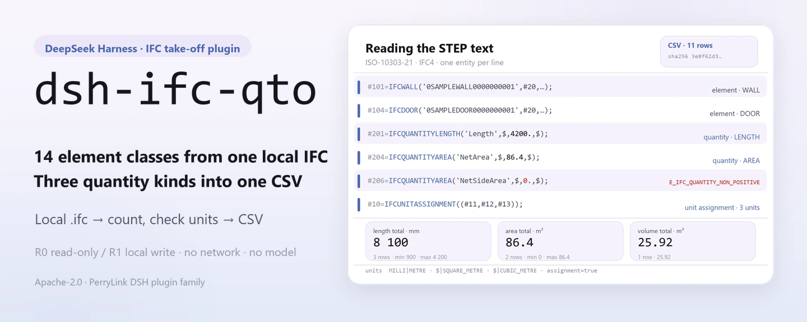
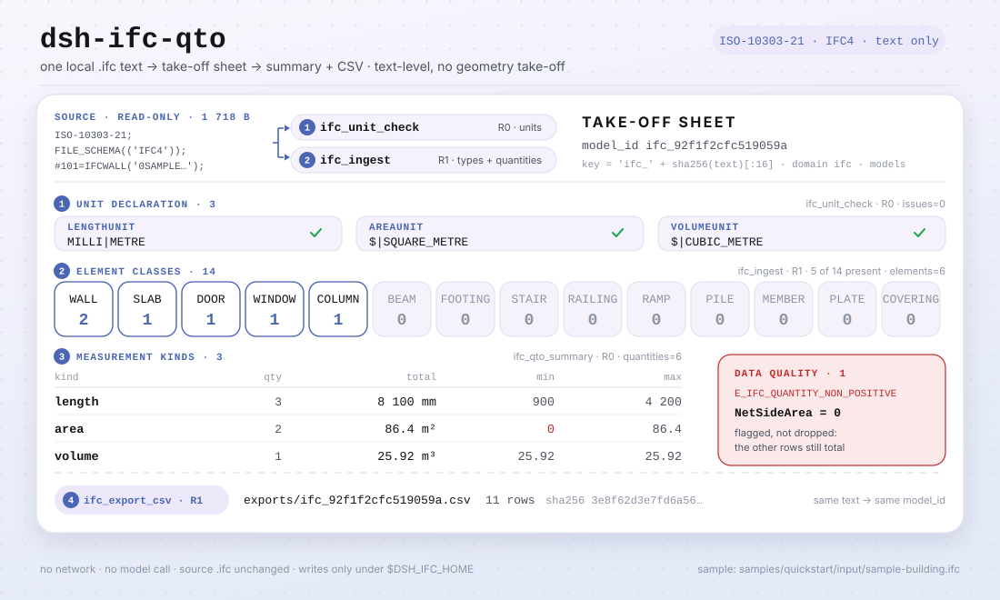

<div align="center">

<picture>
  <source media="(prefers-color-scheme: dark)" srcset="docs/assets/dsh-ifc-qto-hero-en-dark.webp">
  
</picture>

# dsh-ifc-qto

**स्थानीय IFC मॉडल को जाँचने योग्य एलिमेंट सूची और मात्रा CSV में बदलें — केवल टेक्स्ट, कोई नेटवर्क नहीं, कोई मॉडल कॉल नहीं।**

DeepSeek Harness के लिए स्थानीय टेकऑफ़ प्लगइन: ISO-10303-21 टेक्स्ट पढ़ता है, दीवार, स्लैब, दरवाज़े, खिड़कियाँ और अन्य एलिमेंट उनके `IfcQuantity` मानों के साथ गिनता है, माप प्रकार के अनुसार सारांश बनाता है और CSV निर्यात करता है; स्रोत फ़ाइल नहीं बदलती और कुछ भी आपकी मशीन से बाहर नहीं जाता।

[इंस्टॉल](#तीन-चरणों-में-शुरुआत) · [कॉन्फ़िगरेशन](#कॉन्फ़िगरेशन) · [FAQ](#faq) · [简体中文](README.md) · [English](README.en.md) · [Español](README.es.md) · [Português](README.pt.md) · [हिन्दी](README.hi.md)

[](LICENSE)
[](#अनुकूलता)
[](https://www.npmjs.com/package/dsh-ifc-qto)
[](https://github.com/PerryLink/dsh-ifc-qto/actions/workflows/ci.yml)
[](#अनुकूलता)

[](https://github.com/PerryLink/dsh-ifc-qto/stargazers)
[](https://www.npmjs.com/package/dsh-ifc-qto)
[](https://dshfind.com/plugins/PerryLink/dsh-ifc-qto?ref=badge)
[](https://dsh.market/)

```sh
dsh plugin --profile <profile> add dsh-ifc-qto
```

</div>

<sub>समुदाय प्लगइन, DeepSeek से संबद्ध नहीं। एकमात्र रेपो: <https://github.com/PerryLink/dsh-ifc-qto>. alpha / सार्वजनिक या सिंथेटिक डेटा / आंशिक / गिना नहीं गया / GA नहीं; कोई ग्राहक साक्ष्य या ग्राहक डेटा नहीं, उत्पादन-तैयारी का दावा नहीं।</sub>

## यह क्या है

`dsh-ifc-qto` DeepSeek Harness के भीतर पूरी तरह स्थानीय टेकऑफ़ पाइपलाइन चलाता है: स्थानीय `.ifc` टेक्स्ट (ISO-10303-21, IFC4) पढ़ता है, दीवार, स्लैब, दरवाज़े, खिड़कियाँ, कॉलम, बीम, फ़ुटिंग, सीढ़ियाँ और अन्य एलिमेंट गिनता है, फ़ाइल की `IfcQuantityLength` / `IfcQuantityArea` / `IfcQuantityVolume` एंटिटी निकालता है, माप प्रकार के अनुसार सारांश (संख्या, कुल, न्यूनतम/अधिकतम) बनाता है, शून्य या ऋणात्मक मात्राओं को डेटा-गुणवत्ता समस्या के रूप में चिह्नित करता है और जाँचने योग्य CSV निर्यात करता है। यह केवल टेक्स्ट-स्तर पर काम करता है — कोई ज्यामितीय टेकऑफ़ नहीं — और कभी नेटवर्क या मॉडल कॉल नहीं करता; आपकी दी गई `.ifc` केवल पढ़ी जाती है।

- **उपयुक्त**: निविदा या मात्रा-प्रमाणन से पहले त्वरित जाँच — मॉडल में कितनी दीवारें, स्लैब और खुलाई हैं, क्षेत्रफल व आयतन का कुल कितना है; किसी प्राप्त `.ifc` में क्या है, यह पहली नज़र में देखना।
- **उपयुक्त नहीं**: ज्यामितीय पुनर्मापन या ड्रॉइंग से मद-दर-मद मिलान; RVT/DWG जैसे गैर-IFC प्रारूप; स्कैन या स्क्रीनशॉट।

**इनपुट**: स्थानीय `.ifc` टेक्स्ट (ISO-10303-21, IFC4), UTF-8, प्रति फ़ाइल ≤50 MB अनुशंसित, डिज़ाइन ऑफ़िस या मॉडल लेखक द्वारा निर्यात। साथ दिया नमूना: `samples/quickstart/input/sample-building.ifc` (1.7 KB, सिंथेटिक: काल्पनिक प्रोजेक्ट और एलिमेंट आईडी, कोई ग्राहक मॉडल नहीं)।

**आउटपुट**: एलिमेंट सूची (प्रकार, संख्या, नाम), मात्रा सारांश (लंबाई, क्षेत्रफल और आयतन के लिए संख्या/कुल/न्यूनतम/अधिकतम), डेटा-गुणवत्ता संकेत, और `$DSH_HOME/storages/dsh-ifc-qto/exports/` में CSV। **स्रोत फ़ाइल नहीं बदलती और कुछ अपलोड नहीं होता।**

<picture>
  <source media="(prefers-color-scheme: dark)" srcset="docs/assets/dsh-ifc-qto-flow-v5-dark.svg">
  
</picture>

## तीन चरणों में शुरुआत

1. **इंस्टॉल** (चार चैनल; npm अनुशंसित):

   ```sh
   # npm चैनल (अनुशंसित; 0.2.0 प्रकाशित)
   dsh plugin --profile <profile> add dsh-ifc-qto
   # git चैनल (main का अनुसरण; lib/ बिल्ड आर्टिफ़ैक्ट है — checkout में पहले pnpm install && pnpm build चलाएँ)
   dsh plugin --profile <profile> add github:PerryLink/dsh-ifc-qto
   # tarball चैनल: इस रेपो में pnpm install && pnpm build && pnpm pack के बाद
   dsh plugin --profile <profile> add ./dsh-ifc-qto-<version>.tgz
   # 1024 स्टोर चैनल
   npm i -g dsh1024
   dsh1024 plugin --profile <profile> add dsh-ifc-qto
   ```

2. **न्यूनतम कॉन्फ़िगरेशन** (प्लगइन-स्तर की कोई कॉन्फ़िग कुंजी नहीं): `cordis.patch.yml` केवल एक पंक्ति जोड़ता है। डेटा रूट डिफ़ॉल्ट रूप से `$DSH_HOME/storages/dsh-ifc-qto` है; बदलने के लिए `DSH_IFC_HOME` सेट करें (देखें «कॉन्फ़िगरेशन»)। होस्ट प्रोफ़ाइल में `tools` और `storageDomain` दोनों सेवाएँ होनी चाहिए।

   ```yaml
   - insert:
       - id: dsh-ifc-qto
         name: dsh-ifc-qto
   ```

3. **जाँचें कि माउंट हुआ**:

   ```sh
   dsh --profile <profile> --dump-config | grep dsh-ifc-qto
   pnpm install --frozen-lockfile && pnpm build
   node samples/quickstart/run.mjs
   ```

   साथ दिया quickstart `samples/quickstart/input/sample-building.ifc` को `ifc_unit_check → ifc_ingest → ifc_qto_summary → ifc_export_csv` से चलाता है और अंत में यह दिखना चाहिए:

   ```text
   ifc_unit_check   assignment=true length=MILLI|METRE area=$|SQUARE_METRE volume=$|CUBIC_METRE issues=0
   ifc_ingest       elements=6 quantities=6 types=WALL:2 SLAB:1 DOOR:1 WINDOW:1 COLUMN:1
   ifc_qto_summary  length qty=3 total=8100 min=900 max=4200
                    area   qty=2 total=86.4 min=0 max=86.4
                    volume qty=1 total=25.92 min=25.92 max=25.92
   data quality     1 issue(s): E_IFC_QUANTITY_NON_POSITIVE NetSideArea=0
   ifc_export_csv   11 rows -> exports/ifc_92f1f2cfc519059a.csv (sha256 3e8f62d3e7fd6a56…)
   ok: quickstart finished (4 tool calls, 1 data-quality issue)
   ```

   सेशन में सीधे यही प्रवाह भी माँग सकते हैं; `package.json` का डेमो प्रॉम्प्ट चीनी में है:

   ```text
   帮我从自带样例的模型里提取构件和工程量，看看单位声明全不全，再按类别汇总并导出一份 CSV。
   ```

**अनइंस्टॉल**: `dsh plugin --profile <profile> remove dsh-ifc-qto` (या प्रोफ़ाइल पैच से वह पंक्ति हटा दें)।

## मुख्य क्षमताएँ

- **टेक्स्ट-स्तरीय एलिमेंट सूची** — `ifc_ingest` `ISO-10303-21` / `FILE_SCHEMA` जाँचता है, फिर 14 एलिमेंट एंटिटी (`IFCWALL`, `IFCSLAB`, `IFCDOOR`, `IFCWINDOW`, `IFCCOLUMN`, `IFCBEAM`, `IFCFOOTING`, `IFCSTAIR`, `IFCRAILING`, `IFCRAMP`, `IFCPILE`, `IFCMEMBER`, `IFCPLATE`, `IFCCOVERING`) पर चलता है, GUID और नाम लेता है और प्रकार के अनुसार गिनता है।
- **मात्रा निष्कर्षण** — उसी प्रक्रिया में `IfcQuantityLength` / `IfcQuantityArea` / `IfcQuantityVolume` के नाम और मान (आर्ग्युमेंट सूची का अंतिम संख्या, अतिरिक्त `$` सहन करते हुए) निकाले जाते हैं।
- **इकाई घोषणा जाँच** — `ifc_unit_check` `IfcUnitAssignment` और लंबाई/क्षेत्रफल/आयतन के `IfcSIUnit` खोजता है, `assignment`, `prefix|unit` और `E_IFC_*UNIT*_MISSING` समस्याओं की सूची देता है; इकाइयों के बिना संख्याएँ मात्रा-प्रमाणन के लिए उपयोगी नहीं।
- **सारांश और डेटा गुणवत्ता** — `ifc_qto_summary` हर माप प्रकार के लिए संख्या, कुल, न्यूनतम/अधिकतम और एलिमेंट-प्रकार वितरण देता है, तथा शून्य या ऋणात्मक मात्राओं को `E_IFC_QUANTITY_NON_POSITIVE` के रूप में चिह्नित करता है; एक खराब मान बाकी सारांश नहीं रोकता।
- **CSV निर्यात** — `ifc_export_csv` प्रकार-गणना और मात्रा पंक्तियों को `exports/ifc_<sha16>.csv` में लिखता है और पंक्ति-संख्या तथा CSV का SHA-256 देता है; वही टेक्स्ट दोबारा आयात करने पर वही `model_id` और वही फ़ाइल नाम मिलता है।
- **केवल-पढ़ने वाला इनपुट** — आपकी दी गई `.ifc` केवल पढ़ी जाती है; लेखन केवल `$DSH_IFC_HOME` (डिफ़ॉल्ट `$DSH_HOME/storages/dsh-ifc-qto`) और `ifc` स्टोरेज डोमेन की `models` तालिका में होता है।
- **पूरी तरह स्थानीय** — सोर्स में कोई `fetch` / HTTP / DNS / WebSocket कॉल नहीं, और `package.json` का डेमो मेटाडेटा `network: false` घोषित करता है; इनपुट और आउटपुट मशीन से बाहर नहीं जाते।

### टूल सतह

टूल नाम स्थिर API हैं (रनटाइम आउटपुट से मेल खाते हैं, अंग्रेज़ी में रखे गए); विवरण स्थानीयकृत हैं। सभी नाम `^[a-zA-Z0-9_-]+$` से मेल खाते हैं (अंडरस्कोर, बिना बिंदु): प्रोवाइडर बिंदु वाले `tools[].name` को अस्वीकार करता है। फ़ाइल लिखने वाले टूल **R1 (स्थानीय लेखन)** और केवल-पढ़ने वाले **R0** चिह्नित हैं।

| टूल | उद्देश्य | जोखिम |
|---|---|---|
| `ifc_ingest` | IFC टेक्स्ट पार्स करें, 14 एलिमेंट प्रकार और मात्रा एंटिटी की सूची बनाएँ, मॉडल सहेजें और `model_id` लौटाएँ | R1 स्थानीय लेखन |
| `ifc_export_csv` | प्रकार-गणना और मात्रा पंक्तियाँ CSV में निर्यात करें; पथ, पंक्तियाँ और हैश लौटाएँ | R1 स्थानीय लेखन |
| `ifc_qto_summary` | माप प्रकार के अनुसार सारांश (संख्या/कुल/न्यूनतम/अधिकतम) और गैर-धनात्मक समस्याएँ | R0 केवल पढ़ना |
| `ifc_unit_check` | जाँचें कि मॉडल में लंबाई/क्षेत्रफल/आयतन की SI इकाइयाँ घोषित हैं | R0 केवल पढ़ना |

`ifc_export_csv` और `ifc_qto_summary` केवल `ifc_ingest` से मिला और `models` तालिका में सहेजा `model_id` स्वीकार करते हैं; फ़ाइल पथ नहीं।

### उदाहरण

ये प्लगइन के वास्तविक प्रवेश-बिंदु हैं; साथ दिया सिंथेटिक नमूना सब कुछ दोहराता है।

**विस्तृत उदाहरण** — `node samples/quickstart/run.mjs` (4 टूल कॉल, 1 डेटा-गुणवत्ता समस्या):

```text
ifc_unit_check   assignment=true length=MILLI|METRE area=$|SQUARE_METRE volume=$|CUBIC_METRE issues=0
ifc_ingest       elements=6 quantities=6 types=WALL:2 SLAB:1 DOOR:1 WINDOW:1 COLUMN:1
ifc_qto_summary  length qty=3 total=8100 min=900 max=4200
                 area   qty=2 total=86.4 min=0 max=86.4
                 volume qty=1 total=25.92 min=25.92 max=25.92
data quality     1 issue(s): E_IFC_QUANTITY_NON_POSITIVE NetSideArea=0
ifc_export_csv   11 rows -> exports/ifc_92f1f2cfc519059a.csv (sha256 3e8f62d3e7fd6a56…)
```

*Observed from `samples/quickstart/expected/console.txt` (`samples/quickstart/expected/result.json` से मेल खाता है)।*

**विफलता शाखा** — न मौजूद `model_id` के साथ `ifc_export_csv`:

```text
找不到这个模型（E_IFC_UNREADABLE）｜下一步：先用 ifc_ingest 导入模型拿到 model_id，再导出 CSV
```

*Observed from `src/plugin/tools.ts:5`; बाकी कोड [`TROUBLESHOOTING.md`](TROUBLESHOOTING.md) में हैं।*

## मापा गया डेटा


*ऊपर की कैप्चर साथ दिए सिंथेटिक नमूने पर `node samples/quickstart/run.mjs` का वास्तविक रन है (2026-11-02), `samples/quickstart/expected/console.txt` से पंक्ति-दर-पंक्ति मेल खाता है; नमूने में केवल काल्पनिक प्रोजेक्ट और एलिमेंट आईडी हैं, कोई ग्राहक मॉडल नहीं।*

सार्वजनिक/सिंथेटिक स्वीकृति `scripts/acceptance.mjs` से दोहराई जाती है और विवरण `ACCEPTANCE.csv` में रहता है। नीचे सभी 8 पंक्तियाँ हैं, जैसी की तैसी (पूरी फ़ाइल में `script` और `evidence_sha256` भी हैं):

```csv
req_id,metric,threshold,actual,pass,source,counted
SKU-07-A01,IFC 构件（20）,20,20,true,public/synthetic,false
SKU-07-A02,类型数,5,5,true,public/synthetic,false
SKU-07-A03,量实体,3,3,true,public/synthetic,false
SKU-07-A04,CSV 行,>=8,8,true,public/synthetic,false
SKU-07-A05,公开 IFC 量实体,>=5,36,true,public/synthetic,false
SKU-07-A06,QTO 汇总/数据质量,1,3,true,public/synthetic,false
SKU-07-A07,IFC 单位声明检查,>=1,3,true,public/synthetic,false
PS1-QS01,quickstart 样例与金标一致,1/1,1,true,synthetic/quickstart,true
```

SKU-07 पंक्तियाँ सार्वजनिक/सिंथेटिक fixture जाँचें हैं (`counted=false`); केवल `PS1-QS01` साथ दिए नमूने का स्थानीय पुनरुत्पादन है (`counted=true`)। quickstart मॉडल में 6 एलिमेंट और 6 मात्राएँ हैं: 3 लंबाई मान जिनका कुल 8100, 2 क्षेत्रफल मान जिनका कुल 86.4, 1 आयतन मान 25.92, और 11 पंक्तियों वाला CSV। यह किसी ग्राहक का रन नहीं है और कोई आउटपुट नहीं गढ़ा गया।

**fixture-आधारित स्वीकृति**: सार्वजनिक MIT नमूना `fixtures/public/mit/3walls.ifc` को `test/public-ifc.test.mjs` (`pnpm test` से) पार्स करता है, जबकि स्वीकृति पंक्ति `SKU-07-A01` (IFC एलिमेंट 20, 20/20) `scripts/acceptance.mjs` के सिंथेटिक IFC से आती है। दोनों सार्वजनिक/सिंथेटिक fixture हैं, ग्राहक रन नहीं। सभी सार्वजनिक नमूने `fixtures/` में हैं (`SOURCE.md` और अपस्ट्रीम लाइसेंस सहित), और `ACCEPTANCE.csv` की हर SKU पंक्ति `counted=false` है।

## कॉन्फ़िगरेशन

इस प्लगइन में कोई Schemastery `Config` फ़ील्ड नहीं: `cordis.patch.yml` केवल एक पंक्ति जोड़ता है, और समायोज्य चीज़ें पर्यावरण चर तथा टूल आर्ग्युमेंट हैं।

| समायोज्य | डिफ़ॉल्ट | अर्थ |
|---|---|---|
| `DSH_IFC_HOME` | सेट नहीं | डेटा रूट; सेट न हो तो `$DSH_HOME/storages/dsh-ifc-qto`, और `DSH_HOME` भी न हो तो होस्ट प्रोसेस के cwd के नीचे `storages/dsh-ifc-qto` |
| `DSH_HOME` | सेट नहीं | होस्ट home; डिफ़ॉल्ट डेटा रूट तय करता है |
| निर्यात निर्देशिका | `<डेटा रूट>/exports` | CSV का गंतव्य; फ़ाइल नाम निश्चित, `ifc_<sha256 के पहले 16 अक्षर>.csv` |

मॉडल रिकॉर्ड प्लगइन के अपने `ifc` स्टोरेज डोमेन (संस्करण 1) की `models` तालिका में रहते हैं; हर `ifc_ingest` एक रिकॉर्ड लिखता है और `model_id` ही `ifc_<sha256 के पहले 16 अक्षर>` है।

<details>
<summary>टूल आर्ग्युमेंट</summary>

| आर्ग्युमेंट | डिफ़ॉल्ट | किस पर लागू | अर्थ |
|---|---|---|---|
| `ifc_text` | अनिवार्य | `ifc_ingest` / `ifc_unit_check` | IFC टेक्स्ट स्वयं (ISO-10303-21) |
| `source_name` | `inline.ifc` | `ifc_ingest` | रिकॉर्ड में सहेजा स्रोत लेबल; केवल पहचान |
| `model_id` | अनिवार्य | `ifc_export_csv` / `ifc_qto_summary` | `ifc_ingest` का लौटाया id |

</details>

<details>
<summary>त्रुटि प्रारूप और सामान्य कोड</summary>

हर विफलता «एक स्पष्ट वाक्य (`E_IFC_*`) | अगला: एक क्रिया» के रूप में है; चरण-दर-चरण निदान [`TROUBLESHOOTING.md`](TROUBLESHOOTING.md) में।

| कोड | अर्थ |
|---|---|
| `E_IFC_UNREADABLE` | IFC टेक्स्ट नहीं; या गिनने योग्य एलिमेंट/मात्रा नहीं; या `model_id` मौजूद नहीं |
| `E_IFC_EMPTY` | फ़ाइल खाली है (0 बाइट या केवल रिक्त स्थान) |
| `E_IFC_EXPORT_FAILED` | CSV नहीं लिखा जा सका (अनुमतियाँ, केवल-पढ़ने माउंट, डिस्क भरा) |
| `E_IFC_QUANTITY_NON_POSITIVE` | कोई मात्रा शून्य या ऋणात्मक है (गुणवत्ता संकेत; बाकी सारांश नहीं रोकता) |
| `E_IFC_UNITASSIGNMENT_MISSING` | मॉडल में `IfcUnitAssignment` नहीं |
| `E_IFC_LENGTHUNIT_MISSING` / `E_IFC_AREAUNIT_MISSING` / `E_IFC_VOLUMEUNIT_MISSING` | संबंधित माप प्रकार की `IfcSIUnit` घोषणा नहीं |

</details>

प्रोफ़ाइल पैच में ओवरराइड उदाहरण:

```yaml
- insert:
    - id: dsh-ifc-qto
      name: dsh-ifc-qto
```

डेटा रूट बदलना:

```sh
export DSH_IFC_HOME=/path/to/ifc-data   # Windows PowerShell: $env:DSH_IFC_HOME = 'D:\ifc-data'
```

## FAQ

<details>
<summary>डेटा कहाँ रहता है? मेरी स्रोत फ़ाइल बदलती है क्या?</summary>

मॉडल रिकॉर्ड `ifc` स्टोरेज डोमेन की `models` तालिका में जाते हैं (डिफ़ॉल्ट रूट `$DSH_HOME/storages/dsh-ifc-qto`, `DSH_IFC_HOME` से बदलें), और CSV `<डेटा रूट>/exports/` में। आपकी दी गई `.ifc` केवल पढ़ी जाती है और टूल उसे कभी नहीं लिखते; कोई अपलोड नहीं, कोई टेलीमेट्री नहीं।

</details>

<details>
<summary>क्या मेरा वास्तविक मॉडल चलेगा? ज्यामिति निकालता है क्या?</summary>

मानक `.ifc` (ISO-10303-21) टेक्स्ट पढ़ता है, पर केवल टेक्स्ट-स्तरीय टेकऑफ़ करता है: एलिमेंट गिनना, फ़ाइल में पहले से मौजूद `IfcQuantity*` और इकाई घोषणा। 3D ज्यामितीय टेकऑफ़ नहीं करता और क्षेत्रफल/आयतन स्वयं नहीं निकालता — मॉडल में `IfcQuantity` न हो तो कुछ नहीं गिना जाएगा। RVT/DWG/PDF और स्कैन समर्थित नहीं; पैकेज alpha है और केवल सार्वजनिक/सिंथेटिक डेटा पर सत्यापित है, इसलिए यह मात्रा-प्रमाणन या निपटान का आधार नहीं है। एक कॉल में एक IFC टेक्स्ट (कोई बैच नहीं), प्रति फ़ाइल ≤50 MB अनुशंसित; पार्सिंग पंक्ति-आधारित रेगुलर एक्सप्रेशन स्कैन है, कोई मॉडल कॉल या नेटवर्क राउंड-ट्रिप नहीं।

</details>

<details>
<summary>संख्याएँ मेल नहीं खातीं, या E_IFC_QUANTITY_NON_POSITIVE दिखता है — क्या करें?</summary>

पहले `ifc_unit_check` चलाकर देखें कि लंबाई/क्षेत्रफल/आयतन की इकाइयाँ घोषित हैं (इकाइयों के बिना संख्याएँ मात्रा-प्रमाणन के लिए उपयोगी नहीं), फिर `ifc_qto_summary` के `issues` देखें: शून्य या ऋणात्मक मात्रा प्रायः छूटे हुए या गलत निर्यात किए मान से आती है, मॉडल ठीक करके दोबारा निर्यात करें। यह केवल गुणवत्ता संकेत है और बाकी सारांश नहीं रोकता।

</details>

<details>
<summary>इंस्टॉल नहीं होता या सक्रिय नहीं होता — क्या जाँचें?</summary>

`node --version` (`>=24.9 <25`) और `dsh --version` (`>=0.2.1-rc.3 <0.4.0`) देखें, फिर `dsh --profile <profile> --dump-config | grep dsh-ifc-qto` से माउंट की पुष्टि करें। प्लगइन को होस्ट की दोनों सेवाएँ `tools` और `storageDomain` चाहिए; एक भी न हो तो यह लागू नहीं होगा। पूरे चरण [`TROUBLESHOOTING.md`](TROUBLESHOOTING.md) में हैं।

</details>

<details>
<summary>क्या यह दूसरे प्लगइन से कमांड, स्लॉट या स्टोरेज के लिए टकराता है? खर्च कितना?</summary>

नहीं। चारों टूल `ifc_*` नेमस्पेस में हैं; कोई कमांड, क्लाइंट स्लॉट, `webServer` रूट या सर्विस कुंजी पंजीकृत नहीं करता; अपने `ifc` v1 डोमेन की केवल एक `models` तालिका उपयोग करता है और दूसरे डोमेन नहीं छूता; प्रोटोटाइप नहीं बदलता, `process.env` नहीं लिखता और ग्लोबल fetch नहीं बदलता। बिंदु-दर-बिंदु तर्क «अन्य DSH प्लगइन के साथ अंतर-संचालनीयता» में है।

खर्च भी कम है: पार्सिंग पंक्ति-आधारित रेगुलर एक्सप्रेशन स्कैन है, कोई मॉडल कॉल नहीं और कोई नेटवर्क अनुरोध नहीं; सबसे भारी चरण टेक्स्ट पढ़ना और एक सारांश पास है।

</details>

## सुरक्षा सीमाएँ

- **कोई नेटवर्क नहीं, कोई मॉडल कॉल नहीं।** सोर्स में कोई `fetch` / HTTP / DNS / WebSocket कॉल नहीं, और `package.json` का डेमो मेटाडेटा `network: false` घोषित करता है। इनपुट और आउटपुट स्थानीय रहते हैं।
- **स्रोत फ़ाइल नहीं बदलती।** लेखन केवल `$DSH_IFC_HOME` (डिफ़ॉल्ट `$DSH_HOME/storages/dsh-ifc-qto`) के `exports/` और `ifc` स्टोरेज डोमेन की `models` तालिका में; पढ़ने की सतह कॉलर द्वारा दिया IFC टेक्स्ट है — प्लगइन कोई निर्देशिका नहीं घूमता और कोई दूसरी फ़ाइल नहीं खोलता।
- **सख्त पार्सिंग, ज़ोरदार विफलता।** ISO-10303-21 न हो, या गिनने योग्य एलिमेंट/मात्रा न हो तो `E_IFC_UNREADABLE`; खाली फ़ाइल पर `E_IFC_EMPTY`; कभी चुपचाप खाली सूची नहीं लौटाता।
- **पढ़ने योग्य त्रुटियाँ जो कुछ उजागर नहीं करतीं।** उपयोगकर्ता के लिए «एक स्पष्ट वाक्य + कोड + अगली क्रिया»; मूल मॉडल सामग्री कभी त्रुटि में नहीं दोहराई जाती।
- **स्वतंत्र स्टोरेज डोमेन।** केवल अपने `ifc` v1 डोमेन की एक `models` तालिका; डोमेन Cordis effect से बंद होता है, इसलिए रोकना/हॉट-रीलोड हटा देता है।
- **कोई क्रेडेंशियल नहीं, कोई बाहरी सिस्टम नहीं।** क्रेडेंशियल नहीं पढ़ता और ERP / BIM प्लेटफ़ॉर्म / क्लाउड सेवा से नहीं जुड़ता; कोई टेलीमेट्री या अपलोड नहीं।
- **केवल होस्ट फ़ेस।** कोई क्लाइंट बंडल, स्लॉट या UI पंजीकृत नहीं; सब कुछ टूल सतह से।

## अनुमतियाँ और डेटा

```text
पढ़ना: उपयोगकर्ता द्वारा बताई .ifc फ़ाइल; कोई अन्य निर्देशिका नहीं
लिखना: $DSH_HOME/storages/dsh-ifc-qto (मूल फ़ाइल संग्रहीत नहीं; केवल पार्स किए रिकॉर्ड और exports/*.csv); स्रोत फ़ाइल नहीं बदलती
नेटवर्क: नहीं
बाहरी सिस्टम: कोई नहीं
```

यह सोर्स से मेल खाता है: `apply()` लेखन निर्देशिका `DSH_IFC_HOME` (डिफ़ॉल्ट `$DSH_HOME/storages/dsh-ifc-qto`) से लेता है और कहीं कोई नेटवर्क कॉल नहीं। प्लगइन स्वयं कोई फ़ाइल पथ नहीं खोलता; `ifc_text` कॉलर देता है। लिखने वाले टूल (`ifc_ingest`, `ifc_export_csv`) **R1 स्थानीय लेखन** और केवल-पढ़ने वाले (`ifc_qto_summary`, `ifc_unit_check`) **R0** हैं।

## ज्ञात सीमाएँ

- **केवल सार्वजनिक/सिंथेटिक सत्यापन।** सभी स्वीकृति पंक्तियाँ सार्वजनिक या सिंथेटिक fixture से हैं (`ACCEPTANCE.csv` की SKU-07 पंक्तियों में `counted=false`; `PS1-QS01` साथ दिए नमूने का स्थानीय पुनरुत्पादन, `counted=true`); कोई ग्राहक डेटा या साक्ष्य नहीं।
- **alpha / आंशिक / गिना नहीं गया / GA नहीं।** उत्पादन-तैयारी का दावा नहीं, और यह मात्रा-प्रमाणन, निपटान या ऑडिट निष्कर्ष नहीं है।
- **टेक्स्ट-स्तर, ज्यामितीय नहीं।** एलिमेंट गिनता है और फ़ाइल में पहले से मौजूद `IfcQuantity*` पढ़ता है; 3D ज्यामितीय टेकऑफ़ नहीं, क्षेत्रफल/आयतन स्वयं नहीं निकालता, ड्रॉइंग से मिलान नहीं।
- **एलिमेंट प्रकार एक बंद सूची हैं।** केवल 14 गिने जाते हैं: `IFCWALL`, `IFCSLAB`, `IFCDOOR`, `IFCWINDOW`, `IFCCOLUMN`, `IFCBEAM`, `IFCFOOTING`, `IFCSTAIR`, `IFCRAILING`, `IFCRAMP`, `IFCPILE`, `IFCMEMBER`, `IFCPLATE`, `IFCCOVERING`; बाकी अनदेखा।
- **केवल IFC टेक्स्ट।** RVT, DWG, PDF, स्कैन और चित्र समर्थित नहीं; बाइनरी फ़ाइल या बदला हुआ एक्सटेंशन `E_IFC_UNREADABLE` देता है।
- **एक फ़ाइल, कोई बैच नहीं।** प्रति कॉल एक IFC टेक्स्ट, प्रति फ़ाइल ≤50 MB अनुशंसित; बैच के लिए लूप करें।
- **`model_id` पथ नहीं है।** `ifc_qto_summary` / `ifc_export_csv` केवल `ifc_ingest` से मिला और `models` में सहेजा id स्वीकार करते हैं; फ़ाइल पथ देने पर `E_IFC_UNREADABLE`।
- **स्टोरेज JSON KV है।** `ifc` v1 डोमेन में एक `models` तालिका है, कोई क्रॉस-टेबल ट्रांज़ैक्शन, विदेशी कुंजी या माइग्रेशन नहीं; वही टेक्स्ट दोबारा आयात करने पर वही रिकॉर्ड अधिलिखित होता है।
- **होस्ट सेवाएँ आवश्यक।** प्लगइन `tools` और `storageDomain` इंजेक्ट करता है; बिना storage वाली बेयर प्रोफ़ाइल में लागू नहीं होता।
- **संकीर्ण Node रेंज।** केवल `>=24.9.0 <25`; कोई ब्राउज़र हाफ़ नहीं और कोई UI नहीं।

## अन्य DSH प्लगइन के साथ अंतर-संचालनीयता

सोर्स (`src/plugin/index.ts`, `src/plugin/tools.ts`, `src/plugin/storage.ts`) के अनुसार जाँचा गया: कमांड, टूल, स्लॉट, HTTP रूट या स्टोरेज डोमेन के साथ कोई टकराव सतह नहीं:

- **नेमस्पेस वाले टूल नाम।** चारों टूल `ifc_` से शुरू होते हैं और किसी अंतर्निहित या दूसरे प्लगइन का खुला नाम नहीं लेते।
- **केवल उपभोग, कोई सेवा नहीं।** `inject` केवल `['tools', 'storageDomain']`; कोई कमांड, क्लाइंट स्लॉट, `webServer` प्रीफ़िक्स या सर्विस कुंजी नहीं।
- **स्वतंत्र स्टोरेज डोमेन।** अपने `ifc` v1 डोमेन की केवल एक `models` तालिका, दूसरे डोमेन नहीं।
- **कोई ग्लोबल बदलाव नहीं।** प्रोटोटाइप पैच नहीं, `process.env` नहीं, ग्लोबल fetch प्रतिस्थापित नहीं।
- **निर्यात बाहर नहीं।** CSV केवल अपने `exports/` में, नाम `model_id` से।
- **केवल-पढ़ने वाले टूल पुनः-प्रवेश्य।** `ifc_qto_summary` और `ifc_unit_check` कोई स्थिति नहीं लिखते और बार-बार सुरक्षित हैं।

## अनुकूलता

| सतह | स्थिति |
|---|---|
| Harness | `dsh >=0.2.1-rc.3 <0.4.0` (`package.json` का `engines.dsh`) |
| Node | `>=24.9.0 <25` (`.nvmrc`: 24) |
| होस्ट सेवाएँ | `tools` और `storageDomain` रचना आवश्यक (देखें `inject`, `src/plugin/index.ts`) |
| प्लेटफ़ॉर्म | जहाँ DSH चले; केवल स्थानीय फ़ाइलें, कोई ब्राउज़र हाफ़ नहीं |
| मॉडल | आवश्यक नहीं; कोई मॉडल कॉल नहीं |
| डेटा | कोई नेटवर्क नहीं, कोई मॉडल कॉल नहीं, कोई अपलोड नहीं; केवल `$DSH_HOME/storages/dsh-ifc-qto` लिखता है |
| रखरखाव | सक्रिय (2026-11-01 से; सुविधाएँ और सुदृढ़ीकरण alpha रिलीज़ में) |

## पारिस्थितिकी और गुणवत्ता

- [dshfind प्लगइन पृष्ठ](https://dshfind.com/plugins/PerryLink/dsh-ifc-qto) (इंस्टॉल और रैंकिंग)
- [DSH Market](https://dsh.market/) (सूचीबद्ध)
- [डोमेन सूचकांक](https://perrylink.github.io/dsh-plugins/) · [Checker परिवार](https://perrylink.github.io/zh/checkers/) · [मुख्य परिवार](https://github.com/PerryLink/dsh-kit)
- [Gitee समग्र मिरर](https://gitee.com/perrylink/dsh-plugins) (GitHub मानक है)
- **1024 स्टोर चैनल**: एक बार `npm i -g dsh1024`, फिर `dsh1024 plugin --profile <profile> add dsh-ifc-qto` ([deepseek1024.com](https://deepseek1024.com) की इंस्टॉल रैंकिंग में गिना जाता है)
- सहोदर पैकेज: [`dsh-docx-redline`](https://github.com/PerryLink/dsh-docx-redline), [`dsh-pim-lint`](https://github.com/PerryLink/dsh-pim-lint)
- संबंधित चेकर (हर एक अलग पैकेज, अपने नियम पैक और संस्करण के साथ; केवल आवश्यक इंस्टॉल करें):

| पैकेज | क्यों प्रासंगिक |
|---|---|
| [`dsh-construction-doc-check`](https://github.com/PerryLink/dsh-construction-doc-check) | निर्माण दस्तावेज़ निर्देशिका, संस्करण और खाली फ़ाइलें |
| [`dsh-pipeline-check`](https://github.com/PerryLink/dsh-pipeline-check) | परियोजना की पूरी प्रक्रिया की दस्तावेज़ श्रृंखला |
| [`dsh-site-log-check`](https://github.com/PerryLink/dsh-site-log-check) | पर्यवेक्षण लॉग की निरंतरता और साइट रिकॉर्ड कवरेज |

- दस्तावेज़: [`TROUBLESHOOTING.md`](TROUBLESHOOTING.md) · [`PRIVACY.md`](PRIVACY.md) · [`SECURITY.md`](SECURITY.md) · [`FIXTURES.md`](FIXTURES.md) · [`EVIDENCE.md`](EVIDENCE.md) · [`ACCEPTANCE.csv`](ACCEPTANCE.csv)

## विकास

```sh
pnpm install --frozen-lockfile
pnpm build && pnpm lint && pnpm typecheck && pnpm test   # 6 टेस्ट फ़ाइलें
pnpm gate:sku07                                          # स्वीकृति गेट (ACCEPTANCE.csv)
node scripts/acceptance.mjs                              # सार्वजनिक/सिंथेटिक स्वीकृति दोहराएँ
node samples/quickstart/run.mjs                          # सिंथेटिक नमूना: 4 टूल कॉल, 1 डेटा-गुणवत्ता समस्या
```

वर्तमान संस्करण `0.2.0`।

निर्देशिका संरचना:

| पथ | सामग्री |
|---|---|
| `src/core/` | `ifc.ts`: IFC टेक्स्ट पार्सिंग (एलिमेंट, मात्रा) और इकाई घोषणा जाँच |
| `src/plugin/` | `index.ts` (apply), `tools.ts` (4 टूल), `storage.ts` (स्टोरेज डोमेन `ifc` v1) |
| `test/` | `node --test` केस (ifc, plugin-smoke, public-ifc, qto-summary, tool-name-wire, units) |
| `scripts/` | यांत्रिक गेट: lint, acceptance, gate-sku07, check-pack, sbom, make-samples, और नया `gen-readme-assets.py` |
| `fixtures/public/mit/` | 4 सार्वजनिक MIT/Apache IFC नमूने (`SOURCE.md` और अपस्ट्रीम लाइसेंस सहित) |
| `samples/quickstart/` | सिंथेटिक भवन नमूना, `run.mjs` और गोल्डन `expected/console.txt` / `result.json` |
| `docs/assets/` | README चित्र |
| `evidence/` | स्वीकृति रन स्नैपशॉट (`result.json`) |

बैनर और संरचना आरेख [`scripts/gen-readme-assets.py`](scripts/gen-readme-assets.py) द्वारा प्रोग्रामेटिक रूप से बनते हैं (चार 1440x576 webp बैनर Pillow से, 1100x660 हल्का/गहरा आरेख हाथ से लिखे SVG से) और सुरक्षित रूप से दोबारा चलाए जा सकते हैं; पुराना एकल-संस्करण `docs/assets/dsh-ifc-qto-flow.svg` और पुराने `flow-{light,dark}.svg` बाहरी लिंक के 404 से बचने के लिए रखे गए हैं।

Topics: `deepseek-harness`, `dsh`, `dsh-plugin`, `ifc`, `qto`, `bim`, `perrylink`, `construction`

## परिवार और आभार

यह परियोजना [PerryLink](https://github.com/PerryLink) के DeepSeek Harness प्लगइन परिवार का हिस्सा है (सभी Apache-2.0)। अगर यह उपयोगी हो, **एक स्टार अगले व्यक्ति को इसे खोजने में मदद करता है**; इससे कोई सुविधा अनलॉक नहीं होती।

- [@PerryLink](https://github.com/PerryLink) — निर्माता और अनुरक्षक: IFC टेक्स्ट टेकऑफ़ और मात्रा निष्कर्षण, इकाई घोषणा जाँच, QTO सारांश और CSV निर्यात, quickstart और स्वीकृति सूट, तथा पाँच-भाषा दस्तावेज़।

<details>
<summary>DSH डोमेन प्लगइन परिवार खोलें (15 पैकेज + 2 सूट)</summary>

| Plugin | npm | स्थिति |
|---|---|---|
| **[dsh-einvoice](https://github.com/PerryLink/dsh-einvoice)** | [npm](https://www.npmjs.com/package/dsh-einvoice) |  |
| **[dsh-docx-redline](https://github.com/PerryLink/dsh-docx-redline)** | [npm](https://www.npmjs.com/package/dsh-docx-redline) |  |
| **[dsh-policy-ledger](https://github.com/PerryLink/dsh-policy-ledger)** | [npm](https://www.npmjs.com/package/dsh-policy-ledger) |  |
| **[dsh-ghg](https://github.com/PerryLink/dsh-ghg)** | [npm](https://www.npmjs.com/package/dsh-ghg) |  |
| **[dsh-bankrec](https://github.com/PerryLink/dsh-bankrec)** | [npm](https://www.npmjs.com/package/dsh-bankrec) |  |
| **[dsh-ap-three-way](https://github.com/PerryLink/dsh-ap-three-way)** | [npm](https://www.npmjs.com/package/dsh-ap-three-way) |  |
| **[dsh-ifc-qto](https://github.com/PerryLink/dsh-ifc-qto)** | [npm](https://www.npmjs.com/package/dsh-ifc-qto) |  |
| **[dsh-qms-capa](https://github.com/PerryLink/dsh-qms-capa)** | [npm](https://www.npmjs.com/package/dsh-qms-capa) |  |
| **[dsh-legal-intake](https://github.com/PerryLink/dsh-legal-intake)** | [npm](https://www.npmjs.com/package/dsh-legal-intake) |  |
| **[dsh-legal-clause](https://github.com/PerryLink/dsh-legal-clause)** | [npm](https://www.npmjs.com/package/dsh-legal-clause) |  |
| **[dsh-freight-audit](https://github.com/PerryLink/dsh-freight-audit)** | [npm](https://www.npmjs.com/package/dsh-freight-audit) |  |
| **[dsh-hs-candidate](https://github.com/PerryLink/dsh-hs-candidate)** | [npm](https://www.npmjs.com/package/dsh-hs-candidate) |  |
| **[dsh-travel-recon](https://github.com/PerryLink/dsh-travel-recon)** | [npm](https://www.npmjs.com/package/dsh-travel-recon) |  |
| **[dsh-pim-lint](https://github.com/PerryLink/dsh-pim-lint)** | [npm](https://www.npmjs.com/package/dsh-pim-lint) |  |
| **[dsh-eval-pack](https://github.com/PerryLink/dsh-eval-pack)** | [npm](https://www.npmjs.com/package/dsh-eval-pack) |  |
| **[dsh-finops-suite](https://github.com/PerryLink/dsh-finops-suite)** | [npm](https://www.npmjs.com/package/dsh-finops-suite) |  |
| **[dsh-contract-suite](https://github.com/PerryLink/dsh-contract-suite)** | [npm](https://www.npmjs.com/package/dsh-contract-suite) |  |

</details>

<details>
<summary>मुख्य परिवार खोलें (87 वर्तमान इंस्टॉल स्पेक)</summary>

| Plugin | npm | स्थिति |
|---|---|---|
| **[dsh-aqua-input-check](https://github.com/PerryLink/dsh-aqua-input-check)** | [npm](https://www.npmjs.com/package/dsh-aqua-input-check) |  |
| **[dsh-archive-check](https://github.com/PerryLink/dsh-archive-check)** | [npm](https://www.npmjs.com/package/dsh-archive-check) |  |
| **[dsh-bid-ca-precheck](https://github.com/PerryLink/dsh-bid-ca-precheck)** | [npm](https://www.npmjs.com/package/dsh-bid-ca-precheck) |  |
| **[dsh-bid-qual-check](https://github.com/PerryLink/dsh-bid-qual-check)** | [npm](https://www.npmjs.com/package/dsh-bid-qual-check) |  |
| **[dsh-contract-stance](https://github.com/PerryLink/dsh-contract-stance)** | [npm](https://www.npmjs.com/package/dsh-contract-stance) |  |
| **[dsh-customs-doc-check](https://github.com/PerryLink/dsh-customs-doc-check)** | [npm](https://www.npmjs.com/package/dsh-customs-doc-check) |  |
| **[dsh-demurrage-ledger](https://github.com/PerryLink/dsh-demurrage-ledger)** | [npm](https://www.npmjs.com/package/dsh-demurrage-ledger) |  |
| **[dsh-drill-script-check](https://github.com/PerryLink/dsh-drill-script-check)** | [npm](https://www.npmjs.com/package/dsh-drill-script-check) |  |
| **[dsh-eia-guide-check](https://github.com/PerryLink/dsh-eia-guide-check)** | [npm](https://www.npmjs.com/package/dsh-eia-guide-check) |  |
| **[dsh-emergency-plan](https://github.com/PerryLink/dsh-emergency-plan)** | [npm](https://www.npmjs.com/package/dsh-emergency-plan) |  |
| **[dsh-essay-rubric-check](https://github.com/PerryLink/dsh-essay-rubric-check)** | [npm](https://www.npmjs.com/package/dsh-essay-rubric-check) |  |
| **[dsh-evidence-check](https://github.com/PerryLink/dsh-evidence-check)** | [npm](https://www.npmjs.com/package/dsh-evidence-check) |  |
| **[dsh-export-ctl-check](https://github.com/PerryLink/dsh-export-ctl-check)** | [npm](https://www.npmjs.com/package/dsh-export-ctl-check) |  |
| **[dsh-fmea-table-check](https://github.com/PerryLink/dsh-fmea-table-check)** | [npm](https://www.npmjs.com/package/dsh-fmea-table-check) |  |
| **[dsh-forecast-penalty](https://github.com/PerryLink/dsh-forecast-penalty)** | [npm](https://www.npmjs.com/package/dsh-forecast-penalty) |  |
| **[dsh-gongwen-flow-check](https://github.com/PerryLink/dsh-gongwen-flow-check)** | [npm](https://www.npmjs.com/package/dsh-gongwen-flow-check) |  |
| **[dsh-gongwen-word-check](https://github.com/PerryLink/dsh-gongwen-word-check)** | [npm](https://www.npmjs.com/package/dsh-gongwen-word-check) |  |
| **[dsh-guard-plan-qc](https://github.com/PerryLink/dsh-guard-plan-qc)** | [npm](https://www.npmjs.com/package/dsh-guard-plan-qc) |  |
| **[dsh-hazchem-check](https://github.com/PerryLink/dsh-hazchem-check)** | [npm](https://www.npmjs.com/package/dsh-hazchem-check) |  |
| **[dsh-hazplan-check](https://github.com/PerryLink/dsh-hazplan-check)** | [npm](https://www.npmjs.com/package/dsh-hazplan-check) |  |
| **[dsh-hidden-risk-map](https://github.com/PerryLink/dsh-hidden-risk-map)** | [npm](https://www.npmjs.com/package/dsh-hidden-risk-map) |  |
| **[dsh-hs-classify](https://github.com/PerryLink/dsh-hs-classify)** | [npm](https://www.npmjs.com/package/dsh-hs-classify) |  |
| **[dsh-icd-rule-check](https://github.com/PerryLink/dsh-icd-rule-check)** | [npm](https://www.npmjs.com/package/dsh-icd-rule-check) |  |
| **[dsh-lawcite-adapter](https://github.com/PerryLink/dsh-lawcite-adapter)** | [npm](https://www.npmjs.com/package/dsh-lawcite-adapter) |  |
| **[dsh-lc-doc-check](https://github.com/PerryLink/dsh-lc-doc-check)** | [npm](https://www.npmjs.com/package/dsh-lc-doc-check) |  |
| **[dsh-learning-gap-check](https://github.com/PerryLink/dsh-learning-gap-check)** | [npm](https://www.npmjs.com/package/dsh-learning-gap-check) |  |
| **[dsh-medrec-qc](https://github.com/PerryLink/dsh-medrec-qc)** | [npm](https://www.npmjs.com/package/dsh-medrec-qc) |  |
| **[dsh-nsfc-form-check](https://github.com/PerryLink/dsh-nsfc-form-check)** | [npm](https://www.npmjs.com/package/dsh-nsfc-form-check) |  |
| **[dsh-nurse-record-check](https://github.com/PerryLink/dsh-nurse-record-check)** | [npm](https://www.npmjs.com/package/dsh-nurse-record-check) |  |
| **[dsh-origin-rvc-check](https://github.com/PerryLink/dsh-origin-rvc-check)** | [npm](https://www.npmjs.com/package/dsh-origin-rvc-check) |  |
| **[dsh-ota-review-check](https://github.com/PerryLink/dsh-ota-review-check)** | [npm](https://www.npmjs.com/package/dsh-ota-review-check) |  |
| **[dsh-paper-doc-adapter](https://github.com/PerryLink/dsh-paper-doc-adapter)** | [npm](https://www.npmjs.com/package/dsh-paper-doc-adapter) |  |
| **[dsh-permit-report-check](https://github.com/PerryLink/dsh-permit-report-check)** | [npm](https://www.npmjs.com/package/dsh-permit-report-check) |  |
| **[dsh-pipeline-check](https://github.com/PerryLink/dsh-pipeline-check)** | [npm](https://www.npmjs.com/package/dsh-pipeline-check) |  |
| **[dsh-pleading-draft](https://github.com/PerryLink/dsh-pleading-draft)** | [npm](https://www.npmjs.com/package/dsh-pleading-draft) |  |
| **[dsh-policy-brief-draft](https://github.com/PerryLink/dsh-policy-brief-draft)** | [npm](https://www.npmjs.com/package/dsh-policy-brief-draft) |  |
| **[dsh-power-loss-split](https://github.com/PerryLink/dsh-power-loss-split)** | [npm](https://www.npmjs.com/package/dsh-power-loss-split) |  |
| **[dsh-power-ticket-check](https://github.com/PerryLink/dsh-power-ticket-check)** | [npm](https://www.npmjs.com/package/dsh-power-ticket-check) |  |
| **[dsh-ppap-check](https://github.com/PerryLink/dsh-ppap-check)** | [npm](https://www.npmjs.com/package/dsh-ppap-check) |  |
| **[dsh-protest-deadline](https://github.com/PerryLink/dsh-protest-deadline)** | [npm](https://www.npmjs.com/package/dsh-protest-deadline) |  |
| **[dsh-railway-window](https://github.com/PerryLink/dsh-railway-window)** | [npm](https://www.npmjs.com/package/dsh-railway-window) |  |
| **[dsh-repair-order-qc](https://github.com/PerryLink/dsh-repair-order-qc)** | [npm](https://www.npmjs.com/package/dsh-repair-order-qc) |  |
| **[dsh-review-reply-check](https://github.com/PerryLink/dsh-review-reply-check)** | [npm](https://www.npmjs.com/package/dsh-review-reply-check) |  |
| **[dsh-rulefile-check](https://github.com/PerryLink/dsh-rulefile-check)** | [npm](https://www.npmjs.com/package/dsh-rulefile-check) |  |
| **[dsh-safety-brief-check](https://github.com/PerryLink/dsh-safety-brief-check)** | [npm](https://www.npmjs.com/package/dsh-safety-brief-check) |  |
| **[dsh-site-log-check](https://github.com/PerryLink/dsh-site-log-check)** | [npm](https://www.npmjs.com/package/dsh-site-log-check) |  |
| **[dsh-soe-decision-check](https://github.com/PerryLink/dsh-soe-decision-check)** | [npm](https://www.npmjs.com/package/dsh-soe-decision-check) |  |
| **[dsh-soilwater-check](https://github.com/PerryLink/dsh-soilwater-check)** | [npm](https://www.npmjs.com/package/dsh-soilwater-check) |  |
| **[dsh-sop-sync-check](https://github.com/PerryLink/dsh-sop-sync-check)** | [npm](https://www.npmjs.com/package/dsh-sop-sync-check) |  |
| **[dsh-spc-gbt-adapter](https://github.com/PerryLink/dsh-spc-gbt-adapter)** | [npm](https://www.npmjs.com/package/dsh-spc-gbt-adapter) |  |
| **[dsh-tender-extract](https://github.com/PerryLink/dsh-tender-extract)** | [npm](https://www.npmjs.com/package/dsh-tender-extract) |  |
| **[dsh-tender-matrix](https://github.com/PerryLink/dsh-tender-matrix)** | [npm](https://www.npmjs.com/package/dsh-tender-matrix) |  |
| **[dsh-warranty-calc](https://github.com/PerryLink/dsh-warranty-calc)** | [npm](https://www.npmjs.com/package/dsh-warranty-calc) |  |
| **[dsh-auto-review](https://github.com/PerryLink/dsh-auto-review)** | [npm](https://www.npmjs.com/package/dsh-auto-review) |  |
| **[dsh-autotier](https://github.com/PerryLink/dsh-autotier)** | [npm](https://www.npmjs.com/package/dsh-autotier) | 🧊 फ़्रोज़न — रेपो README देखें |
| **[dsh-budget](https://github.com/PerryLink/dsh-budget)** | [npm](https://www.npmjs.com/package/dsh-budget) |  |
| **[dsh-cert-mcp](https://github.com/PerryLink/dsh-cert-mcp)** | [npm](https://www.npmjs.com/package/dsh-cert-mcp) | 🧊 फ़्रोज़न — रेपो README देखें |
| **[dsh-checkpoint-rewind](https://github.com/PerryLink/dsh-checkpoint-rewind)** | [npm](https://www.npmjs.com/package/dsh-checkpoint-rewind) |  |
| **[dsh-claude-move](https://github.com/PerryLink/dsh-claude-move)** | [npm](https://www.npmjs.com/package/dsh-claude-move) |  |
| **[dsh-click](https://github.com/PerryLink/dsh-click)** | [npm](https://www.npmjs.com/package/dsh-click) |  |
| **[dsh-composer-history](https://github.com/PerryLink/dsh-composer-history)** | [npm](https://www.npmjs.com/package/dsh-composer-history) |  |
| **[dsh-data-quality](https://github.com/PerryLink/dsh-data-quality)** | [npm](https://www.npmjs.com/package/dsh-data-quality) | 🧊 फ़्रोज़न — रेपो README देखें |
| **[dsh-defend](https://github.com/PerryLink/dsh-defend)** | [npm](https://www.npmjs.com/package/dsh-defend) |  |
| **[dsh-doublecheck](https://github.com/PerryLink/dsh-doublecheck)** | [npm](https://www.npmjs.com/package/dsh-doublecheck) |  |
| **[dsh-draw](https://github.com/PerryLink/dsh-draw)** | [npm](https://www.npmjs.com/package/dsh-draw) | 🧊 फ़्रोज़न — रेपो README देखें |
| **[dsh-fast](https://github.com/PerryLink/dsh-fast)** | [npm](https://www.npmjs.com/package/dsh-fast) |  |
| **[dsh-fund-research](https://github.com/PerryLink/dsh-fund-research)** | [npm](https://www.npmjs.com/package/dsh-fund-research) |  |
| **[dsh-industry-research](https://github.com/PerryLink/dsh-industry-research)** | [npm](https://www.npmjs.com/package/dsh-industry-research) |  |
| **[dsh-laya](https://github.com/PerryLink/dsh-laya)** | [npm](https://www.npmjs.com/package/dsh-laya) |  |
| **[dsh-library](https://github.com/PerryLink/dsh-library)** | [npm](https://www.npmjs.com/package/dsh-library) |  |
| **[dsh-local-ai](https://github.com/PerryLink/dsh-local-ai)** | [npm](https://www.npmjs.com/package/dsh-local-ai) |  |
| **[dsh-lsp-actions](https://github.com/PerryLink/dsh-lsp-actions)** | [npm](https://www.npmjs.com/package/dsh-lsp-actions) |  |
| **[dsh-mask](https://github.com/PerryLink/dsh-mask)** | [npm](https://www.npmjs.com/package/dsh-mask) |  |
| **[dsh-mcp-panel](https://github.com/PerryLink/dsh-mcp-panel)** | [npm](https://www.npmjs.com/package/dsh-mcp-panel) |  |
| **[dsh-memento](https://github.com/PerryLink/dsh-memento)** | [npm](https://www.npmjs.com/package/dsh-memento) | 🧊 फ़्रोज़न — रेपो README देखें |
| **[dsh-observe](https://github.com/PerryLink/dsh-observe)** | [npm](https://www.npmjs.com/package/dsh-observe) |  |
| **[dsh-output-styles](https://github.com/PerryLink/dsh-output-styles)** | [npm](https://www.npmjs.com/package/dsh-output-styles) |  |
| **[dsh-permission-rules](https://github.com/PerryLink/dsh-permission-rules)** | [npm](https://www.npmjs.com/package/dsh-permission-rules) |  |
| **[dsh-plugin-guide](https://github.com/PerryLink/dsh-plugin-guide)** | [npm](https://www.npmjs.com/package/dsh-plugin-guide) |  |
| **[dsh-plugin-upgrade](https://github.com/PerryLink/dsh-plugin-upgrade)** | [npm](https://www.npmjs.com/package/dsh-plugin-upgrade) | 🚫 रिटायर्ड (रेपो संग्रहीत) |
| **[dsh-reach](https://github.com/PerryLink/dsh-reach)** | [npm](https://www.npmjs.com/package/dsh-reach) |  |
| **[dsh-research-report](https://github.com/PerryLink/dsh-research-report)** | [npm](https://www.npmjs.com/package/dsh-research-report) |  |
| **[dsh-score](https://github.com/PerryLink/dsh-score)** | [npm](https://www.npmjs.com/package/dsh-score) | 🧊 फ़्रोज़न — रेपो README देखें |
| **[dsh-session-sync](https://github.com/PerryLink/dsh-session-sync)** | [npm](https://www.npmjs.com/package/dsh-session-sync) |  |
| **[dsh-talk](https://github.com/PerryLink/dsh-talk)** | [npm](https://www.npmjs.com/package/dsh-talk) |  |
| **[dsh-test-drive](https://github.com/PerryLink/dsh-test-drive)** | [npm](https://www.npmjs.com/package/dsh-test-drive) |  |
| **[dsh-translate](https://github.com/PerryLink/dsh-translate)** | [npm](https://www.npmjs.com/package/dsh-translate) |  |

</details>

## लाइसेंस

[LICENSE](LICENSE) (Apache License 2.0) © 2026 dsh-ifc-qto contributors; `NOTICE` और `THIRD-PARTY-NOTICES` भी देखें।

<p align="center"><sub>Apache-2.0 · समुदाय प्लगइन, DeepSeek से संबद्ध नहीं।</sub></p>
