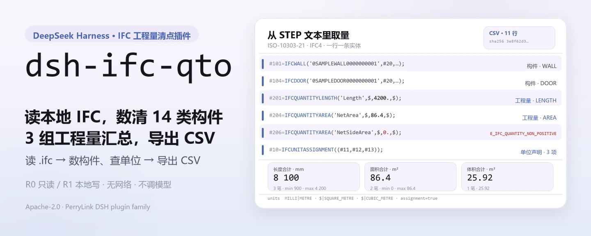
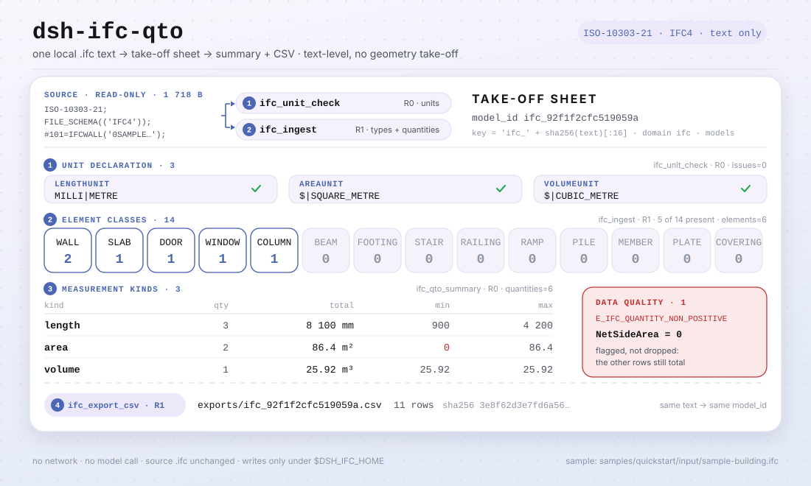

<div align="center">

<picture>
  <source media="(prefers-color-scheme: dark)" srcset="docs/assets/dsh-ifc-qto-hero-zh-dark.webp">
  
</picture>

# dsh-ifc-qto

**把本地 IFC 模型清点成可核对的构件清单和工程量 CSV——只读文本，不联网、不调模型。**

面向 DeepSeek Harness 的本地清点插件：读 ISO-10303-21 文本，数出墙/板/门窗等构件与 IfcQuantity 工程量，按计量类型汇总后导出 CSV；原文件不动，全程不联网。

[安装](#三步上手) · [配置](#配置) · [FAQ](#faq) · [简体中文](README.md) · [English](README.en.md) · [Español](README.es.md) · [Português](README.pt.md) · [हिन्दी](README.hi.md)

[](LICENSE)
[](#兼容性)
[](https://www.npmjs.com/package/dsh-ifc-qto)
[](https://github.com/PerryLink/dsh-ifc-qto/actions/workflows/ci.yml)
[](#兼容性)

[](https://github.com/PerryLink/dsh-ifc-qto/stargazers)
[](https://www.npmjs.com/package/dsh-ifc-qto)
[](https://dshfind.com/plugins/PerryLink/dsh-ifc-qto?ref=badge)
[](https://dsh.market/)

```sh
dsh plugin --profile <profile> add dsh-ifc-qto
```

</div>

<sub>社区插件，与 DeepSeek 官方无关。唯一仓库：<https://github.com/PerryLink/dsh-ifc-qto>。状态：alpha · 仅公开/合成数据 · 部分实现 · 未计入 · 非 GA——不含客户数据或客户证据，不作生产可用声明。</sub>

## 它是什么

`dsh-ifc-qto` 在 DeepSeek Harness 里跑一条纯本地的清点流水线：读一份本地 `.ifc` 文本（ISO-10303-21，IFC4），把墙、板、门窗、柱、梁、基础、楼梯等构件数出来，把文件里的 `IfcQuantityLength` / `IfcQuantityArea` / `IfcQuantityVolume` 取出来，按计量类型汇总（笔数、合计、最小/最大），标出 0 或负数的数据质量问题，最后导出一张可核对的 CSV。它只做文本级清点，不做几何核量，也不联网、不调模型；你给的 `.ifc` 只读不改。

- **适合**：投标或报量前快速核一遍模型里有多少墙、板、门窗，面积体积合计多少；收到上游 `.ifc` 想先看看里面有什么。
- **不适合**：需要三维几何核量、与图纸逐项对量的场景；RVT/DWG 等非 IFC 格式；扫描件或截图。

**输入**：本地 `.ifc` 文本（ISO-10303-21，IFC4），UTF-8，单文件建议 ≤50 MB；来自设计院或建模方导出。自带样例 `samples/quickstart/input/sample-building.ifc`（1.7 KB，合成数据：虚构项目/构件编号，无客户模型）。

**输出**：构件清单（类型、数量、名称）、工程量汇总（长度/面积/体积的笔数、合计、最小/最大）、数据质量提示；CSV 写到 `$DSH_HOME/storages/dsh-ifc-qto/exports/`。**不改原文件，不上传。**

<picture>
  <source media="(prefers-color-scheme: dark)" srcset="docs/assets/dsh-ifc-qto-flow-v5-dark.svg">
  
</picture>

## 三步上手

1. **安装**（四选一；npm 是推荐通道）：

   ```sh
   # npm 通道（推荐，已发布 0.1.1）
   dsh plugin --profile <profile> add dsh-ifc-qto
   # git 通道（跟随 main；lib/ 是构建产物，需在 checkout 内先 pnpm install && pnpm build）
   dsh plugin --profile <profile> add github:PerryLink/dsh-ifc-qto
   # tarball 通道：在本仓库 pnpm install && pnpm build && pnpm pack 之后
   dsh plugin --profile <profile> add ./dsh-ifc-qto-<version>.tgz
   # 1024 商店通道
   npm i -g dsh1024
   dsh1024 plugin --profile <profile> add dsh-ifc-qto
   ```

2. **最小配置**（没有插件级配置键）：`cordis.patch.yml` 只 `insert` 一行；数据根目录默认 `$DSH_HOME/storages/dsh-ifc-qto`，要换目录就设 `DSH_IFC_HOME`（见「配置」）。宿主 profile 需提供 `tools` 与 `storageDomain` 两个服务。

   ```yaml
   - insert:
       - id: dsh-ifc-qto
         name: dsh-ifc-qto
   ```

3. **验证已生效**：

   ```sh
   dsh --profile <profile> --dump-config | grep dsh-ifc-qto
   pnpm install --frozen-lockfile && pnpm build
   node samples/quickstart/run.mjs
   ```

   自带 quickstart 用 `samples/quickstart/input/sample-building.ifc` 依次调用 `ifc.unit_check → ifc.ingest → ifc.qto_summary → ifc.export_csv`，结尾应输出：

   ```text
   ifc.unit_check   assignment=true length=MILLI|METRE area=$|SQUARE_METRE volume=$|CUBIC_METRE issues=0
   ifc.ingest       elements=6 quantities=6 types=WALL:2 SLAB:1 DOOR:1 WINDOW:1 COLUMN:1
   ifc.qto_summary  length qty=3 total=8100 min=900 max=4200
                    area   qty=2 total=86.4 min=0 max=86.4
                    volume qty=1 total=25.92 min=25.92 max=25.92
   data quality     1 issue(s): E_IFC_QUANTITY_NON_POSITIVE NetSideArea=0
   ifc.export_csv   11 rows -> exports/ifc_92f1f2cfc519059a.csv (sha256 3e8f62d3e7fd6a56…)
   ok: quickstart finished (4 tool calls, 1 data-quality issue)
   ```

   在会话里也可以直接说（`package.json` 的 `dsh.demo.prompt`）：

   > 帮我从自带样例的模型里提取构件和工程量，看看单位声明全不全，再按类别汇总并导出一份 CSV。

**卸载**：`dsh plugin --profile <profile> remove dsh-ifc-qto`（或从 profile patch 删掉该行）。

## 核心能力

- **文本级构件清点** —— `ifc.ingest` 用 `ISO-10303-21` / `FILE_SCHEMA` 判断是不是 IFC，再遍历 14 类构件实体（`IFCWALL`、`IFCSLAB`、`IFCDOOR`、`IFCWINDOW`、`IFCCOLUMN`、`IFCBEAM`、`IFCFOOTING`、`IFCSTAIR`、`IFCRAILING`、`IFCRAMP`、`IFCPILE`、`IFCMEMBER`、`IFCPLATE`、`IFCCOVERING`），取 GUID 与名称，按类型计数。
- **工程量提取** —— 同一遍流程取出 `IfcQuantityLength` / `IfcQuantityArea` / `IfcQuantityVolume` 的名称与数值（参数里最后一个数字，兼容额外的 `$` 占位）。
- **单位声明检查** —— `ifc.unit_check` 检查 `IfcUnitAssignment` 与长度/面积/体积的 `IfcSIUnit`，返回 `assignment`、`prefix|unit` 与 `E_IFC_*UNIT*_MISSING` 问题列表；没有单位，算出来的量不能直接报量。
- **分类汇总与数据质量** —— `ifc.qto_summary` 给每种计量类型的笔数、合计、最小/最大与构件类型分布，并把 0 或负数工程量标成 `E_IFC_QUANTITY_NON_POSITIVE`；一条坏值不影响其余构件的汇总。
- **CSV 导出** —— `ifc.export_csv` 把类型计数与工程量明细写成 `exports/ifc_<sha16>.csv`，返回行数与 CSV 的 SHA-256；同一份文本重复导入得到同一个 `model_id`，落同一个文件名。
- **只读输入** —— 你给的 `.ifc` 只读；写操作只落在 `$DSH_IFC_HOME`（缺省 `$DSH_HOME/storages/dsh-ifc-qto`）与存储域 `ifc` 的 `models` 表。
- **纯本地** —— 源码里没有 `fetch` / HTTP / DNS / WebSocket 调用，`package.json` 的演示元数据声明 `network: false`；输入输出都不离开本机。

### 工具面

工具名是稳定 API（与运行时输出一致，保持英文）；说明已本地化。写文件的工具标 **R1（本地写）**，只读工具标 **R0**。

| 工具 | 用途 | 风险 |
|---|---|---|
| `ifc.ingest` | 解析 IFC 文本，清点 14 类构件与工程量实体，存成模型并返回 `model_id` | R1 本地写 |
| `ifc.export_csv` | 把类型计数与工程量明细导出成 CSV，返回路径、行数与哈希 | R1 本地写 |
| `ifc.qto_summary` | 按计量类型汇总（笔数/合计/最小/最大）并列出非正数问题 | R0 只读 |
| `ifc.unit_check` | 检查模型是否声明了长度/面积/体积的 SI 单位 | R0 只读 |

`ifc.export_csv` 与 `ifc.qto_summary` 只认 `ifc.ingest` 返回并已存进 `models` 表的 `model_id`，不认文件路径。

### 示例

以下为插件真实入口；仓库自带的合成样例可以完整复现。

**详细示例** —— `node samples/quickstart/run.mjs`（4 次工具调用，1 个数据质量问题）：

```text
ifc.unit_check   assignment=true length=MILLI|METRE area=$|SQUARE_METRE volume=$|CUBIC_METRE issues=0
ifc.ingest       elements=6 quantities=6 types=WALL:2 SLAB:1 DOOR:1 WINDOW:1 COLUMN:1
ifc.qto_summary  length qty=3 total=8100 min=900 max=4200
                 area   qty=2 total=86.4 min=0 max=86.4
                 volume qty=1 total=25.92 min=25.92 max=25.92
data quality     1 issue(s): E_IFC_QUANTITY_NON_POSITIVE NetSideArea=0
ifc.export_csv   11 rows -> exports/ifc_92f1f2cfc519059a.csv (sha256 3e8f62d3e7fd6a56…)
```

*Observed from `samples/quickstart/expected/console.txt`（与 `samples/quickstart/expected/result.json` 一致）。*

**失败分支** —— 用未入库的 `model_id` 调 `ifc.export_csv`，输出：

```text
找不到这个模型（E_IFC_UNREADABLE）｜下一步：先用 ifc.ingest 导入模型拿到 model_id，再导出 CSV
```

*Observed from `src/plugin/tools.ts:5`；其余错误码见 [`TROUBLESHOOTING.md`](TROUBLESHOOTING.md)。*

## 实测数据


*上图是 `node samples/quickstart/run.mjs` 在自带合成样例上的真实捕获（2026-11-02），与 `samples/quickstart/expected/console.txt` 逐行一致；合成样例只有虚构项目/构件编号，没有客户模型。*

公开 / 合成验收由 `scripts/acceptance.mjs` 重跑，明细落在 `ACCEPTANCE.csv`。以下为全部 8 行（原样引用；完整列含 `script` 与 `evidence_sha256`）：

```csv
req_id,metric,threshold,actual,pass,source,counted
SKU-07-A01,IFC 构件（20）,20,20,true,public/synthetic,false
SKU-07-A02,类型数,5,5,true,public/synthetic,false
SKU-07-A03,量实体,3,3,true,public/synthetic,false
SKU-07-A04,CSV 行,>=8,8,true,public/synthetic,false
SKU-07-A05,公开 IFC 量实体,>=5,36,true,public/synthetic,false
SKU-07-A06,QTO 汇总/数据质量,1,3,true,public/synthetic,false
SKU-07-A07,IFC 单位声明检查,>=1,3,true,public/synthetic,false
PS1-QS01,quickstart 样例与金标一致,1/1,1,true,synthetic/quickstart,true
```

SKU-07 行是公开 / 合成 fixture 检查（`counted=false`），只有 `PS1-QS01` 是随包样例的本地复现（`counted=true`）。quickstart 的合成模型是 6 个构件、6 条工程量：长度 3 笔合计 8100、面积 2 笔合计 86.4、体积 1 笔合计 25.92，CSV 11 行。以上都不是客户运行，没有虚构输出。

**fixture 支撑的验收**：公开 MIT 样例 `fixtures/public/mit/3walls.ifc` 由 `test/public-ifc.test.mjs` 解析（`pnpm test`）；验收行 `SKU-07-A01`（IFC 构件 20，20/20）来自 `scripts/acceptance.mjs` 的合成 IFC。两者都是公开 / 合成 fixture，不是客户运行。公开样例都在 `fixtures/`（含 `SOURCE.md` 与上游许可证），`ACCEPTANCE.csv` 的 SKU 行全部 `counted=false`。

## 配置

本插件没有 Schemastery `Config` 字段，`cordis.patch.yml` 只插入一行；可调项是环境变量与工具参数。

| 可调项 | 默认值 | 含义 |
|---|---|---|
| `DSH_IFC_HOME` | 未设置 | 数据根目录；未设置时用 `$DSH_HOME/storages/dsh-ifc-qto`，`DSH_HOME` 也未设置时用宿主进程 cwd |
| `DSH_HOME` | 未设置 | 宿主 home；决定默认数据根目录 |
| 导出目录 | `<数据根目录>/exports` | CSV 落点；文件名固定为 `ifc_<sha256 前 16 位>.csv` |

模型记录存在自建的存储域 `ifc`（version 1）的 `models` 表里；每次 `ifc.ingest` 写一条，`model_id` 就是 `ifc_<sha256 前 16 位>`。

<details>
<summary>工具参数</summary>

| 参数 | 默认值 | 作用于 | 含义 |
|---|---|---|---|
| `ifc_text` | 必填 | `ifc.ingest` / `ifc.unit_check` | IFC 文本本身（ISO-10303-21） |
| `source_name` | `inline.ifc` | `ifc.ingest` | 记录里的来源名，仅作标识 |
| `model_id` | 必填 | `ifc.export_csv` / `ifc.qto_summary` | `ifc.ingest` 返回的 id |

</details>

<details>
<summary>错误格式与常见错误码</summary>

报错统一是「一句人话（`E_IFC_*`）｜下一步：一个动作」，逐条排查见 [`TROUBLESHOOTING.md`](TROUBLESHOOTING.md)。

| 错误码 | 含义 |
|---|---|
| `E_IFC_UNREADABLE` | 不像 IFC 文本；或文件里没有可统计的构件/工程量；或 `model_id` 不存在 |
| `E_IFC_EMPTY` | 文件是空的（0 字节或只有空白） |
| `E_IFC_EXPORT_FAILED` | CSV 写不出去（权限、只读挂载、磁盘满） |
| `E_IFC_QUANTITY_NON_POSITIVE` | 工程量有 0 或负数（数据质量提示，不阻断其余汇总） |
| `E_IFC_UNITASSIGNMENT_MISSING` | 模型没有 `IfcUnitAssignment` |
| `E_IFC_LENGTHUNIT_MISSING` / `E_IFC_AREAUNIT_MISSING` / `E_IFC_VOLUMEUNIT_MISSING` | 缺对应计量类型的 `IfcSIUnit` 声明 |

</details>

profile patch 覆盖示例：

```yaml
- insert:
    - id: dsh-ifc-qto
      name: dsh-ifc-qto
```

数据根目录换位置：

```sh
export DSH_IFC_HOME=/path/to/ifc-data   # Windows PowerShell: $env:DSH_IFC_HOME = 'D:\ifc-data'
```

## FAQ

<details>
<summary>数据存在哪？会改我的原文件吗？</summary>

模型记录写进存储域 `ifc` 的 `models` 表（默认根目录 `$DSH_HOME/storages/dsh-ifc-qto`，可用 `DSH_IFC_HOME` 覆盖），CSV 写在 `<数据根目录>/exports/`。你给的 `.ifc` 只读，工具不会改写它；没有上传，也没有遥测。

</details>

<details>
<summary>能处理我的真实模型吗？能算几何量吗？</summary>

能读标准 `.ifc`（ISO-10303-21）文本，但只做文本级清点：构件数、`IfcQuantity*` 里的工程量与单位声明。不做三维几何核量，也不会自己推算面积体积——模型里没写 `IfcQuantity`，就统计不到。RVT/DWG/PDF 与扫描件不支持；本包是 alpha、只用公开/合成数据验证，不构成报量或结算结论。一次处理一份 IFC 文本（无批量），单文件建议 ≤50 MB；解析是逐行正则扫描，没有模型调用或网络往返。

</details>

<details>
<summary>结果对不上，或者提示 E_IFC_QUANTITY_NON_POSITIVE 怎么办？</summary>

先跑 `ifc.unit_check` 看长度/面积/体积单位是否声明齐全（缺单位时数值不能直接报量），再看 `ifc.qto_summary` 的 `issues`：0 或负数工程量通常来自漏填或导出错误，核对模型后重新导出即可。它只是数据质量提示，不影响其余构件的汇总。

</details>

<details>
<summary>装不上或没生效怎么办？</summary>

先看 `node --version` 是否满足 `>=24.9 <25`、`dsh --version` 是否在 `>=0.2.1-rc.3 <0.4.0`；再用 `dsh --profile <profile> --dump-config | grep dsh-ifc-qto` 确认已挂载。插件需要宿主提供 `tools` 与 `storageDomain` 两个服务，缺一个都不会 apply。完整步骤见 [`TROUBLESHOOTING.md`](TROUBLESHOOTING.md)。

</details>

<details>
<summary>会和其他插件抢命令名、slot 或存储吗？开销多大？</summary>

不会。四个工具都在 `ifc.*` 命名空间；不注册命令、客户端 slot、`webServer` 路由或服务键；只用自建 `ifc` v1 域的一张 `models` 表，不读写其他域；不改原型、不改写 `process.env`、不替换全局 fetch。逐条论证见「与其他 DSH 插件的互操作性」。

开销也很小：解析是逐行正则扫描，没有模型调用、没有网络请求；最重的步骤是读入文本和一次汇总遍历。

</details>

## 安全边界

- **不联网、不调模型。** 源码中没有 `fetch` / HTTP / DNS / WebSocket 调用；`package.json` 的演示元数据也声明 `network: false`。输入和输出都留在本地。
- **原文件不被修改。** 写操作只落在 `$DSH_IFC_HOME`（缺省 `$DSH_HOME/storages/dsh-ifc-qto`）下的 `exports/` 与存储域 `ifc` 的 `models` 表；读取范围仅限调用方传入的 IFC 文本——插件不遍历目录、不打开其他文件。
- **文本解析严格、失败响亮。** 不是 ISO-10303-21 / 没有可统计的构件或工程量会报 `E_IFC_UNREADABLE`；空文件报 `E_IFC_EMPTY`；不会静默返回空清单。
- **错误可读且不泄密。** 面向用户的文本是「一句人话 + 错误码 + 下一步」；不把原始模型内容回显到错误里。
- **存储域独立。** 只用自建 `ifc` v1 域的单表 `models`；域关闭走 Cordis effect，停止 / 热重载即可撤销。
- **无凭据、无外部系统。** 不读凭据、不连 ERP / BIM 平台 / 云服务，也没有遥测或上传。
- **只有 host 面。** 不注册客户端包、slot 或 UI；所有操作走工具面。

## 权限与数据

```text
读：用户指定的 .ifc 模型文件；不读其他目录
写：$DSH_HOME/storages/dsh-ifc-qto（原件不入库，只存解析记录与 exports/*.csv）；不改原文件
联网：否
外部系统：无
```

以上与源码一致：`apply()` 只从 `DSH_IFC_HOME`（缺省 `$DSH_HOME/storages/dsh-ifc-qto`）取写入目录，源码里没有任何网络调用。插件本身不打开文件路径，`ifc_text` 由调用方提供。写盘的工具（`ifc.ingest`、`ifc.export_csv`）标 **R1 本地写**，只读工具（`ifc.qto_summary`、`ifc.unit_check`）标 **R0**。

## 已知限制

- **仅公开 / 合成验证。** 所有验收行都来自公开或合成 fixture（`ACCEPTANCE.csv` 中 SKU 行 `counted=false`，PS1-QS01 为随包样例本地复现 `counted=true`）；不含客户数据或客户证据。
- **alpha / 部分实现 / 未计入 / 非 GA。** 不作生产可用声明，不构成报量、结算或审计结论。
- **文本级，不做几何。** 只数构件、只取文件里已有的 `IfcQuantity*`；不做三维几何核量、不自己推算面积体积、不与图纸逐项对量。
- **构件类型有白名单。** 只统计 14 类：`IFCWALL`、`IFCSLAB`、`IFCDOOR`、`IFCWINDOW`、`IFCCOLUMN`、`IFCBEAM`、`IFCFOOTING`、`IFCSTAIR`、`IFCRAILING`、`IFCRAMP`、`IFCPILE`、`IFCMEMBER`、`IFCPLATE`、`IFCCOVERING`；其他类型不计入。
- **只认 IFC 文本。** RVT、DWG、PDF、扫描件与图片不支持；另存成二进制或改了后缀的文件会报 `E_IFC_UNREADABLE`。
- **单文件、无批量。** 一次一份 IFC 文本，单文件建议 ≤50 MB；批量请循环调用。
- **`model_id` 不认路径。** `ifc.qto_summary` / `ifc.export_csv` 只认 `ifc.ingest` 返回并存进 `models` 表的 id；直接传文件路径会报 `E_IFC_UNREADABLE`。
- **存储是 JSON KV。** `ifc` 域 v1 只有一张 `models` 表，没有跨表事务、外键或迁移；同一份文本重复导入会覆盖同一条记录。
- **需要宿主服务。** 插件 `inject` 了 `tools` 与 `storageDomain`；bare profile 不组合 storage 时不会 apply。
- **Node 区间窄。** 只支持 `>=24.9.0 <25`；没有浏览器半，也没有 UI。

## 与其他 DSH 插件的互操作性

按源码核对（`src/plugin/index.ts`、`src/plugin/tools.ts`、`src/plugin/storage.ts`），本插件与命令、工具、slot、HTTP 路由、storage 域均无冲突面：

- **工具名带命名空间。** 4 个工具全部以 `ifc.` 开头，不占用内置工具或其他插件的裸名。
- **只消费、不提供服务。** `inject` 只有 `['tools', 'storageDomain']`；不注册命令、客户端 slot、`webServer` 前缀或服务键。
- **独立 storage 域。** 只用自建 `ifc` v1 域的一张 `models` 表，不读写其他域。
- **无全局改写。** 不改原型、不改写 `process.env`、不替换全局 fetch。
- **导出不外溢。** CSV 只写进自己的 `exports/`，文件名由 `model_id` 拼出。
- **只读工具可重入。** `ifc.qto_summary` 与 `ifc.unit_check` 不写状态，可安全重复调用。

## 兼容性

| 维度 | 状态 |
|---|---|
| Harness | `dsh >=0.2.1-rc.3 <0.4.0`（`package.json` 的 `engines.dsh`） |
| Node | `>=24.9.0 <25`（`.nvmrc`：24） |
| 宿主服务 | 需组合 `tools` 与 `storageDomain`（见 `src/plugin/index.ts` 的 `inject`） |
| 平台 | 任何 DSH 可运行处；纯本地文件，无浏览器半 |
| 模型 | 不需要；不调用模型 |
| 数据 | 不联网、不调用模型、不上传；只写 `$DSH_HOME/storages/dsh-ifc-qto` |
| 维护状态 | 活跃（2026-11-01 起；新功能与加固随 alpha 版本发布） |

## 生态与质量

- [dshfind 插件页](https://dshfind.com/plugins/PerryLink/dsh-ifc-qto)（安装量与排名）
- [DSH Market](https://dsh.market/)（已上架）
- [领域索引](https://perrylink.github.io/dsh-plugins/) · [Checker 家族](https://perrylink.github.io/zh/checkers/) · [主线家族](https://github.com/PerryLink/dsh-kit)
- [Gitee 聚合镜像](https://gitee.com/perrylink/dsh-plugins)（以 GitHub 为准）
- **1024 商店渠道**：先 `npm i -g dsh1024`，再 `dsh1024 plugin --profile <profile> add dsh-ifc-qto`（计入 [deepseek1024.com](https://deepseek1024.com) 安装排行）
- 兄弟包：[`dsh-docx-redline`](https://github.com/PerryLink/dsh-docx-redline)、[`dsh-pim-lint`](https://github.com/PerryLink/dsh-pim-lint)
- 相关核查器（各自是独立包，带独立规则包与版本；只装需要的）：

| 包 | 为什么相关 |
|---|---|
| [`dsh-construction-doc-check`](https://github.com/PerryLink/dsh-construction-doc-check) | 施工资料目录、版本与空文件检查 |
| [`dsh-pipeline-check`](https://github.com/PerryLink/dsh-pipeline-check) | 工程全流程资料链检查 |
| [`dsh-site-log-check`](https://github.com/PerryLink/dsh-site-log-check) | 监理日志连续性与现场记录覆盖检查 |

- 文档：[`TROUBLESHOOTING.md`](TROUBLESHOOTING.md) · [`PRIVACY.md`](PRIVACY.md) · [`SECURITY.md`](SECURITY.md) · [`FIXTURES.md`](FIXTURES.md) · [`EVIDENCE.md`](EVIDENCE.md) · [`ACCEPTANCE.csv`](ACCEPTANCE.csv)

## 开发

```sh
pnpm install --frozen-lockfile
pnpm build && pnpm lint && pnpm typecheck && pnpm test   # 5 个测试文件
pnpm gate:sku07                                          # 验收门禁（ACCEPTANCE.csv）
node scripts/acceptance.mjs                              # 重跑公开 / 合成验收
node samples/quickstart/run.mjs                          # 合成样例，应输出 4 次工具调用、1 个数据质量问题
```

当前版本 `0.1.1`。

目录布局：

| 路径 | 内容 |
|---|---|
| `src/core/` | `ifc.ts`：IFC 文本解析（构件、工程量）与单位声明检查 |
| `src/plugin/` | `index.ts`（apply）、`tools.ts`（4 个工具）、`storage.ts`（storage domain `ifc` v1） |
| `test/` | `node --test` 用例（ifc、plugin-smoke、public-ifc、qto-summary、units） |
| `scripts/` | 机械门禁：lint、acceptance、gate-sku07、check-pack、sbom、make-samples，以及本次新增的 `gen-readme-assets.py` |
| `fixtures/public/mit/` | 4 份公开 MIT/Apache IFC 样例（含 `SOURCE.md` 与上游许可证） |
| `samples/quickstart/` | 合成建筑样例、`run.mjs` 与金标 `expected/console.txt` / `result.json` |
| `docs/assets/` | README 配图 |
| `evidence/` | 验收运行快照（`result.json`） |

开头横幅与结构图由 [`scripts/gen-readme-assets.py`](scripts/gen-readme-assets.py) 程序化生成（Pillow 画 1440×576 横幅四张 webp，手写 SVG 画 1100×660 结构图深浅双版），可重复执行；旧的单版 `docs/assets/dsh-ifc-qto-flow.svg` 与旧的 `flow-{light,dark}.svg` 保留不删，避免外链 404。

Topics：`deepseek-harness`, `dsh`, `dsh-plugin`, `ifc`, `qto`, `bim`, `perrylink`, `construction`

## 家族与致谢

本项目是 [PerryLink](https://github.com/PerryLink) 维护的 DeepSeek Harness 插件家族成员（全部 Apache-2.0）。如果这个插件帮到了你，**给个 star**——它不解锁任何功能，但会让下一个人更容易找到它。

- [@PerryLink](https://github.com/PerryLink) —— 创建者与维护者：IFC 文本清点与工程量提取、单位声明检查、QTO 汇总与 CSV 导出、quickstart 与验收套件、五语文档。

<details>
<summary>展开 DSH 领域插件家族（15 个包 + 2 个 suite）</summary>

| Plugin | npm | 状态 |
|---|---|---|
| **[dsh-einvoice](https://github.com/PerryLink/dsh-einvoice)** | [npm](https://www.npmjs.com/package/dsh-einvoice) |  |
| **[dsh-docx-redline](https://github.com/PerryLink/dsh-docx-redline)** | [npm](https://www.npmjs.com/package/dsh-docx-redline) |  |
| **[dsh-policy-ledger](https://github.com/PerryLink/dsh-policy-ledger)** | [npm](https://www.npmjs.com/package/dsh-policy-ledger) |  |
| **[dsh-ghg](https://github.com/PerryLink/dsh-ghg)** | [npm](https://www.npmjs.com/package/dsh-ghg) |  |
| **[dsh-bankrec](https://github.com/PerryLink/dsh-bankrec)** | [npm](https://www.npmjs.com/package/dsh-bankrec) |  |
| **[dsh-ap-three-way](https://github.com/PerryLink/dsh-ap-three-way)** | [npm](https://www.npmjs.com/package/dsh-ap-three-way) |  |
| **[dsh-ifc-qto](https://github.com/PerryLink/dsh-ifc-qto)** | [npm](https://www.npmjs.com/package/dsh-ifc-qto) |  |
| **[dsh-qms-capa](https://github.com/PerryLink/dsh-qms-capa)** | [npm](https://www.npmjs.com/package/dsh-qms-capa) |  |
| **[dsh-legal-intake](https://github.com/PerryLink/dsh-legal-intake)** | [npm](https://www.npmjs.com/package/dsh-legal-intake) |  |
| **[dsh-legal-clause](https://github.com/PerryLink/dsh-legal-clause)** | [npm](https://www.npmjs.com/package/dsh-legal-clause) |  |
| **[dsh-freight-audit](https://github.com/PerryLink/dsh-freight-audit)** | [npm](https://www.npmjs.com/package/dsh-freight-audit) |  |
| **[dsh-hs-candidate](https://github.com/PerryLink/dsh-hs-candidate)** | [npm](https://www.npmjs.com/package/dsh-hs-candidate) |  |
| **[dsh-travel-recon](https://github.com/PerryLink/dsh-travel-recon)** | [npm](https://www.npmjs.com/package/dsh-travel-recon) |  |
| **[dsh-pim-lint](https://github.com/PerryLink/dsh-pim-lint)** | [npm](https://www.npmjs.com/package/dsh-pim-lint) |  |
| **[dsh-eval-pack](https://github.com/PerryLink/dsh-eval-pack)** | [npm](https://www.npmjs.com/package/dsh-eval-pack) |  |
| **[dsh-finops-suite](https://github.com/PerryLink/dsh-finops-suite)** | [npm](https://www.npmjs.com/package/dsh-finops-suite) |  |
| **[dsh-contract-suite](https://github.com/PerryLink/dsh-contract-suite)** | [npm](https://www.npmjs.com/package/dsh-contract-suite) |  |

</details>

<details>
<summary>展开主线家族（87 个当前安装 spec）</summary>

| Plugin | npm | 状态 |
|---|---|---|
| **[dsh-aqua-input-check](https://github.com/PerryLink/dsh-aqua-input-check)** | [npm](https://www.npmjs.com/package/dsh-aqua-input-check) |  |
| **[dsh-archive-check](https://github.com/PerryLink/dsh-archive-check)** | [npm](https://www.npmjs.com/package/dsh-archive-check) |  |
| **[dsh-bid-ca-precheck](https://github.com/PerryLink/dsh-bid-ca-precheck)** | [npm](https://www.npmjs.com/package/dsh-bid-ca-precheck) |  |
| **[dsh-bid-qual-check](https://github.com/PerryLink/dsh-bid-qual-check)** | [npm](https://www.npmjs.com/package/dsh-bid-qual-check) |  |
| **[dsh-contract-stance](https://github.com/PerryLink/dsh-contract-stance)** | [npm](https://www.npmjs.com/package/dsh-contract-stance) |  |
| **[dsh-customs-doc-check](https://github.com/PerryLink/dsh-customs-doc-check)** | [npm](https://www.npmjs.com/package/dsh-customs-doc-check) |  |
| **[dsh-demurrage-ledger](https://github.com/PerryLink/dsh-demurrage-ledger)** | [npm](https://www.npmjs.com/package/dsh-demurrage-ledger) |  |
| **[dsh-drill-script-check](https://github.com/PerryLink/dsh-drill-script-check)** | [npm](https://www.npmjs.com/package/dsh-drill-script-check) |  |
| **[dsh-eia-guide-check](https://github.com/PerryLink/dsh-eia-guide-check)** | [npm](https://www.npmjs.com/package/dsh-eia-guide-check) |  |
| **[dsh-emergency-plan](https://github.com/PerryLink/dsh-emergency-plan)** | [npm](https://www.npmjs.com/package/dsh-emergency-plan) |  |
| **[dsh-essay-rubric-check](https://github.com/PerryLink/dsh-essay-rubric-check)** | [npm](https://www.npmjs.com/package/dsh-essay-rubric-check) |  |
| **[dsh-evidence-check](https://github.com/PerryLink/dsh-evidence-check)** | [npm](https://www.npmjs.com/package/dsh-evidence-check) |  |
| **[dsh-export-ctl-check](https://github.com/PerryLink/dsh-export-ctl-check)** | [npm](https://www.npmjs.com/package/dsh-export-ctl-check) |  |
| **[dsh-fmea-table-check](https://github.com/PerryLink/dsh-fmea-table-check)** | [npm](https://www.npmjs.com/package/dsh-fmea-table-check) |  |
| **[dsh-forecast-penalty](https://github.com/PerryLink/dsh-forecast-penalty)** | [npm](https://www.npmjs.com/package/dsh-forecast-penalty) |  |
| **[dsh-gongwen-flow-check](https://github.com/PerryLink/dsh-gongwen-flow-check)** | [npm](https://www.npmjs.com/package/dsh-gongwen-flow-check) |  |
| **[dsh-gongwen-word-check](https://github.com/PerryLink/dsh-gongwen-word-check)** | [npm](https://www.npmjs.com/package/dsh-gongwen-word-check) |  |
| **[dsh-guard-plan-qc](https://github.com/PerryLink/dsh-guard-plan-qc)** | [npm](https://www.npmjs.com/package/dsh-guard-plan-qc) |  |
| **[dsh-hazchem-check](https://github.com/PerryLink/dsh-hazchem-check)** | [npm](https://www.npmjs.com/package/dsh-hazchem-check) |  |
| **[dsh-hazplan-check](https://github.com/PerryLink/dsh-hazplan-check)** | [npm](https://www.npmjs.com/package/dsh-hazplan-check) |  |
| **[dsh-hidden-risk-map](https://github.com/PerryLink/dsh-hidden-risk-map)** | [npm](https://www.npmjs.com/package/dsh-hidden-risk-map) |  |
| **[dsh-hs-classify](https://github.com/PerryLink/dsh-hs-classify)** | [npm](https://www.npmjs.com/package/dsh-hs-classify) |  |
| **[dsh-icd-rule-check](https://github.com/PerryLink/dsh-icd-rule-check)** | [npm](https://www.npmjs.com/package/dsh-icd-rule-check) |  |
| **[dsh-lawcite-adapter](https://github.com/PerryLink/dsh-lawcite-adapter)** | [npm](https://www.npmjs.com/package/dsh-lawcite-adapter) |  |
| **[dsh-lc-doc-check](https://github.com/PerryLink/dsh-lc-doc-check)** | [npm](https://www.npmjs.com/package/dsh-lc-doc-check) |  |
| **[dsh-learning-gap-check](https://github.com/PerryLink/dsh-learning-gap-check)** | [npm](https://www.npmjs.com/package/dsh-learning-gap-check) |  |
| **[dsh-medrec-qc](https://github.com/PerryLink/dsh-medrec-qc)** | [npm](https://www.npmjs.com/package/dsh-medrec-qc) |  |
| **[dsh-nsfc-form-check](https://github.com/PerryLink/dsh-nsfc-form-check)** | [npm](https://www.npmjs.com/package/dsh-nsfc-form-check) |  |
| **[dsh-nurse-record-check](https://github.com/PerryLink/dsh-nurse-record-check)** | [npm](https://www.npmjs.com/package/dsh-nurse-record-check) |  |
| **[dsh-origin-rvc-check](https://github.com/PerryLink/dsh-origin-rvc-check)** | [npm](https://www.npmjs.com/package/dsh-origin-rvc-check) |  |
| **[dsh-ota-review-check](https://github.com/PerryLink/dsh-ota-review-check)** | [npm](https://www.npmjs.com/package/dsh-ota-review-check) |  |
| **[dsh-paper-doc-adapter](https://github.com/PerryLink/dsh-paper-doc-adapter)** | [npm](https://www.npmjs.com/package/dsh-paper-doc-adapter) |  |
| **[dsh-permit-report-check](https://github.com/PerryLink/dsh-permit-report-check)** | [npm](https://www.npmjs.com/package/dsh-permit-report-check) |  |
| **[dsh-pipeline-check](https://github.com/PerryLink/dsh-pipeline-check)** | [npm](https://www.npmjs.com/package/dsh-pipeline-check) |  |
| **[dsh-pleading-draft](https://github.com/PerryLink/dsh-pleading-draft)** | [npm](https://www.npmjs.com/package/dsh-pleading-draft) |  |
| **[dsh-policy-brief-draft](https://github.com/PerryLink/dsh-policy-brief-draft)** | [npm](https://www.npmjs.com/package/dsh-policy-brief-draft) |  |
| **[dsh-power-loss-split](https://github.com/PerryLink/dsh-power-loss-split)** | [npm](https://www.npmjs.com/package/dsh-power-loss-split) |  |
| **[dsh-power-ticket-check](https://github.com/PerryLink/dsh-power-ticket-check)** | [npm](https://www.npmjs.com/package/dsh-power-ticket-check) |  |
| **[dsh-ppap-check](https://github.com/PerryLink/dsh-ppap-check)** | [npm](https://www.npmjs.com/package/dsh-ppap-check) |  |
| **[dsh-protest-deadline](https://github.com/PerryLink/dsh-protest-deadline)** | [npm](https://www.npmjs.com/package/dsh-protest-deadline) |  |
| **[dsh-railway-window](https://github.com/PerryLink/dsh-railway-window)** | [npm](https://www.npmjs.com/package/dsh-railway-window) |  |
| **[dsh-repair-order-qc](https://github.com/PerryLink/dsh-repair-order-qc)** | [npm](https://www.npmjs.com/package/dsh-repair-order-qc) |  |
| **[dsh-review-reply-check](https://github.com/PerryLink/dsh-review-reply-check)** | [npm](https://www.npmjs.com/package/dsh-review-reply-check) |  |
| **[dsh-rulefile-check](https://github.com/PerryLink/dsh-rulefile-check)** | [npm](https://www.npmjs.com/package/dsh-rulefile-check) |  |
| **[dsh-safety-brief-check](https://github.com/PerryLink/dsh-safety-brief-check)** | [npm](https://www.npmjs.com/package/dsh-safety-brief-check) |  |
| **[dsh-site-log-check](https://github.com/PerryLink/dsh-site-log-check)** | [npm](https://www.npmjs.com/package/dsh-site-log-check) |  |
| **[dsh-soe-decision-check](https://github.com/PerryLink/dsh-soe-decision-check)** | [npm](https://www.npmjs.com/package/dsh-soe-decision-check) |  |
| **[dsh-soilwater-check](https://github.com/PerryLink/dsh-soilwater-check)** | [npm](https://www.npmjs.com/package/dsh-soilwater-check) |  |
| **[dsh-sop-sync-check](https://github.com/PerryLink/dsh-sop-sync-check)** | [npm](https://www.npmjs.com/package/dsh-sop-sync-check) |  |
| **[dsh-spc-gbt-adapter](https://github.com/PerryLink/dsh-spc-gbt-adapter)** | [npm](https://www.npmjs.com/package/dsh-spc-gbt-adapter) |  |
| **[dsh-tender-extract](https://github.com/PerryLink/dsh-tender-extract)** | [npm](https://www.npmjs.com/package/dsh-tender-extract) |  |
| **[dsh-tender-matrix](https://github.com/PerryLink/dsh-tender-matrix)** | [npm](https://www.npmjs.com/package/dsh-tender-matrix) |  |
| **[dsh-warranty-calc](https://github.com/PerryLink/dsh-warranty-calc)** | [npm](https://www.npmjs.com/package/dsh-warranty-calc) |  |
| **[dsh-auto-review](https://github.com/PerryLink/dsh-auto-review)** | [npm](https://www.npmjs.com/package/dsh-auto-review) |  |
| **[dsh-autotier](https://github.com/PerryLink/dsh-autotier)** | [npm](https://www.npmjs.com/package/dsh-autotier) | 🧊 已冻结 — 见仓库 README |
| **[dsh-budget](https://github.com/PerryLink/dsh-budget)** | [npm](https://www.npmjs.com/package/dsh-budget) |  |
| **[dsh-cert-mcp](https://github.com/PerryLink/dsh-cert-mcp)** | [npm](https://www.npmjs.com/package/dsh-cert-mcp) | 🧊 已冻结 — 见仓库 README |
| **[dsh-checkpoint-rewind](https://github.com/PerryLink/dsh-checkpoint-rewind)** | [npm](https://www.npmjs.com/package/dsh-checkpoint-rewind) |  |
| **[dsh-claude-move](https://github.com/PerryLink/dsh-claude-move)** | [npm](https://www.npmjs.com/package/dsh-claude-move) |  |
| **[dsh-click](https://github.com/PerryLink/dsh-click)** | [npm](https://www.npmjs.com/package/dsh-click) |  |
| **[dsh-composer-history](https://github.com/PerryLink/dsh-composer-history)** | [npm](https://www.npmjs.com/package/dsh-composer-history) |  |
| **[dsh-data-quality](https://github.com/PerryLink/dsh-data-quality)** | [npm](https://www.npmjs.com/package/dsh-data-quality) | 🧊 已冻结 — 见仓库 README |
| **[dsh-defend](https://github.com/PerryLink/dsh-defend)** | [npm](https://www.npmjs.com/package/dsh-defend) |  |
| **[dsh-doublecheck](https://github.com/PerryLink/dsh-doublecheck)** | [npm](https://www.npmjs.com/package/dsh-doublecheck) |  |
| **[dsh-draw](https://github.com/PerryLink/dsh-draw)** | [npm](https://www.npmjs.com/package/dsh-draw) | 🧊 已冻结 — 见仓库 README |
| **[dsh-fast](https://github.com/PerryLink/dsh-fast)** | [npm](https://www.npmjs.com/package/dsh-fast) |  |
| **[dsh-fund-research](https://github.com/PerryLink/dsh-fund-research)** | [npm](https://www.npmjs.com/package/dsh-fund-research) |  |
| **[dsh-industry-research](https://github.com/PerryLink/dsh-industry-research)** | [npm](https://www.npmjs.com/package/dsh-industry-research) |  |
| **[dsh-laya](https://github.com/PerryLink/dsh-laya)** | [npm](https://www.npmjs.com/package/dsh-laya) |  |
| **[dsh-library](https://github.com/PerryLink/dsh-library)** | [npm](https://www.npmjs.com/package/dsh-library) |  |
| **[dsh-local-ai](https://github.com/PerryLink/dsh-local-ai)** | [npm](https://www.npmjs.com/package/dsh-local-ai) |  |
| **[dsh-lsp-actions](https://github.com/PerryLink/dsh-lsp-actions)** | [npm](https://www.npmjs.com/package/dsh-lsp-actions) |  |
| **[dsh-mask](https://github.com/PerryLink/dsh-mask)** | [npm](https://www.npmjs.com/package/dsh-mask) |  |
| **[dsh-mcp-panel](https://github.com/PerryLink/dsh-mcp-panel)** | [npm](https://www.npmjs.com/package/dsh-mcp-panel) |  |
| **[dsh-memento](https://github.com/PerryLink/dsh-memento)** | [npm](https://www.npmjs.com/package/dsh-memento) | 🧊 已冻结 — 见仓库 README |
| **[dsh-observe](https://github.com/PerryLink/dsh-observe)** | [npm](https://www.npmjs.com/package/dsh-observe) |  |
| **[dsh-output-styles](https://github.com/PerryLink/dsh-output-styles)** | [npm](https://www.npmjs.com/package/dsh-output-styles) |  |
| **[dsh-permission-rules](https://github.com/PerryLink/dsh-permission-rules)** | [npm](https://www.npmjs.com/package/dsh-permission-rules) |  |
| **[dsh-plugin-guide](https://github.com/PerryLink/dsh-plugin-guide)** | [npm](https://www.npmjs.com/package/dsh-plugin-guide) |  |
| **[dsh-plugin-upgrade](https://github.com/PerryLink/dsh-plugin-upgrade)** | [npm](https://www.npmjs.com/package/dsh-plugin-upgrade) | 🚫 已退役（仓库已归档） |
| **[dsh-reach](https://github.com/PerryLink/dsh-reach)** | [npm](https://www.npmjs.com/package/dsh-reach) |  |
| **[dsh-research-report](https://github.com/PerryLink/dsh-research-report)** | [npm](https://www.npmjs.com/package/dsh-research-report) |  |
| **[dsh-score](https://github.com/PerryLink/dsh-score)** | [npm](https://www.npmjs.com/package/dsh-score) | 🧊 已冻结 — 见仓库 README |
| **[dsh-session-sync](https://github.com/PerryLink/dsh-session-sync)** | [npm](https://www.npmjs.com/package/dsh-session-sync) |  |
| **[dsh-talk](https://github.com/PerryLink/dsh-talk)** | [npm](https://www.npmjs.com/package/dsh-talk) |  |
| **[dsh-test-drive](https://github.com/PerryLink/dsh-test-drive)** | [npm](https://www.npmjs.com/package/dsh-test-drive) |  |
| **[dsh-translate](https://github.com/PerryLink/dsh-translate)** | [npm](https://www.npmjs.com/package/dsh-translate) |  |

</details>

## License

[LICENSE](LICENSE)（Apache License 2.0）© 2026 dsh-ifc-qto contributors；另见 `NOTICE` 与 `THIRD-PARTY-NOTICES`。

<p align="center"><sub>Apache-2.0 · 社区插件，与 DeepSeek 无关。</sub></p>
