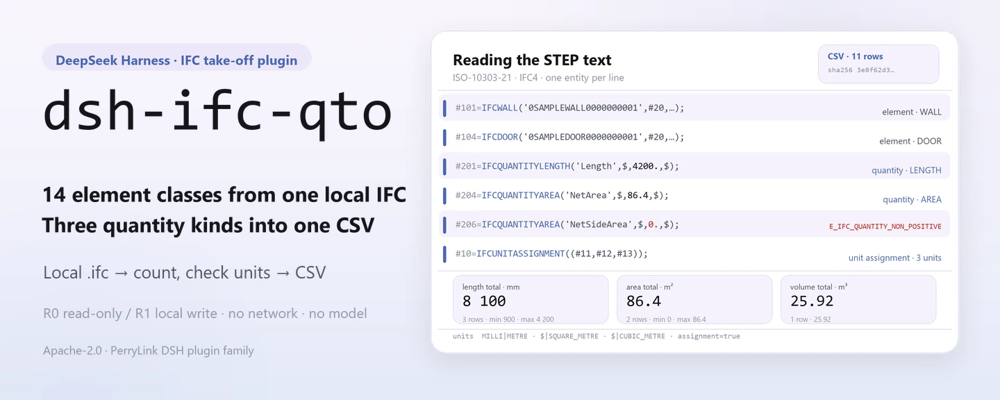
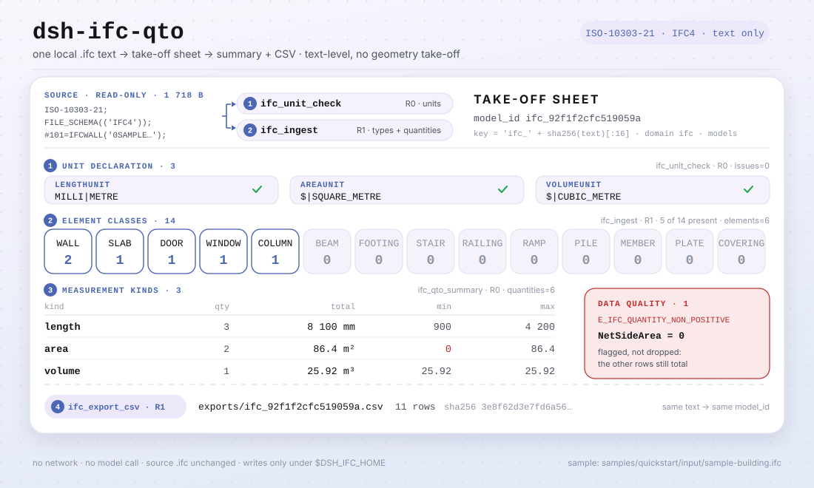

<div align="center">

<picture>
  <source media="(prefers-color-scheme: dark)" srcset="docs/assets/dsh-ifc-qto-hero-en-dark.webp">
  
</picture>

# dsh-ifc-qto

**Transforme um modelo IFC local em uma lista de elementos e um CSV de quantidades conferíveis — só texto, sem rede e sem chamada ao modelo.**

Um plugin de levantamento local para o DeepSeek Harness: lê texto ISO-10303-21, conta paredes, lajes, portas, janelas e outros elementos com seus valores `IfcQuantity`, resume por tipo de medição e exporta um CSV; o arquivo de origem não é alterado e nada sai da sua máquina.

[Instalar](#instalação-em-três-passos) · [Configuração](#configuração) · [FAQ](#faq) · [简体中文](README.md) · [English](README.en.md) · [Español](README.es.md) · [Português](README.pt.md) · [हिन्दी](README.hi.md)

[](LICENSE)
[](#compatibilidade)
[](https://www.npmjs.com/package/dsh-ifc-qto)
[](https://github.com/PerryLink/dsh-ifc-qto/actions/workflows/ci.yml)
[](#compatibilidade)

[](https://github.com/PerryLink/dsh-ifc-qto/stargazers)
[](https://www.npmjs.com/package/dsh-ifc-qto)
[](https://dshfind.com/plugins/PerryLink/dsh-ifc-qto?ref=badge)
[](https://dsh.market/)

```sh
dsh plugin --profile <profile> add dsh-ifc-qto
```

</div>

<sub>Plugin da comunidade, não afiliado ao DeepSeek. Repositório canônico: <https://github.com/PerryLink/dsh-ifc-qto>. alpha / dados públicos ou sintéticos / parcial / não contabilizado / não GA; sem evidência ou dados de clientes e sem promessa de produção.</sub>

## O que é

O `dsh-ifc-qto` executa dentro do DeepSeek Harness um pipeline de levantamento totalmente local: lê um texto `.ifc` local (ISO-10303-21, IFC4), conta paredes, lajes, portas, janelas, pilares, vigas, sapatas, escadas e outros elementos, extrai as entidades `IfcQuantityLength` / `IfcQuantityArea` / `IfcQuantityVolume` do arquivo, resume por tipo de medição (contagem, total, mínimo/máximo), marca quantidades zero ou negativas como problemas de qualidade de dados e exporta um CSV conferível. É só em nível de texto — sem levantamento geométrico — e nunca chama a rede nem um modelo; o `.ifc` que você passa é somente leitura.

- **Combina** com uma conferência rápida antes de uma licitação ou de uma medição contratual: quantas paredes, lajes e vãos o modelo tem, e quanto somam as áreas e os volumes; também para ver o que há em um `.ifc` recebido.
- **Não combina** com remedição geométrica ou conciliação item a item com desenhos; nem com RVT/DWG ou outros formatos que não sejam IFC, nem com digitalizações ou capturas de tela.

**Entrada**: um texto `.ifc` local (ISO-10303-21, IFC4), UTF-8, ≤50 MB por arquivo recomendado, exportado por um escritório de projeto ou pelo autor do modelo. Amostra incluída: `samples/quickstart/input/sample-building.ifc` (1,7 KB, sintética: projeto e elementos fictícios, sem modelo de cliente).

**Saída**: inventário de elementos (tipo, contagem, nome), resumo de quantidades (contagem/total/mínimo/máximo para comprimento, área e volume), avisos de qualidade de dados e um CSV em `$DSH_HOME/storages/dsh-ifc-qto/exports/`. **O arquivo de origem não é alterado e nada é enviado.**

<picture>
  <source media="(prefers-color-scheme: dark)" srcset="docs/assets/dsh-ifc-qto-flow-v5-dark.svg">
  
</picture>

## Instalação em três passos

1. **Instalar** (quatro canais; npm é o recomendado):

   ```sh
   # canal npm (recomendado; 0.1.1 publicada)
   dsh plugin --profile <profile> add dsh-ifc-qto
   # canal git (segue a main; lib/ é artefato de build — antes rode pnpm install && pnpm build no checkout)
   dsh plugin --profile <profile> add github:PerryLink/dsh-ifc-qto
   # canal tarball: após pnpm install && pnpm build && pnpm pack neste repositório
   dsh plugin --profile <profile> add ./dsh-ifc-qto-<version>.tgz
   # canal da loja 1024
   npm i -g dsh1024
   dsh1024 plugin --profile <profile> add dsh-ifc-qto
   ```

2. **Configuração mínima** (não há chaves de configuração do plugin): o `cordis.patch.yml` apenas insere uma linha. A raiz de dados é `$DSH_HOME/storages/dsh-ifc-qto` por padrão; defina `DSH_IFC_HOME` para mudá-la (ver «Configuração»). O perfil do host precisa oferecer os serviços `tools` e `storageDomain`.

   ```yaml
   - insert:
       - id: dsh-ifc-qto
         name: dsh-ifc-qto
   ```

3. **Conferir que montou**:

   ```sh
   dsh --profile <profile> --dump-config | grep dsh-ifc-qto
   pnpm install --frozen-lockfile && pnpm build
   node samples/quickstart/run.mjs
   ```

   O quickstart incluído percorre `samples/quickstart/input/sample-building.ifc` com `ifc.unit_check → ifc.ingest → ifc.qto_summary → ifc.export_csv` e deve terminar assim:

   ```text
   ifc.unit_check   assignment=true length=MILLI|METRE area=$|SQUARE_METRE volume=$|CUBIC_METRE issues=0
   ifc.ingest       elements=6 quantities=6 types=WALL:2 SLAB:1 DOOR:1 WINDOW:1 COLUMN:1
   ifc.qto_summary  length qty=3 total=8100 min=900 max=4200
                    area   qty=2 total=86.4 min=0 max=86.4
                    volume qty=1 total=25.92 min=25.92 max=25.92
   data quality     1 issue(s): E_IFC_QUANTITY_NON_POSITIVE NetSideArea=0
   ifc.export_csv   11 rows -> exports/ifc_92f1f2cfc519059a.csv (sha256 3e8f62d3e7fd6a56…)
   ok: quickstart finished (4 tool calls, 1 data-quality issue)
   ```

   Em uma sessão você também pode pedir o mesmo fluxo; o prompt de demonstração do `package.json` está em chinês:

   ```text
   帮我从自带样例的模型里提取构件和工程量，看看单位声明全不全，再按类别汇总并导出一份 CSV。
   ```

**Desinstalar**: `dsh plugin --profile <profile> remove dsh-ifc-qto` (ou remova a linha do patch do perfil).

## Capacidades principais

- **Inventário de elementos em nível de texto** — `ifc.ingest` verifica `ISO-10303-21` / `FILE_SCHEMA` e percorre 14 entidades de elemento (`IFCWALL`, `IFCSLAB`, `IFCDOOR`, `IFCWINDOW`, `IFCCOLUMN`, `IFCBEAM`, `IFCFOOTING`, `IFCSTAIR`, `IFCRAILING`, `IFCRAMP`, `IFCPILE`, `IFCMEMBER`, `IFCPLATE`, `IFCCOVERING`), captura GUID e nome e conta por tipo.
- **Extração de quantidades** — a mesma passagem captura nomes e valores de `IfcQuantityLength` / `IfcQuantityArea` / `IfcQuantityVolume` (o último número da lista de argumentos, tolerando `$` extras).
- **Verificação de unidades** — `ifc.unit_check` procura `IfcUnitAssignment` e os `IfcSIUnit` de comprimento/área/volume, devolvendo `assignment`, `prefix|unit` e a lista de problemas `E_IFC_*UNIT*_MISSING`; sem unidades, os números não servem para uma medição contratual.
- **Resumo e qualidade de dados** — `ifc.qto_summary` devolve contagem, total, mínimo/máximo e distribuição por tipo de elemento para cada tipo de medição, e marca quantidades zero ou negativas como `E_IFC_QUANTITY_NON_POSITIVE`; um valor ruim não interrompe o restante do resumo.
- **Exportação CSV** — `ifc.export_csv` grava as contagens por tipo e as linhas de quantidades em `exports/ifc_<sha16>.csv` e devolve o número de linhas e o SHA-256 do CSV; reimportar o mesmo texto gera o mesmo `model_id` e o mesmo nome de arquivo.
- **Entrada somente leitura** — o `.ifc` que você passa é somente leitura; as gravações vão apenas para `$DSH_IFC_HOME` (padrão `$DSH_HOME/storages/dsh-ifc-qto`) e para a tabela `models` do domínio de armazenamento `ifc`.
- **Somente local** — o código não contém chamadas `fetch` / HTTP / DNS / WebSocket, e os metadados de demonstração do `package.json` declaram `network: false`; entrada e saída não saem da sua máquina.

### Superfície de ferramentas

Os nomes das ferramentas são a API estável (coincidem com a saída do runtime e ficam em inglês); as descrições estão localizadas. Ferramentas que gravam arquivos são marcadas **R1 (gravação local)**; as somente leitura, **R0**.

| Ferramenta | Finalidade | Risco |
|---|---|---|
| `ifc.ingest` | Analisa texto IFC, inventaria 14 tipos de elemento e as entidades de quantidade, guarda o modelo e devolve `model_id` | R1 gravação local |
| `ifc.export_csv` | Exporta contagens por tipo e linhas de quantidades em CSV; devolve caminho, linhas e hash | R1 gravação local |
| `ifc.qto_summary` | Resume por tipo de medição (contagem/total/mínimo/máximo) e lista problemas não positivos | R0 somente leitura |
| `ifc.unit_check` | Verifica se o modelo declara unidades SI de comprimento/área/volume | R0 somente leitura |

`ifc.export_csv` e `ifc.qto_summary` só aceitam um `model_id` devolvido por `ifc.ingest` e guardado na tabela `models`; não aceitam caminho de arquivo.

### Exemplos

Estes são os pontos de entrada reais do plugin; a amostra sintética incluída reproduz tudo.

**Exemplo detalhado** — `node samples/quickstart/run.mjs` (4 chamadas de ferramenta, 1 problema de qualidade de dados):

```text
ifc.unit_check   assignment=true length=MILLI|METRE area=$|SQUARE_METRE volume=$|CUBIC_METRE issues=0
ifc.ingest       elements=6 quantities=6 types=WALL:2 SLAB:1 DOOR:1 WINDOW:1 COLUMN:1
ifc.qto_summary  length qty=3 total=8100 min=900 max=4200
                 area   qty=2 total=86.4 min=0 max=86.4
                 volume qty=1 total=25.92 min=25.92 max=25.92
data quality     1 issue(s): E_IFC_QUANTITY_NON_POSITIVE NetSideArea=0
ifc.export_csv   11 rows -> exports/ifc_92f1f2cfc519059a.csv (sha256 3e8f62d3e7fd6a56…)
```

*Observed from `samples/quickstart/expected/console.txt` (coincide com `samples/quickstart/expected/result.json`).*

**Ramo de falha** — chamar `ifc.export_csv` com um `model_id` inexistente:

```text
找不到这个模型（E_IFC_UNREADABLE）｜下一步：先用 ifc.ingest 导入模型拿到 model_id，再导出 CSV
```

*Observed from `src/plugin/tools.ts:5`; os demais códigos estão em [`TROUBLESHOOTING.md`](TROUBLESHOOTING.md).*

## Dados medidos


*A captura é uma execução real de `node samples/quickstart/run.mjs` na amostra sintética incluída (2026-11-02), idêntica linha a linha a `samples/quickstart/expected/console.txt`; a amostra só tem projeto e elementos fictícios, sem modelo de cliente.*

A aceitação pública/sintética é reproduzida com `scripts/acceptance.mjs` e o detalhe fica em `ACCEPTANCE.csv`. Estas são as 8 linhas, citadas literalmente (o arquivo completo traz ainda `script` e `evidence_sha256`):

```csv
req_id,metric,threshold,actual,pass,source,counted
SKU-07-A01,IFC 构件（20）,20,20,true,public/synthetic,false
SKU-07-A02,类型数,5,5,true,public/synthetic,false
SKU-07-A03,量实体,3,3,true,public/synthetic,false
SKU-07-A04,CSV 行,>=8,8,true,public/synthetic,false
SKU-07-A05,公开 IFC 量实体,>=5,36,true,public/synthetic,false
SKU-07-A06,QTO 汇总/数据质量,1,3,true,public/synthetic,false
SKU-07-A07,IFC 单位声明检查,>=1,3,true,public/synthetic,false
PS1-QS01,quickstart 样例与金标一致,1/1,1,true,synthetic/quickstart,true
```

As linhas SKU-07 são verificações com fixtures públicas/sintéticas (`counted=false`); só `PS1-QS01` é uma reprodução local da amostra incluída (`counted=true`). O modelo do quickstart tem 6 elementos e 6 quantidades: 3 valores de comprimento que somam 8100, 2 de área que somam 86.4, 1 de volume de 25.92 e um CSV de 11 linhas. Nada disso é uma execução de cliente e nenhuma saída é inventada.

**Aceitação respaldada por fixtures**: a amostra pública MIT `fixtures/public/mit/3walls.ifc` é analisada por `test/public-ifc.test.mjs` (com `pnpm test`), enquanto a linha `SKU-07-A01` (elementos IFC 20, 20/20) vem do IFC sintético de `scripts/acceptance.mjs`. Ambas são fixtures públicas/sintéticas, não uma execução de cliente. Todas as amostras públicas ficam em `fixtures/` (com `SOURCE.md` e licenças de origem), e todas as linhas SKU de `ACCEPTANCE.csv` são `counted=false`.

## Configuração

Este plugin não tem campos Schemastery `Config`: o `cordis.patch.yml` só insere uma linha, e o ajustável são variáveis de ambiente e argumentos das ferramentas.

| Ajuste | Padrão | Significado |
|---|---|---|
| `DSH_IFC_HOME` | não definido | Raiz de dados; se não definida é `$DSH_HOME/storages/dsh-ifc-qto`, e se `DSH_HOME` também não existir, `storages/dsh-ifc-qto` sob o cwd do processo host |
| `DSH_HOME` | não definido | Home do host; decide a raiz de dados padrão |
| Diretório de exportação | `<raiz de dados>/exports` | Destino do CSV; o nome é fixo, `ifc_<primeiros 16 caracteres do sha256>.csv` |

Os registros de modelo ficam no domínio de armazenamento próprio `ifc` (versão 1), tabela `models`; cada `ifc.ingest` grava um registro e `model_id` é `ifc_<primeiros 16 caracteres do sha256>`.

<details>
<summary>Argumentos das ferramentas</summary>

| Argumento | Padrão | Aplica-se a | Significado |
|---|---|---|---|
| `ifc_text` | obrigatório | `ifc.ingest` / `ifc.unit_check` | O próprio texto IFC (ISO-10303-21) |
| `source_name` | `inline.ifc` | `ifc.ingest` | Rótulo de origem guardado no registro; apenas identificação |
| `model_id` | obrigatório | `ifc.export_csv` / `ifc.qto_summary` | O id devolvido por `ifc.ingest` |

</details>

<details>
<summary>Formato de erro e códigos comuns</summary>

Toda falha é lida como «uma frase clara (`E_IFC_*`) | próximo: uma ação»; o diagnóstico passo a passo está em [`TROUBLESHOOTING.md`](TROUBLESHOOTING.md).

| Código | Significado |
|---|---|
| `E_IFC_UNREADABLE` | Não é texto IFC; ou não há elementos/quantidades contáveis; ou o `model_id` não existe |
| `E_IFC_EMPTY` | O arquivo está vazio (0 bytes ou só espaços) |
| `E_IFC_EXPORT_FAILED` | Não foi possível gravar o CSV (permissões, montagem somente leitura, disco cheio) |
| `E_IFC_QUANTITY_NON_POSITIVE` | Uma quantidade é zero ou negativa (aviso de qualidade; não bloqueia o restante) |
| `E_IFC_UNITASSIGNMENT_MISSING` | O modelo não tem `IfcUnitAssignment` |
| `E_IFC_LENGTHUNIT_MISSING` / `E_IFC_AREAUNIT_MISSING` / `E_IFC_VOLUMEUNIT_MISSING` | Falta a declaração `IfcSIUnit` do tipo de medição correspondente |

</details>

Exemplo de override no patch do perfil:

```yaml
- insert:
    - id: dsh-ifc-qto
      name: dsh-ifc-qto
```

Mudar a raiz de dados:

```sh
export DSH_IFC_HOME=/path/to/ifc-data   # Windows PowerShell: $env:DSH_IFC_HOME = 'D:\ifc-data'
```

## FAQ

<details>
<summary>Onde os dados ficam? Meu arquivo de origem é alterado?</summary>

Os registros de modelo vão para a tabela `models` do domínio de armazenamento `ifc` (raiz padrão `$DSH_HOME/storages/dsh-ifc-qto`, configurável com `DSH_IFC_HOME`) e os CSVs para `<raiz de dados>/exports/`. O `.ifc` que você passa é somente leitura e as ferramentas nunca o reescrevem; não há upload nem telemetria.

</details>

<details>
<summary>Dá para processar meu modelo real? Calcula geometria?</summary>

Lê texto `.ifc` padrão (ISO-10303-21), mas só faz levantamento em nível de texto: contagem de elementos, quantidades já presentes como `IfcQuantity*` e declaração de unidades. Não faz levantamento geométrico 3D nem deduz áreas ou volumes: se o modelo não traz `IfcQuantity`, nada é contado. RVT/DWG/PDF e digitalizações não são suportados; o pacote é alpha e só foi verificado com dados públicos/sintéticos, então não serve como base para medição contratual ou liquidação. É um texto IFC por chamada (sem lotes), ≤50 MB por arquivo recomendado; a análise é uma varredura por linhas com expressões regulares, sem chamada ao modelo nem idas e voltas de rede.

</details>

<details>
<summary>Os números não batem, ou aparece E_IFC_QUANTITY_NON_POSITIVE: o que fazer?</summary>

Rode primeiro `ifc.unit_check` para confirmar que as unidades de comprimento/área/volume estão declaradas (sem unidades os números não servem para medir) e veja depois `issues` de `ifc.qto_summary`: quantidade zero ou negativa costuma vir de valor ausente ou mal exportado, então corrija o modelo e exporte de novo. É só um aviso de qualidade e não bloqueia o restante do resumo.

</details>

<details>
<summary>Não instala ou não ativa: o que conferir?</summary>

Verifique `node --version` (`>=24.9 <25`) e `dsh --version` (`>=0.2.1-rc.3 <0.4.0`), e confirme a montagem com `dsh --profile <profile> --dump-config | grep dsh-ifc-qto`. O plugin precisa dos dois serviços do host, `tools` e `storageDomain`; faltando um, ele não é aplicado. Os passos completos estão em [`TROUBLESHOOTING.md`](TROUBLESHOOTING.md).

</details>

<details>
<summary>Ele disputa comandos, slots ou armazenamento com outros plugins? Qual é o custo?</summary>

Não. As quatro ferramentas ficam sob o namespace `ifc.*`; não registra comandos, slots de cliente, rotas `webServer` nem chaves de serviço; usa só uma tabela `models` no próprio domínio `ifc` v1 e não lê nem grava outros domínios; não altera protótipos, não reescreve `process.env` e não substitui o fetch global. O argumento ponto a ponto está em «Interoperabilidade com outros plugins DSH».

O custo também é baixo: a análise é uma varredura por linhas com expressões regulares, sem chamada ao modelo e sem requisições de rede; o passo mais pesado é ler o texto e uma passagem de resumo.

</details>

## Limites de segurança

- **Sem rede e sem chamada ao modelo.** O código não contém chamadas `fetch` / HTTP / DNS / WebSocket, e os metadados de demonstração do `package.json` declaram `network: false`. Entrada e saída ficam locais.
- **O arquivo de origem não é alterado.** As gravações vão só para `$DSH_IFC_HOME` (padrão `$DSH_HOME/storages/dsh-ifc-qto`) em `exports/`, e para a tabela `models` do domínio `ifc`; a superfície de leitura é o texto IFC entregue por quem chama: o plugin não percorre diretórios nem abre outros arquivos.
- **Análise estrita e falha ruidosa.** Texto que não seja ISO-10303-21, ou sem elementos/quantidades contáveis, falha com `E_IFC_UNREADABLE`; arquivo vazio falha com `E_IFC_EMPTY`; nunca devolve um inventário vazio em silêncio.
- **Erros legíveis que não revelam nada.** O texto para o usuário é «uma frase clara + código + próxima ação»; o conteúdo original do modelo nunca é repetido em um erro.
- **Domínio de armazenamento independente.** Só uma tabela `models` no próprio domínio `ifc` v1; o domínio fecha por um efeito do Cordis, então parar ou recarregar a quente o remove.
- **Sem credenciais nem sistemas externos.** Não lê credenciais nem se conecta a ERP / plataformas BIM / serviços de nuvem; não há telemetria nem upload.
- **Somente face host.** Não registra pacote de cliente, slot ou UI; tudo passa pela superfície de ferramentas.

## Permissões e dados

```text
Leitura: o arquivo .ifc indicado pelo usuário; nenhum outro diretório
Gravação: $DSH_HOME/storages/dsh-ifc-qto (o original não é guardado; só registros analisados e exports/*.csv); o arquivo de origem não é alterado
Rede: não
Sistemas externos: nenhum
```

Isso coincide com o código: `apply()` tira o diretório de gravação de `DSH_IFC_HOME` (padrão `$DSH_HOME/storages/dsh-ifc-qto`) e não há nenhuma chamada de rede. O plugin não abre caminhos de arquivo; o `ifc_text` é fornecido por quem chama. As ferramentas que gravam (`ifc.ingest`, `ifc.export_csv`) são **R1 gravação local**; as somente leitura (`ifc.qto_summary`, `ifc.unit_check`) são **R0**.

## Limitações conhecidas

- **Verificação só pública/sintética.** Todas as linhas de aceitação vêm de fixtures públicas ou sintéticas (`counted=false` nas linhas SKU-07 de `ACCEPTANCE.csv`; `PS1-QS01` é uma reprodução local da amostra incluída, `counted=true`); sem dados ou evidência de clientes.
- **alpha / parcial / não contabilizado / não GA.** Sem promessa de produção e sem que isto constitua conclusão de medição, liquidação ou auditoria.
- **Nível de texto, não geométrico.** Conta elementos e lê os `IfcQuantity*` que já estão no arquivo; não faz levantamento geométrico 3D, não deduz áreas nem volumes e não concilia com desenhos.
- **Os tipos de elemento são uma lista fechada.** Só 14 são contados: `IFCWALL`, `IFCSLAB`, `IFCDOOR`, `IFCWINDOW`, `IFCCOLUMN`, `IFCBEAM`, `IFCFOOTING`, `IFCSTAIR`, `IFCRAILING`, `IFCRAMP`, `IFCPILE`, `IFCMEMBER`, `IFCPLATE`, `IFCCOVERING`; o resto é ignorado.
- **Só texto IFC.** RVT, DWG, PDF, digitalizações e imagens não são suportados; arquivo binário ou com extensão trocada falha com `E_IFC_UNREADABLE`.
- **Um arquivo, sem lotes.** Um texto IFC por chamada, ≤50 MB por arquivo recomendado; para lotes é preciso iterar.
- **`model_id` não é caminho.** `ifc.qto_summary` / `ifc.export_csv` só aceitam um id devolvido por `ifc.ingest` e guardado em `models`; passar caminho de arquivo falha com `E_IFC_UNREADABLE`.
- **O armazenamento é um KV JSON.** O domínio `ifc` v1 tem uma tabela `models` sem transações entre tabelas, chaves estrangeiras ou migrações; reimportar o mesmo texto sobrescreve o mesmo registro.
- **Precisa de serviços do host.** O plugin injeta `tools` e `storageDomain`; em perfil básico sem storage ele não é aplicado.
- **Faixa de Node estreita.** Só `>=24.9.0 <25`; sem metade de navegador e sem UI.

## Interoperabilidade com outros plugins DSH

Conferido no código (`src/plugin/index.ts`, `src/plugin/tools.ts`, `src/plugin/storage.ts`), o plugin não tem superfície de colisão com comandos, ferramentas, slots, rotas HTTP ou domínios de armazenamento:

- **Nomes de ferramenta com namespace.** As 4 ferramentas começam com `ifc.` e não ocupam nome nu de ferramenta embutida ou de outro plugin.
- **Só consome, não oferece serviços.** `inject` é só `['tools', 'storageDomain']`; não registra comandos, slots de cliente, prefixos `webServer` nem chaves de serviço.
- **Domínio de armazenamento independente.** Usa só uma tabela `models` no próprio domínio `ifc` v1 e não lê nem grava outros domínios.
- **Sem mutação global.** Não altera protótipos, não reescreve `process.env` nem substitui o fetch global.
- **Exportações não escapam.** O CSV vai só para o próprio `exports/`, com nome derivado de `model_id`.
- **Ferramentas somente leitura são reentrantes.** `ifc.qto_summary` e `ifc.unit_check` não gravam estado e podem ser chamadas repetidamente.

## Compatibilidade

| Superfície | Status |
|---|---|
| Harness | `dsh >=0.2.1-rc.3 <0.4.0` (`engines.dsh` no `package.json`) |
| Node | `>=24.9.0 <25` (`.nvmrc`: 24) |
| Serviços do host | É preciso compor `tools` e `storageDomain` (ver `inject` em `src/plugin/index.ts`) |
| Plataformas | Qualquer lugar onde o DSH rode; só arquivos locais, sem metade de navegador |
| Modelo | Não é necessário; sem chamada ao modelo |
| Dados | Sem rede, sem chamada ao modelo, sem upload; grava só `$DSH_HOME/storages/dsh-ifc-qto` |
| Manutenção | Ativo (desde 2026-11-01; recursos e endurecimento saem em versões alpha) |

## Ecossistema e qualidade

- [Página do plugin no dshfind](https://dshfind.com/plugins/PerryLink/dsh-ifc-qto) (instalações e ranking)
- [DSH Market](https://dsh.market/) (listado)
- [Índice de domínio](https://perrylink.github.io/dsh-plugins/) · [Família de checkers](https://perrylink.github.io/zh/checkers/) · [Família principal](https://github.com/PerryLink/dsh-kit)
- [Espelho agregado no Gitee](https://gitee.com/perrylink/dsh-plugins) (o GitHub é a referência)
- **Canal da loja 1024**: `npm i -g dsh1024` uma vez e depois `dsh1024 plugin --profile <profile> add dsh-ifc-qto` (conta para o ranking de instalações do [deepseek1024.com](https://deepseek1024.com))
- Pacotes irmãos: [`dsh-docx-redline`](https://github.com/PerryLink/dsh-docx-redline), [`dsh-pim-lint`](https://github.com/PerryLink/dsh-pim-lint)
- Verificadores relacionados (cada um é um pacote separado, com seu próprio pacote de regras e versão; instale só os necessários):

| Pacote | Por que é relevante |
|---|---|
| [`dsh-construction-doc-check`](https://github.com/PerryLink/dsh-construction-doc-check) | Diretório de documentação de obra, versões e arquivos vazios |
| [`dsh-pipeline-check`](https://github.com/PerryLink/dsh-pipeline-check) | Cadeia documental de todo o ciclo do projeto |
| [`dsh-site-log-check`](https://github.com/PerryLink/dsh-site-log-check) | Continuidade do diário de fiscalização e cobertura de registros em obra |

- Documentação: [`TROUBLESHOOTING.md`](TROUBLESHOOTING.md) · [`PRIVACY.md`](PRIVACY.md) · [`SECURITY.md`](SECURITY.md) · [`FIXTURES.md`](FIXTURES.md) · [`EVIDENCE.md`](EVIDENCE.md) · [`ACCEPTANCE.csv`](ACCEPTANCE.csv)

## Desenvolvimento

```sh
pnpm install --frozen-lockfile
pnpm build && pnpm lint && pnpm typecheck && pnpm test   # 5 arquivos de teste
pnpm gate:sku07                                          # portão de aceitação (ACCEPTANCE.csv)
node scripts/acceptance.mjs                              # repetir a aceitação pública/sintética
node samples/quickstart/run.mjs                          # amostra sintética: 4 chamadas, 1 problema de qualidade
```

Versão atual `0.1.1`.

Estrutura de diretórios:

| Caminho | Conteúdo |
|---|---|
| `src/core/` | `ifc.ts`: análise de texto IFC (elementos, quantidades) e verificação de unidades |
| `src/plugin/` | `index.ts` (apply), `tools.ts` (4 ferramentas), `storage.ts` (domínio de armazenamento `ifc` v1) |
| `test/` | Casos `node --test` (ifc, plugin-smoke, public-ifc, qto-summary, units) |
| `scripts/` | Portões mecânicos: lint, acceptance, gate-sku07, check-pack, sbom, make-samples e o novo `gen-readme-assets.py` |
| `fixtures/public/mit/` | 4 amostras IFC públicas MIT/Apache (com `SOURCE.md` e licenças de origem) |
| `samples/quickstart/` | Amostra sintética de edifício, `run.mjs` e o golden `expected/console.txt` / `result.json` |
| `docs/assets/` | Imagens do README |
| `evidence/` | Instantâneos das execuções de aceitação (`result.json`) |

O banner e o diagrama de estrutura são gerados por [`scripts/gen-readme-assets.py`](scripts/gen-readme-assets.py) (Pillow para os quatro banners webp de 1440x576, SVG escrito à mão para o diagrama claro/escuro de 1100x660) e podem ser reexecutados; o antigo SVG de versão única `docs/assets/dsh-ifc-qto-flow.svg` e os antigos `flow-{light,dark}.svg` são mantidos para que links externos não deem 404.

Topics: `deepseek-harness`, `dsh`, `dsh-plugin`, `ifc`, `qto`, `bim`, `perrylink`, `construction`

## Família e agradecimentos

Este projeto faz parte da família de plugins do DeepSeek Harness da [PerryLink](https://github.com/PerryLink) (todos Apache-2.0). Se for útil, **uma estrela ajuda a próxima pessoa a encontrá-lo**; nada é desbloqueado por ela.

- [@PerryLink](https://github.com/PerryLink) — criador e mantenedor: levantamento de texto IFC e extração de quantidades, verificação de unidades, resumo QTO e exportação CSV, o quickstart e a suíte de aceitação, e a documentação em cinco idiomas.

<details>
<summary>Expandir a família de plugins de domínio DSH (15 pacotes + 2 suítes)</summary>

| Plugin | npm | Status |
|---|---|---|
| **[dsh-einvoice](https://github.com/PerryLink/dsh-einvoice)** | [npm](https://www.npmjs.com/package/dsh-einvoice) |  |
| **[dsh-docx-redline](https://github.com/PerryLink/dsh-docx-redline)** | [npm](https://www.npmjs.com/package/dsh-docx-redline) |  |
| **[dsh-policy-ledger](https://github.com/PerryLink/dsh-policy-ledger)** | [npm](https://www.npmjs.com/package/dsh-policy-ledger) |  |
| **[dsh-ghg](https://github.com/PerryLink/dsh-ghg)** | [npm](https://www.npmjs.com/package/dsh-ghg) |  |
| **[dsh-bankrec](https://github.com/PerryLink/dsh-bankrec)** | [npm](https://www.npmjs.com/package/dsh-bankrec) |  |
| **[dsh-ap-three-way](https://github.com/PerryLink/dsh-ap-three-way)** | [npm](https://www.npmjs.com/package/dsh-ap-three-way) |  |
| **[dsh-ifc-qto](https://github.com/PerryLink/dsh-ifc-qto)** | [npm](https://www.npmjs.com/package/dsh-ifc-qto) |  |
| **[dsh-qms-capa](https://github.com/PerryLink/dsh-qms-capa)** | [npm](https://www.npmjs.com/package/dsh-qms-capa) |  |
| **[dsh-legal-intake](https://github.com/PerryLink/dsh-legal-intake)** | [npm](https://www.npmjs.com/package/dsh-legal-intake) |  |
| **[dsh-legal-clause](https://github.com/PerryLink/dsh-legal-clause)** | [npm](https://www.npmjs.com/package/dsh-legal-clause) |  |
| **[dsh-freight-audit](https://github.com/PerryLink/dsh-freight-audit)** | [npm](https://www.npmjs.com/package/dsh-freight-audit) |  |
| **[dsh-hs-candidate](https://github.com/PerryLink/dsh-hs-candidate)** | [npm](https://www.npmjs.com/package/dsh-hs-candidate) |  |
| **[dsh-travel-recon](https://github.com/PerryLink/dsh-travel-recon)** | [npm](https://www.npmjs.com/package/dsh-travel-recon) |  |
| **[dsh-pim-lint](https://github.com/PerryLink/dsh-pim-lint)** | [npm](https://www.npmjs.com/package/dsh-pim-lint) |  |
| **[dsh-eval-pack](https://github.com/PerryLink/dsh-eval-pack)** | [npm](https://www.npmjs.com/package/dsh-eval-pack) |  |
| **[dsh-finops-suite](https://github.com/PerryLink/dsh-finops-suite)** | [npm](https://www.npmjs.com/package/dsh-finops-suite) |  |
| **[dsh-contract-suite](https://github.com/PerryLink/dsh-contract-suite)** | [npm](https://www.npmjs.com/package/dsh-contract-suite) |  |

</details>

<details>
<summary>Expandir a família principal (87 specs de instalação atuais)</summary>

| Plugin | npm | Status |
|---|---|---|
| **[dsh-aqua-input-check](https://github.com/PerryLink/dsh-aqua-input-check)** | [npm](https://www.npmjs.com/package/dsh-aqua-input-check) |  |
| **[dsh-archive-check](https://github.com/PerryLink/dsh-archive-check)** | [npm](https://www.npmjs.com/package/dsh-archive-check) |  |
| **[dsh-bid-ca-precheck](https://github.com/PerryLink/dsh-bid-ca-precheck)** | [npm](https://www.npmjs.com/package/dsh-bid-ca-precheck) |  |
| **[dsh-bid-qual-check](https://github.com/PerryLink/dsh-bid-qual-check)** | [npm](https://www.npmjs.com/package/dsh-bid-qual-check) |  |
| **[dsh-contract-stance](https://github.com/PerryLink/dsh-contract-stance)** | [npm](https://www.npmjs.com/package/dsh-contract-stance) |  |
| **[dsh-customs-doc-check](https://github.com/PerryLink/dsh-customs-doc-check)** | [npm](https://www.npmjs.com/package/dsh-customs-doc-check) |  |
| **[dsh-demurrage-ledger](https://github.com/PerryLink/dsh-demurrage-ledger)** | [npm](https://www.npmjs.com/package/dsh-demurrage-ledger) |  |
| **[dsh-drill-script-check](https://github.com/PerryLink/dsh-drill-script-check)** | [npm](https://www.npmjs.com/package/dsh-drill-script-check) |  |
| **[dsh-eia-guide-check](https://github.com/PerryLink/dsh-eia-guide-check)** | [npm](https://www.npmjs.com/package/dsh-eia-guide-check) |  |
| **[dsh-emergency-plan](https://github.com/PerryLink/dsh-emergency-plan)** | [npm](https://www.npmjs.com/package/dsh-emergency-plan) |  |
| **[dsh-essay-rubric-check](https://github.com/PerryLink/dsh-essay-rubric-check)** | [npm](https://www.npmjs.com/package/dsh-essay-rubric-check) |  |
| **[dsh-evidence-check](https://github.com/PerryLink/dsh-evidence-check)** | [npm](https://www.npmjs.com/package/dsh-evidence-check) |  |
| **[dsh-export-ctl-check](https://github.com/PerryLink/dsh-export-ctl-check)** | [npm](https://www.npmjs.com/package/dsh-export-ctl-check) |  |
| **[dsh-fmea-table-check](https://github.com/PerryLink/dsh-fmea-table-check)** | [npm](https://www.npmjs.com/package/dsh-fmea-table-check) |  |
| **[dsh-forecast-penalty](https://github.com/PerryLink/dsh-forecast-penalty)** | [npm](https://www.npmjs.com/package/dsh-forecast-penalty) |  |
| **[dsh-gongwen-flow-check](https://github.com/PerryLink/dsh-gongwen-flow-check)** | [npm](https://www.npmjs.com/package/dsh-gongwen-flow-check) |  |
| **[dsh-gongwen-word-check](https://github.com/PerryLink/dsh-gongwen-word-check)** | [npm](https://www.npmjs.com/package/dsh-gongwen-word-check) |  |
| **[dsh-guard-plan-qc](https://github.com/PerryLink/dsh-guard-plan-qc)** | [npm](https://www.npmjs.com/package/dsh-guard-plan-qc) |  |
| **[dsh-hazchem-check](https://github.com/PerryLink/dsh-hazchem-check)** | [npm](https://www.npmjs.com/package/dsh-hazchem-check) |  |
| **[dsh-hazplan-check](https://github.com/PerryLink/dsh-hazplan-check)** | [npm](https://www.npmjs.com/package/dsh-hazplan-check) |  |
| **[dsh-hidden-risk-map](https://github.com/PerryLink/dsh-hidden-risk-map)** | [npm](https://www.npmjs.com/package/dsh-hidden-risk-map) |  |
| **[dsh-hs-classify](https://github.com/PerryLink/dsh-hs-classify)** | [npm](https://www.npmjs.com/package/dsh-hs-classify) |  |
| **[dsh-icd-rule-check](https://github.com/PerryLink/dsh-icd-rule-check)** | [npm](https://www.npmjs.com/package/dsh-icd-rule-check) |  |
| **[dsh-lawcite-adapter](https://github.com/PerryLink/dsh-lawcite-adapter)** | [npm](https://www.npmjs.com/package/dsh-lawcite-adapter) |  |
| **[dsh-lc-doc-check](https://github.com/PerryLink/dsh-lc-doc-check)** | [npm](https://www.npmjs.com/package/dsh-lc-doc-check) |  |
| **[dsh-learning-gap-check](https://github.com/PerryLink/dsh-learning-gap-check)** | [npm](https://www.npmjs.com/package/dsh-learning-gap-check) |  |
| **[dsh-medrec-qc](https://github.com/PerryLink/dsh-medrec-qc)** | [npm](https://www.npmjs.com/package/dsh-medrec-qc) |  |
| **[dsh-nsfc-form-check](https://github.com/PerryLink/dsh-nsfc-form-check)** | [npm](https://www.npmjs.com/package/dsh-nsfc-form-check) |  |
| **[dsh-nurse-record-check](https://github.com/PerryLink/dsh-nurse-record-check)** | [npm](https://www.npmjs.com/package/dsh-nurse-record-check) |  |
| **[dsh-origin-rvc-check](https://github.com/PerryLink/dsh-origin-rvc-check)** | [npm](https://www.npmjs.com/package/dsh-origin-rvc-check) |  |
| **[dsh-ota-review-check](https://github.com/PerryLink/dsh-ota-review-check)** | [npm](https://www.npmjs.com/package/dsh-ota-review-check) |  |
| **[dsh-paper-doc-adapter](https://github.com/PerryLink/dsh-paper-doc-adapter)** | [npm](https://www.npmjs.com/package/dsh-paper-doc-adapter) |  |
| **[dsh-permit-report-check](https://github.com/PerryLink/dsh-permit-report-check)** | [npm](https://www.npmjs.com/package/dsh-permit-report-check) |  |
| **[dsh-pipeline-check](https://github.com/PerryLink/dsh-pipeline-check)** | [npm](https://www.npmjs.com/package/dsh-pipeline-check) |  |
| **[dsh-pleading-draft](https://github.com/PerryLink/dsh-pleading-draft)** | [npm](https://www.npmjs.com/package/dsh-pleading-draft) |  |
| **[dsh-policy-brief-draft](https://github.com/PerryLink/dsh-policy-brief-draft)** | [npm](https://www.npmjs.com/package/dsh-policy-brief-draft) |  |
| **[dsh-power-loss-split](https://github.com/PerryLink/dsh-power-loss-split)** | [npm](https://www.npmjs.com/package/dsh-power-loss-split) |  |
| **[dsh-power-ticket-check](https://github.com/PerryLink/dsh-power-ticket-check)** | [npm](https://www.npmjs.com/package/dsh-power-ticket-check) |  |
| **[dsh-ppap-check](https://github.com/PerryLink/dsh-ppap-check)** | [npm](https://www.npmjs.com/package/dsh-ppap-check) |  |
| **[dsh-protest-deadline](https://github.com/PerryLink/dsh-protest-deadline)** | [npm](https://www.npmjs.com/package/dsh-protest-deadline) |  |
| **[dsh-railway-window](https://github.com/PerryLink/dsh-railway-window)** | [npm](https://www.npmjs.com/package/dsh-railway-window) |  |
| **[dsh-repair-order-qc](https://github.com/PerryLink/dsh-repair-order-qc)** | [npm](https://www.npmjs.com/package/dsh-repair-order-qc) |  |
| **[dsh-review-reply-check](https://github.com/PerryLink/dsh-review-reply-check)** | [npm](https://www.npmjs.com/package/dsh-review-reply-check) |  |
| **[dsh-rulefile-check](https://github.com/PerryLink/dsh-rulefile-check)** | [npm](https://www.npmjs.com/package/dsh-rulefile-check) |  |
| **[dsh-safety-brief-check](https://github.com/PerryLink/dsh-safety-brief-check)** | [npm](https://www.npmjs.com/package/dsh-safety-brief-check) |  |
| **[dsh-site-log-check](https://github.com/PerryLink/dsh-site-log-check)** | [npm](https://www.npmjs.com/package/dsh-site-log-check) |  |
| **[dsh-soe-decision-check](https://github.com/PerryLink/dsh-soe-decision-check)** | [npm](https://www.npmjs.com/package/dsh-soe-decision-check) |  |
| **[dsh-soilwater-check](https://github.com/PerryLink/dsh-soilwater-check)** | [npm](https://www.npmjs.com/package/dsh-soilwater-check) |  |
| **[dsh-sop-sync-check](https://github.com/PerryLink/dsh-sop-sync-check)** | [npm](https://www.npmjs.com/package/dsh-sop-sync-check) |  |
| **[dsh-spc-gbt-adapter](https://github.com/PerryLink/dsh-spc-gbt-adapter)** | [npm](https://www.npmjs.com/package/dsh-spc-gbt-adapter) |  |
| **[dsh-tender-extract](https://github.com/PerryLink/dsh-tender-extract)** | [npm](https://www.npmjs.com/package/dsh-tender-extract) |  |
| **[dsh-tender-matrix](https://github.com/PerryLink/dsh-tender-matrix)** | [npm](https://www.npmjs.com/package/dsh-tender-matrix) |  |
| **[dsh-warranty-calc](https://github.com/PerryLink/dsh-warranty-calc)** | [npm](https://www.npmjs.com/package/dsh-warranty-calc) |  |
| **[dsh-auto-review](https://github.com/PerryLink/dsh-auto-review)** | [npm](https://www.npmjs.com/package/dsh-auto-review) |  |
| **[dsh-autotier](https://github.com/PerryLink/dsh-autotier)** | [npm](https://www.npmjs.com/package/dsh-autotier) | 🧊 CONGELADO — ver o README do repo |
| **[dsh-budget](https://github.com/PerryLink/dsh-budget)** | [npm](https://www.npmjs.com/package/dsh-budget) |  |
| **[dsh-cert-mcp](https://github.com/PerryLink/dsh-cert-mcp)** | [npm](https://www.npmjs.com/package/dsh-cert-mcp) | 🧊 CONGELADO — ver o README do repo |
| **[dsh-checkpoint-rewind](https://github.com/PerryLink/dsh-checkpoint-rewind)** | [npm](https://www.npmjs.com/package/dsh-checkpoint-rewind) |  |
| **[dsh-claude-move](https://github.com/PerryLink/dsh-claude-move)** | [npm](https://www.npmjs.com/package/dsh-claude-move) |  |
| **[dsh-click](https://github.com/PerryLink/dsh-click)** | [npm](https://www.npmjs.com/package/dsh-click) |  |
| **[dsh-composer-history](https://github.com/PerryLink/dsh-composer-history)** | [npm](https://www.npmjs.com/package/dsh-composer-history) |  |
| **[dsh-data-quality](https://github.com/PerryLink/dsh-data-quality)** | [npm](https://www.npmjs.com/package/dsh-data-quality) | 🧊 CONGELADO — ver o README do repo |
| **[dsh-defend](https://github.com/PerryLink/dsh-defend)** | [npm](https://www.npmjs.com/package/dsh-defend) |  |
| **[dsh-doublecheck](https://github.com/PerryLink/dsh-doublecheck)** | [npm](https://www.npmjs.com/package/dsh-doublecheck) |  |
| **[dsh-draw](https://github.com/PerryLink/dsh-draw)** | [npm](https://www.npmjs.com/package/dsh-draw) | 🧊 CONGELADO — ver o README do repo |
| **[dsh-fast](https://github.com/PerryLink/dsh-fast)** | [npm](https://www.npmjs.com/package/dsh-fast) |  |
| **[dsh-fund-research](https://github.com/PerryLink/dsh-fund-research)** | [npm](https://www.npmjs.com/package/dsh-fund-research) |  |
| **[dsh-industry-research](https://github.com/PerryLink/dsh-industry-research)** | [npm](https://www.npmjs.com/package/dsh-industry-research) |  |
| **[dsh-laya](https://github.com/PerryLink/dsh-laya)** | [npm](https://www.npmjs.com/package/dsh-laya) |  |
| **[dsh-library](https://github.com/PerryLink/dsh-library)** | [npm](https://www.npmjs.com/package/dsh-library) |  |
| **[dsh-local-ai](https://github.com/PerryLink/dsh-local-ai)** | [npm](https://www.npmjs.com/package/dsh-local-ai) |  |
| **[dsh-lsp-actions](https://github.com/PerryLink/dsh-lsp-actions)** | [npm](https://www.npmjs.com/package/dsh-lsp-actions) |  |
| **[dsh-mask](https://github.com/PerryLink/dsh-mask)** | [npm](https://www.npmjs.com/package/dsh-mask) |  |
| **[dsh-mcp-panel](https://github.com/PerryLink/dsh-mcp-panel)** | [npm](https://www.npmjs.com/package/dsh-mcp-panel) |  |
| **[dsh-memento](https://github.com/PerryLink/dsh-memento)** | [npm](https://www.npmjs.com/package/dsh-memento) | 🧊 CONGELADO — ver o README do repo |
| **[dsh-observe](https://github.com/PerryLink/dsh-observe)** | [npm](https://www.npmjs.com/package/dsh-observe) |  |
| **[dsh-output-styles](https://github.com/PerryLink/dsh-output-styles)** | [npm](https://www.npmjs.com/package/dsh-output-styles) |  |
| **[dsh-permission-rules](https://github.com/PerryLink/dsh-permission-rules)** | [npm](https://www.npmjs.com/package/dsh-permission-rules) |  |
| **[dsh-plugin-guide](https://github.com/PerryLink/dsh-plugin-guide)** | [npm](https://www.npmjs.com/package/dsh-plugin-guide) |  |
| **[dsh-plugin-upgrade](https://github.com/PerryLink/dsh-plugin-upgrade)** | [npm](https://www.npmjs.com/package/dsh-plugin-upgrade) | 🚫 APOSENTADO (repo arquivado) |
| **[dsh-reach](https://github.com/PerryLink/dsh-reach)** | [npm](https://www.npmjs.com/package/dsh-reach) |  |
| **[dsh-research-report](https://github.com/PerryLink/dsh-research-report)** | [npm](https://www.npmjs.com/package/dsh-research-report) |  |
| **[dsh-score](https://github.com/PerryLink/dsh-score)** | [npm](https://www.npmjs.com/package/dsh-score) | 🧊 CONGELADO — ver o README do repo |
| **[dsh-session-sync](https://github.com/PerryLink/dsh-session-sync)** | [npm](https://www.npmjs.com/package/dsh-session-sync) |  |
| **[dsh-talk](https://github.com/PerryLink/dsh-talk)** | [npm](https://www.npmjs.com/package/dsh-talk) |  |
| **[dsh-test-drive](https://github.com/PerryLink/dsh-test-drive)** | [npm](https://www.npmjs.com/package/dsh-test-drive) |  |
| **[dsh-translate](https://github.com/PerryLink/dsh-translate)** | [npm](https://www.npmjs.com/package/dsh-translate) |  |

</details>

## Licença

[LICENSE](LICENSE) (Apache License 2.0) © 2026 dsh-ifc-qto contributors; ver também `NOTICE` e `THIRD-PARTY-NOTICES`.

<p align="center"><sub>Apache-2.0 · Plugin da comunidade, não afiliado ao DeepSeek.</sub></p>
